# DEVELOPMENT_MAP.md - Codex Approval Bridge

Actualisation SCM du 28 octobre 2026 : **76 changes archivés, 0 change actif**, **618/618 tâches cochées**. Attribution ACL du 28 octobre 2026, plan CAB-ACL-R5 : SUP10 pour la fermeture technique CAB ; 76 correspondances vérifiées, dont les 75 codes antérieurs conservés. MAI11 conserve son attribution rétrospective CAB-ACL-R4. Le suivi de CT14, correctif 2.1.5 archivé avec six tâches validées, est consigné ci-dessous ; les relevés ACL antérieurs restent historiques.

## 1. Périmètre et fraîcheur

Relevé et application : **28 octobre 2026, Europe/Paris**. Plan **CAB-ACL-R1**, validé explicitement par le développeur pour les 72 annotations, le registre et cette cartographie. Le document était un squelette limité à son titre ; le registre était absent.

**Faits du relevé ACL vérifiés par lecture locale :** aucun change actif ; 72 dossiers d’archive distincts ; 72 codes uniques, dont L1 et L2 historiques et 70 attributions rétrospectives ; 597 cases cochées sur 597. Chaque archive possède une proposition, des tâches et des spécifications. Aucun BLOCKER.md ou BLOCKERS.md trouvé dans le périmètre. Aucun lien symbolique ni identifiant technique dupliqué trouvé dans les dossiers examinés.

Sources de cadrage : [AGENTS.md](AGENTS.md), [PROJECT.md](PROJECT.md), [TECHNICAL.md](TECHNICAL.md), [BUILD.md](BUILD.md), [DEVOPS.md](DEVOPS.md), [configuration OpenSpec](openspec/config.yaml), [registre des codes](openspec/BATCH_CODES.md), propositions, tâches et qualifications liées ci-dessous. Les relations explicites sont des faits documentés ; la présence des artefacts et les ratios sont des faits vérifiés le 28 octobre 2026.

Cette synthèse reste subordonnée aux sources de vérité et aux preuves applicables. Les contrôles d’ACL sont documentaires. Les validations fonctionnelles historiques ne sont pas réexécutées. Aucun service, état privé, secret, autre projet ou réseau n’est consulté. Livraison et activation actuelles restent **NON VÉRIFIÉES par ACL** pour chaque entrée, même si des documents historiques rapportent des opérations antérieures.

## 2. Vue d’ensemble

**A → B signifie : A dépend de B.** Les regroupements expriment une appartenance, jamais une dépendance. Les ensembles sont justifiés par les composants des cadrages et les capacités de chaque proposition, pas par le seul préfixe. Les sept ensembles de cette vue sont développés en section 3, sans omission de lot.


La seule lecture du classement ne démontre ni succession chronologique ni effet de déblocage. Les dépendances établies et leurs conditions figurent en section 5.

## 3. Vues détaillées

Les nœuds ci-dessous désignent 76 changes **ARCHIVÉS**, dont CT14, MAI11 et SUP10. Le suivi documentaire reste séparé des preuves opérationnelles. Les titres complets, identifiants techniques et sources figurent en section 4. Les intitulés génériques historiques Proposal et Proposition sont conservés dans les propositions ; les libellés courts des nœuds explicitent leur objet à partir de leurs artefacts.

### 3.1 Broker

Rattachement documenté dans les propositions et capacités : `approval-persistence`, `codex-integration-distribution`. Une capacité transverse ne crée pas de dépendance entre les lots.


### 3.2 Contrôle et supervision

Rattachement documenté dans les propositions et capacités : `approval-workflow`, `controller-transport`, `supervision-remediation`, `codex-integration-distribution`, `persistent-job-supervision`, `archive-session-statistics`, `concurrent-run-coordination`, `native-session-statistics`, `approval-persistence`, `active-component-update`, `opencode-v2-transport`. Une capacité transverse ne crée pas de dépendance entre les lots.


### 3.3 Coordination

Rattachement documenté dans les propositions et capacités : `approval-persistence`, `approval-workflow`, `archive-session-statistics`, `codex-integration-distribution`, `concurrent-run-coordination`, `controller-transport`, `persistent-job-supervision`, `supervision-remediation`, `native-session-statistics`, `active-component-update`, `coding-model-policy`, `local-web-monitor`. Une capacité transverse ne crée pas de dépendance entre les lots.


### 3.4 Observation et statistiques

Rattachement documenté dans les propositions et capacités : `archive-session-statistics`, `codex-integration-distribution`, `concurrent-run-coordination`, `native-session-statistics`, `controller-transport`, `local-web-monitor`, `monitor-management`, `persistent-job-supervision`, `web-statistics-retention`, `active-component-update`, `coding-model-policy`. Une capacité transverse ne crée pas de dépendance entre les lots.

```mermaid
flowchart TB
    STA01["STA01 — Ajouter les statistiques d’archivage CAB<br/>ARCHIVÉ"]
    STA02["STA02 — Statistiques natives et réduction des attentes CAB<br/>ARCHIVÉ"]
    OBS01["OBS01 — Ajouter le résumé des RUN à cab status<br/>ARCHIVÉ"]
    STA03["STA03 — Intégrer les statistiques d’observation<br/>ARCHIVÉ"]
    OBS02["OBS02 — Supervision web locale CAB<br/>ARCHIVÉ"]
    OBS03["OBS03 — Gestion locale du moniteur CAB 1.7.0<br/>ARCHIVÉ"]
    OBS04["OBS04 — Étapes du RUN et versions observées<br/>ARCHIVÉ"]
    STA04["STA04 — Statistiques web et purge des historiques CAB 1.6.0<br/>ARCHIVÉ"]
    OBS05["OBS05 — Préparer le moniteur avant les prévols<br/>ARCHIVÉ"]
    OBS06["OBS06 — Démarrage du monitoring par /cab start<br/>ARCHIVÉ"]
    OBS07["OBS07 — CAB Monitor : vue manuelle persistante, en-tête et classement<br/>ARCHIVÉ"]
    OBS08["OBS08 — Colonne codes de lot du moniteur — CAB 2.1.2<br/>ARCHIVÉ"]
    OBS09["OBS09 — Codes historiques du moniteur<br/>ARCHIVÉ"]
```

### 3.5 Modèles

Rattachement documenté dans les propositions et capacités : `codex-integration-distribution`, `active-component-update`, `coding-model-policy`, `concurrent-run-coordination`, `native-session-statistics`. Une capacité transverse ne crée pas de dépendance entre les lots.


### 3.6 Maintenance et distribution

Rattachement documenté dans les propositions et capacités : `codex-integration-distribution`, `active-component-update`, `concurrent-run-coordination`, `native-session-statistics`, `coding-model-policy`, `controller-transport`, `opencode-v2-transport`, `archive-session-statistics`. Une capacité transverse ne crée pas de dépendance entre les lots.


### 3.7 Cohérence documentaire

Rattachement documenté dans les propositions et capacités : `approval-persistence`, `approval-workflow`, `codex-integration-distribution`, `controller-transport`, `supervision-remediation`, `archive-session-statistics`, `persistent-job-supervision`. Une capacité transverse ne crée pas de dépendance entre les lots.


## 4. Registre des lots et changes

Les ratios ci-dessous comptent les cases cochées du fichier tasks.md, sans assimiler une case à une validation actuelle ou à un pourcentage de réalisation fonctionnelle. Les preuves de réalisation et de validation historique sont celles rapportées par les tâches et, lorsqu’ils existent, les documents de qualification et statistiques liés. Leur présence et leur lecture ne constituent pas une réexécution.

État des 76 archives : **ARCHIVÉ**. SUP10 est archivé avec 7/7 tâches et qualification source finale acquise ; aucune installation ni activation. CT14 est clôturé avec 6/6 tâches ; l’archivage ne vaut ni déploiement ni activation. Réalisabilité d’une nouvelle session : **sans objet pour ces archives**, aucune de ces archives à classer comme change actif. Validations, intégrations ou qualifications nouvelles nécessaires avant réutilisation : **À VÉRIFIER selon le futur périmètre**. Livraison et activation actuelles : **NON VÉRIFIÉES par ACL**, pour chacune des 72 lignes.

| Code | Identifiant technique et dossier | Titre | Ensemble | État | Cases cochées / total | Sources de réalisation et validation historique |
|---|---|---|---|---|---|---|
| BR01 | [fix-crash-recovery-journal-scans](openspec/changes/archive/2026-10-03-fix-crash-recovery-journal-scans/) | Indexer le journal pendant la récupération après crash | Broker | ARCHIVÉ | 10/10 | [proposition](openspec/changes/archive/2026-10-03-fix-crash-recovery-journal-scans/proposal.md) ; [tâches](openspec/changes/archive/2026-10-03-fix-crash-recovery-journal-scans/tasks.md) ; [STATISTICS.md](openspec/changes/archive/2026-10-03-fix-crash-recovery-journal-scans/STATISTICS.md) |
| BR02 | [fix-pending-list-journal-index](openspec/changes/archive/2026-10-05-fix-pending-list-journal-index/) | Indexer le journal pendant la liste des approbations | Broker | ARCHIVÉ | 7/7 | [proposition](openspec/changes/archive/2026-10-05-fix-pending-list-journal-index/proposal.md) ; [tâches](openspec/changes/archive/2026-10-05-fix-pending-list-journal-index/tasks.md) ; [STATISTICS.md](openspec/changes/archive/2026-10-05-fix-pending-list-journal-index/STATISTICS.md) |
| BR03 | [reset-cab-state-before-new-session](openspec/changes/archive/2026-10-05-reset-cab-state-before-new-session/) | Réinitialiser l’état CAB avant une nouvelle session | Broker | ARCHIVÉ | 10/10 | [proposition](openspec/changes/archive/2026-10-05-reset-cab-state-before-new-session/proposal.md) ; [tâches](openspec/changes/archive/2026-10-05-reset-cab-state-before-new-session/tasks.md) ; [STATISTICS.md](openspec/changes/archive/2026-10-05-reset-cab-state-before-new-session/STATISTICS.md) |
| CO01 | [add-concurrent-cismp-runs](openspec/changes/archive/2026-10-13-add-concurrent-cismp-runs/) | Prendre en charge les RUN CISMP concurrents | Coordination | ARCHIVÉ | 10/10 | [proposition](openspec/changes/archive/2026-10-13-add-concurrent-cismp-runs/proposal.md) ; [tâches](openspec/changes/archive/2026-10-13-add-concurrent-cismp-runs/tasks.md) ; [STATISTICS.md](openspec/changes/archive/2026-10-13-add-concurrent-cismp-runs/STATISTICS.md) |
| CO02 | [minimize-integration-exclusion](openspec/changes/archive/2026-10-16-minimize-integration-exclusion/) | Réduire l'exclusion d'intégration — premier lot validé | Coordination | ARCHIVÉ | 8/8 | [proposition](openspec/changes/archive/2026-10-16-minimize-integration-exclusion/proposal.md) ; [tâches](openspec/changes/archive/2026-10-16-minimize-integration-exclusion/tasks.md) ; [STATISTICS.md](openspec/changes/archive/2026-10-16-minimize-integration-exclusion/STATISTICS.md) |
| CO03 | [add-resource-scoped-coordination-1-3-0](openspec/changes/archive/2026-10-17-add-resource-scoped-coordination-1-3-0/) | CAB 1.3.0 — coordination atomique par ressource | Coordination | ARCHIVÉ | 39/39 | [proposition](openspec/changes/archive/2026-10-17-add-resource-scoped-coordination-1-3-0/proposal.md) ; [tâches](openspec/changes/archive/2026-10-17-add-resource-scoped-coordination-1-3-0/tasks.md) ; [STATISTICS.md](openspec/changes/archive/2026-10-17-add-resource-scoped-coordination-1-3-0/STATISTICS.md) |
| CO04 | [fix-stopped-run-rereservation](openspec/changes/archive/2026-10-20-fix-stopped-run-rereservation/) | Reprise d'un RUN après arrêt et libération | Coordination | ARCHIVÉ | 8/8 | [proposition](openspec/changes/archive/2026-10-20-fix-stopped-run-rereservation/proposal.md) ; [tâches](openspec/changes/archive/2026-10-20-fix-stopped-run-rereservation/tasks.md) ; [STATISTICS.md](openspec/changes/archive/2026-10-20-fix-stopped-run-rereservation/STATISTICS.md) |
| CO05 | [add-container-test-resource-locking](openspec/changes/archive/2026-10-25-add-container-test-resource-locking/) | CAB 1.10.0 — ressources de test et rafraîchissement du moniteur | Coordination | ARCHIVÉ | 15/15 | [proposition](openspec/changes/archive/2026-10-25-add-container-test-resource-locking/proposal.md) ; [tâches](openspec/changes/archive/2026-10-25-add-container-test-resource-locking/tasks.md) ; [QUALIFICATION.md](openspec/changes/archive/2026-10-25-add-container-test-resource-locking/QUALIFICATION.md) ; [STATISTICS.md](openspec/changes/archive/2026-10-25-add-container-test-resource-locking/STATISTICS.md) |
| CT01 | [fix-decision-request-id-correlation](openspec/changes/archive/2026-09-11-fix-decision-request-id-correlation/) | Corriger la corrélation des décisions par requestId | Contrôle et supervision | ARCHIVÉ | 5/5 | [proposition](openspec/changes/archive/2026-09-11-fix-decision-request-id-correlation/proposal.md) ; [tâches](openspec/changes/archive/2026-09-11-fix-decision-request-id-correlation/tasks.md) |
| CT02 | [add-manual-cab-decision-mode](openspec/changes/archive/2026-09-15-add-manual-cab-decision-mode/) | Ajouter le mode de décision manuelle CAB | Contrôle et supervision | ARCHIVÉ | 4/4 | [proposition](openspec/changes/archive/2026-09-15-add-manual-cab-decision-mode/proposal.md) ; [tâches](openspec/changes/archive/2026-09-15-add-manual-cab-decision-mode/tasks.md) |
| CT03 | [allow-generic-controller-workspace](openspec/changes/archive/2026-09-15-allow-generic-controller-workspace/) | Accepter un workspace générique pour le contrôleur | Contrôle et supervision | ARCHIVÉ | 4/4 | [proposition](openspec/changes/archive/2026-09-15-allow-generic-controller-workspace/proposal.md) ; [tâches](openspec/changes/archive/2026-09-15-allow-generic-controller-workspace/tasks.md) |
| CT04 | [fix-native-command-correlation](openspec/changes/archive/2026-09-15-fix-native-command-correlation/) | Corriger la corrélation des commandes natives | Contrôle et supervision | ARCHIVÉ | 5/5 | [proposition](openspec/changes/archive/2026-09-15-fix-native-command-correlation/proposal.md) ; [tâches](openspec/changes/archive/2026-09-15-fix-native-command-correlation/tasks.md) |
| CT05 | [add-pending-approval-controller-reminders](openspec/changes/archive/2026-09-18-add-pending-approval-controller-reminders/) | Proposition | Contrôle et supervision | ARCHIVÉ | 6/6 | [proposition](openspec/changes/archive/2026-09-18-add-pending-approval-controller-reminders/proposal.md) ; [tâches](openspec/changes/archive/2026-09-18-add-pending-approval-controller-reminders/tasks.md) |
| CT06 | [validate-decision-request-id-e2e](openspec/changes/archive/2026-09-25-validate-decision-request-id-e2e/) | Valider de bout en bout la corrélation requestId | Contrôle et supervision | ARCHIVÉ | 7/7 | [proposition](openspec/changes/archive/2026-09-25-validate-decision-request-id-e2e/proposal.md) ; [tâches](openspec/changes/archive/2026-09-25-validate-decision-request-id-e2e/tasks.md) |
| CT07 | [fix-manual-controller-reminders](openspec/changes/archive/2026-10-06-fix-manual-controller-reminders/) | Préserver la décision manuelle pendant les rappels | Contrôle et supervision | ARCHIVÉ | 8/8 | [proposition](openspec/changes/archive/2026-10-06-fix-manual-controller-reminders/proposal.md) ; [tâches](openspec/changes/archive/2026-10-06-fix-manual-controller-reminders/tasks.md) ; [STATISTICS.md](openspec/changes/archive/2026-10-06-fix-manual-controller-reminders/STATISTICS.md) |
| CT08 | [fix-controller-job-restoration-errors](openspec/changes/archive/2026-10-10-fix-controller-job-restoration-errors/) | Traiter explicitement les erreurs de restauration du job | Contrôle et supervision | ARCHIVÉ | 10/10 | [proposition](openspec/changes/archive/2026-10-10-fix-controller-job-restoration-errors/proposal.md) ; [tâches](openspec/changes/archive/2026-10-10-fix-controller-job-restoration-errors/tasks.md) ; [STATISTICS.md](openspec/changes/archive/2026-10-10-fix-controller-job-restoration-errors/STATISTICS.md) |
| CT09 | [add-terminal-gate](openspec/changes/archive/2026-10-13-add-terminal-gate/) | Proposal | Contrôle et supervision | ARCHIVÉ | 6/6 | [proposition](openspec/changes/archive/2026-10-13-add-terminal-gate/proposal.md) ; [tâches](openspec/changes/archive/2026-10-13-add-terminal-gate/tasks.md) ; [STATISTICS.md](openspec/changes/archive/2026-10-13-add-terminal-gate/STATISTICS.md) |
| CT10 | [reject-invalid-restored-job-contracts](openspec/changes/archive/2026-10-13-reject-invalid-restored-job-contracts/) | Refuser les contrats de job restaurés invalides | Contrôle et supervision | ARCHIVÉ | 8/8 | [proposition](openspec/changes/archive/2026-10-13-reject-invalid-restored-job-contracts/proposal.md) ; [tâches](openspec/changes/archive/2026-10-13-reject-invalid-restored-job-contracts/tasks.md) ; [STATISTICS.md](openspec/changes/archive/2026-10-13-reject-invalid-restored-job-contracts/STATISTICS.md) |
| CT11 | [prevent-native-permission-bypass](openspec/changes/archive/2026-10-14-prevent-native-permission-bypass/) | Prévenir les exécutions natives sans permission CAB | Contrôle et supervision | ARCHIVÉ | 8/8 | [proposition](openspec/changes/archive/2026-10-14-prevent-native-permission-bypass/proposal.md) ; [tâches](openspec/changes/archive/2026-10-14-prevent-native-permission-bypass/tasks.md) ; [STATISTICS.md](openspec/changes/archive/2026-10-14-prevent-native-permission-bypass/STATISTICS.md) |
| CT12 | [configure-controller-command-length-limit](openspec/changes/archive/2026-10-20-configure-controller-command-length-limit/) | Limite configurable des commandes du contrôleur CAB | Contrôle et supervision | ARCHIVÉ | 11/11 | [proposition](openspec/changes/archive/2026-10-20-configure-controller-command-length-limit/proposal.md) ; [tâches](openspec/changes/archive/2026-10-20-configure-controller-command-length-limit/tasks.md) ; [STATISTICS.md](openspec/changes/archive/2026-10-20-configure-controller-command-length-limit/STATISTICS.md) |
| CT13 | [support-opencode-v2-only-transport](openspec/changes/archive/2026-10-28-support-opencode-v2-only-transport/) | Migration exclusive vers OpenCode V2 | Contrôle et supervision | ARCHIVÉ | 14/14 | [proposition](openspec/changes/archive/2026-10-28-support-opencode-v2-only-transport/proposal.md) ; [tâches](openspec/changes/archive/2026-10-28-support-opencode-v2-only-transport/tasks.md) ; [STATISTICS.md](openspec/changes/archive/2026-10-28-support-opencode-v2-only-transport/STATISTICS.md) |
| CT14 | [fix-native-v2-pagination-and-preflight-2-1-5](openspec/changes/archive/2026-10-28-fix-native-v2-pagination-and-preflight-2-1-5/) | Pagination et preuve native OpenCode — CAB 2.1.5 | Contrôle et supervision | ARCHIVÉ | 6/6 | [proposition](openspec/changes/archive/2026-10-28-fix-native-v2-pagination-and-preflight-2-1-5/proposal.md) ; [tâches](openspec/changes/archive/2026-10-28-fix-native-v2-pagination-and-preflight-2-1-5/tasks.md) ; [design](openspec/changes/archive/2026-10-28-fix-native-v2-pagination-and-preflight-2-1-5/design.md) |
| DIS01 | [correct-plugin-layout-traceability](openspec/changes/archive/2026-09-11-correct-plugin-layout-traceability/) | Corriger la traçabilité de l’arborescence du plugin | Maintenance et distribution | ARCHIVÉ | 4/4 | [proposition](openspec/changes/archive/2026-09-11-correct-plugin-layout-traceability/proposal.md) ; [tâches](openspec/changes/archive/2026-09-11-correct-plugin-layout-traceability/tasks.md) |
| DIS02 | [add-cab-plugin-update-command](openspec/changes/archive/2026-09-19-add-cab-plugin-update-command/) | Ajouter la commande de mise à jour du plugin CAB | Maintenance et distribution | ARCHIVÉ | 6/6 | [proposition](openspec/changes/archive/2026-09-19-add-cab-plugin-update-command/proposal.md) ; [tâches](openspec/changes/archive/2026-09-19-add-cab-plugin-update-command/tasks.md) |
| DIS03 | [add-cab-command-profile-update](openspec/changes/archive/2026-09-21-add-cab-command-profile-update/) | Actualiser la commande CAB du profil Codex | Maintenance et distribution | ARCHIVÉ | 8/8 | [proposition](openspec/changes/archive/2026-09-21-add-cab-command-profile-update/proposal.md) ; [tâches](openspec/changes/archive/2026-09-21-add-cab-command-profile-update/tasks.md) |
| DIS04 | [add-cab-update-version-summary](openspec/changes/archive/2026-09-21-add-cab-update-version-summary/) | Résumer les versions après mise à jour CAB | Maintenance et distribution | ARCHIVÉ | 5/5 | [proposition](openspec/changes/archive/2026-09-21-add-cab-update-version-summary/proposal.md) ; [tâches](openspec/changes/archive/2026-09-21-add-cab-update-version-summary/tasks.md) |
| DIS05 | [align-cab-components-1-1-0](openspec/changes/archive/2026-10-15-align-cab-components-1-1-0/) | Alignement des briques CAB sur 1.1.0 | Maintenance et distribution | ARCHIVÉ | 7/7 | [proposition](openspec/changes/archive/2026-10-15-align-cab-components-1-1-0/proposal.md) ; [tâches](openspec/changes/archive/2026-10-15-align-cab-components-1-1-0/tasks.md) ; [STATISTICS.md](openspec/changes/archive/2026-10-15-align-cab-components-1-1-0/STATISTICS.md) |
| DIS06 | [align-cab-components-1-2-0](openspec/changes/archive/2026-10-16-align-cab-components-1-2-0/) | Aligner les briques CAB sur 1.2.0 | Maintenance et distribution | ARCHIVÉ | 6/6 | [proposition](openspec/changes/archive/2026-10-16-align-cab-components-1-2-0/proposal.md) ; [tâches](openspec/changes/archive/2026-10-16-align-cab-components-1-2-0/tasks.md) ; [STATISTICS.md](openspec/changes/archive/2026-10-16-align-cab-components-1-2-0/STATISTICS.md) |
| DIS07 | [add-cab-uppercase-update-alias](openspec/changes/archive/2026-10-27-add-cab-uppercase-update-alias/) | Ajouter les commandes canoniques CAB et CABU | Maintenance et distribution | ARCHIVÉ | 7/7 | [proposition](openspec/changes/archive/2026-10-27-add-cab-uppercase-update-alias/proposal.md) ; [tâches](openspec/changes/archive/2026-10-27-add-cab-uppercase-update-alias/tasks.md) ; [STATISTICS.md](openspec/changes/archive/2026-10-27-add-cab-uppercase-update-alias/STATISTICS.md) |
| DIS08 | [add-cabu-skill-plugin-command](openspec/changes/archive/2026-10-27-add-cabu-skill-plugin-command/) | Proposal | Maintenance et distribution | ARCHIVÉ | 6/6 | [proposition](openspec/changes/archive/2026-10-27-add-cabu-skill-plugin-command/proposal.md) ; [tâches](openspec/changes/archive/2026-10-27-add-cabu-skill-plugin-command/tasks.md) ; [STATISTICS.md](openspec/changes/archive/2026-10-27-add-cabu-skill-plugin-command/STATISTICS.md) |
| DIS09 | [align-uppercase-cab-identities-2-1-1](openspec/changes/archive/2026-10-28-align-uppercase-cab-identities-2-1-1/) | Aligner les identités publiques CAB sur 2.1.1 | Maintenance et distribution | ARCHIVÉ | 6/6 | [proposition](openspec/changes/archive/2026-10-28-align-uppercase-cab-identities-2-1-1/proposal.md) ; [tâches](openspec/changes/archive/2026-10-28-align-uppercase-cab-identities-2-1-1/tasks.md) ; [STATISTICS.md](openspec/changes/archive/2026-10-28-align-uppercase-cab-identities-2-1-1/STATISTICS.md) |
| L1 | [fix-orphaned-validation-admission](openspec/changes/archive/2026-10-25-fix-orphaned-validation-admission/) | Corriger l’admission des validations orphelines | Contrôle et supervision | ARCHIVÉ | 10/10 | [proposition](openspec/changes/archive/2026-10-25-fix-orphaned-validation-admission/proposal.md) ; [tâches](openspec/changes/archive/2026-10-25-fix-orphaned-validation-admission/tasks.md) ; [QUALIFICATION.md](openspec/changes/archive/2026-10-25-fix-orphaned-validation-admission/QUALIFICATION.md) ; [STATISTICS.md](openspec/changes/archive/2026-10-25-fix-orphaned-validation-admission/STATISTICS.md) |
| L2 | [support-frozen-recovery-controller-maintenance](openspec/changes/archive/2026-10-25-support-frozen-recovery-controller-maintenance/) | Maintenir le contrôleur pendant une récupération gelée | Maintenance et distribution | ARCHIVÉ | 14/14 | [proposition](openspec/changes/archive/2026-10-25-support-frozen-recovery-controller-maintenance/proposal.md) ; [tâches](openspec/changes/archive/2026-10-25-support-frozen-recovery-controller-maintenance/tasks.md) ; [QUALIFICATION.md](openspec/changes/archive/2026-10-25-support-frozen-recovery-controller-maintenance/QUALIFICATION.md) ; [STATISTICS.md](openspec/changes/archive/2026-10-25-support-frozen-recovery-controller-maintenance/STATISTICS.md) |
| MAI01 | [update-active-cab-components](openspec/changes/archive/2026-10-20-update-active-cab-components/) | Mise à jour contrôlée des briques CAB actives | Maintenance et distribution | ARCHIVÉ | 11/11 | [proposition](openspec/changes/archive/2026-10-20-update-active-cab-components/proposal.md) ; [tâches](openspec/changes/archive/2026-10-20-update-active-cab-components/tasks.md) ; [STATISTICS.md](openspec/changes/archive/2026-10-20-update-active-cab-components/STATISTICS.md) |
| MAI02 | [fix-broker-worker-child-proof](openspec/changes/archive/2026-10-25-fix-broker-worker-child-proof/) | Reconnaissance du broker créé depuis un thread OpenCode | Maintenance et distribution | ARCHIVÉ | 5/5 | [proposition](openspec/changes/archive/2026-10-25-fix-broker-worker-child-proof/proposal.md) ; [tâches](openspec/changes/archive/2026-10-25-fix-broker-worker-child-proof/tasks.md) ; [QUALIFICATION.md](openspec/changes/archive/2026-10-25-fix-broker-worker-child-proof/QUALIFICATION.md) ; [STATISTICS.md](openspec/changes/archive/2026-10-25-fix-broker-worker-child-proof/STATISTICS.md) |
| MAI03 | [fix-historical-test-resource-recovery](openspec/changes/archive/2026-10-25-fix-historical-test-resource-recovery/) | Compatibilité historique et récupération en avant 1.10.1 | Maintenance et distribution | ARCHIVÉ | 6/6 | [proposition](openspec/changes/archive/2026-10-25-fix-historical-test-resource-recovery/proposal.md) ; [tâches](openspec/changes/archive/2026-10-25-fix-historical-test-resource-recovery/tasks.md) ; [QUALIFICATION.md](openspec/changes/archive/2026-10-25-fix-historical-test-resource-recovery/QUALIFICATION.md) ; [STATISTICS.md](openspec/changes/archive/2026-10-25-fix-historical-test-resource-recovery/STATISTICS.md) |
| MAI04 | [fix-large-maintenance-registry-1-10-1](openspec/changes/archive/2026-10-25-fix-large-maintenance-registry-1-10-1/) | CAB 1.10.1 — lectures bornées du registre de maintenance | Maintenance et distribution | ARCHIVÉ | 7/7 | [proposition](openspec/changes/archive/2026-10-25-fix-large-maintenance-registry-1-10-1/proposal.md) ; [tâches](openspec/changes/archive/2026-10-25-fix-large-maintenance-registry-1-10-1/tasks.md) ; [QUALIFICATION.md](openspec/changes/archive/2026-10-25-fix-large-maintenance-registry-1-10-1/QUALIFICATION.md) ; [STATISTICS.md](openspec/changes/archive/2026-10-25-fix-large-maintenance-registry-1-10-1/STATISTICS.md) |
| MAI05 | [fix-readonly-broker-1-9-upgrade-1-10](openspec/changes/archive/2026-10-25-fix-readonly-broker-1-9-upgrade-1-10/) | Maintenance reuse-readonly 1.9.0 vers 1.10.0 | Maintenance et distribution | ARCHIVÉ | 5/5 | [proposition](openspec/changes/archive/2026-10-25-fix-readonly-broker-1-9-upgrade-1-10/proposal.md) ; [tâches](openspec/changes/archive/2026-10-25-fix-readonly-broker-1-9-upgrade-1-10/tasks.md) ; [STATISTICS.md](openspec/changes/archive/2026-10-25-fix-readonly-broker-1-9-upgrade-1-10/STATISTICS.md) |
| MAI06 | [support-readonly-broker-reuse](openspec/changes/archive/2026-10-25-support-readonly-broker-reuse/) | Réutiliser le broker externe en lecture seule | Maintenance et distribution | ARCHIVÉ | 11/11 | [proposition](openspec/changes/archive/2026-10-25-support-readonly-broker-reuse/proposal.md) ; [tâches](openspec/changes/archive/2026-10-25-support-readonly-broker-reuse/tasks.md) ; [QUALIFICATION.md](openspec/changes/archive/2026-10-25-support-readonly-broker-reuse/QUALIFICATION.md) ; [STATISTICS.md](openspec/changes/archive/2026-10-25-support-readonly-broker-reuse/STATISTICS.md) |
| MAI07 | [automate-cab-update-lifecycle-1-10-8](openspec/changes/archive/2026-10-27-automate-cab-update-lifecycle-1-10-8/) | Forcer la mise à jour CABU et aligner les briques en 1.10.9 | Maintenance et distribution | ARCHIVÉ | 7/7 | [proposition](openspec/changes/archive/2026-10-27-automate-cab-update-lifecycle-1-10-8/proposal.md) ; [tâches](openspec/changes/archive/2026-10-27-automate-cab-update-lifecycle-1-10-8/tasks.md) ; [STATISTICS.md](openspec/changes/archive/2026-10-27-automate-cab-update-lifecycle-1-10-8/STATISTICS.md) |
| MAI08 | [fix-maintenance-ownership-and-paused-orphan-rejection](openspec/changes/archive/2026-10-27-fix-maintenance-ownership-and-paused-orphan-rejection/) | CAB 1.10.7 — propriétaires et demande orpheline en pause | Maintenance et distribution | ARCHIVÉ | 10/10 | [proposition](openspec/changes/archive/2026-10-27-fix-maintenance-ownership-and-paused-orphan-rejection/proposal.md) ; [tâches](openspec/changes/archive/2026-10-27-fix-maintenance-ownership-and-paused-orphan-rejection/tasks.md) ; [VALIDATION.md](openspec/changes/archive/2026-10-27-fix-maintenance-ownership-and-paused-orphan-rejection/VALIDATION.md) ; [STATISTICS.md](openspec/changes/archive/2026-10-27-fix-maintenance-ownership-and-paused-orphan-rejection/STATISTICS.md) |
| MAI09 | [fix-runtime-recovery-and-fast-cabu-update](openspec/changes/archive/2026-10-28-fix-runtime-recovery-and-fast-cabu-update/) | Fiabiliser la récupération runtime et accélérer CABU | Maintenance et distribution | ARCHIVÉ | 9/9 | [proposition](openspec/changes/archive/2026-10-28-fix-runtime-recovery-and-fast-cabu-update/proposal.md) ; [tâches](openspec/changes/archive/2026-10-28-fix-runtime-recovery-and-fast-cabu-update/tasks.md) ; [STATISTICS.md](openspec/changes/archive/2026-10-28-fix-runtime-recovery-and-fast-cabu-update/STATISTICS.md) |
| MAI10 | [fix-update-credentials-and-mixed-layout-2-1-3](openspec/changes/archive/2026-10-28-fix-update-credentials-and-mixed-layout-2-1-3/) | Fiabiliser la mise à jour CAB 2.1.3 | Maintenance et distribution | ARCHIVÉ | 8/8 | [proposition](openspec/changes/archive/2026-10-28-fix-update-credentials-and-mixed-layout-2-1-3/proposal.md) ; [tâches](openspec/changes/archive/2026-10-28-fix-update-credentials-and-mixed-layout-2-1-3/tasks.md) ; [STATISTICS.md](openspec/changes/archive/2026-10-28-fix-update-credentials-and-mixed-layout-2-1-3/STATISTICS.md) |
| MAI11 | [qualify-historical-bootstrap-2-1-5](openspec/changes/archive/2026-10-28-qualify-historical-bootstrap-2-1-5/) | Qualifier le banc historique CAB 1.7.1 vers 2.1.5 | Maintenance et distribution | ARCHIVÉ | 4/4 | [proposition](openspec/changes/archive/2026-10-28-qualify-historical-bootstrap-2-1-5/proposal.md) ; [tâches](openspec/changes/archive/2026-10-28-qualify-historical-bootstrap-2-1-5/tasks.md) ; [QUALIFICATION.md](openspec/changes/archive/2026-10-28-qualify-historical-bootstrap-2-1-5/QUALIFICATION.md) ; [STATISTICS.md](openspec/changes/archive/2026-10-28-qualify-historical-bootstrap-2-1-5/STATISTICS.md) |
| MOD01 | [add-opencode-model-preflight](openspec/changes/archive/2026-10-13-add-opencode-model-preflight/) | Ajouter le prévol du modèle OpenCode | Modèles | ARCHIVÉ | 5/5 | [proposition](openspec/changes/archive/2026-10-13-add-opencode-model-preflight/proposal.md) ; [tâches](openspec/changes/archive/2026-10-13-add-opencode-model-preflight/tasks.md) ; [STATISTICS.md](openspec/changes/archive/2026-10-13-add-opencode-model-preflight/STATISTICS.md) |
| MOD02 | [add-session-provider-read-limit](openspec/changes/archive/2026-10-26-add-session-provider-read-limit/) | Budget de lecture fournisseur défini par la session | Modèles | ARCHIVÉ | 5/5 | [proposition](openspec/changes/archive/2026-10-26-add-session-provider-read-limit/proposal.md) ; [tâches](openspec/changes/archive/2026-10-26-add-session-provider-read-limit/tasks.md) ; [QUALIFICATION.md](openspec/changes/archive/2026-10-26-add-session-provider-read-limit/QUALIFICATION.md) ; [STATISTICS.md](openspec/changes/archive/2026-10-26-add-session-provider-read-limit/STATISTICS.md) |
| MOD03 | [fix-pllm-controller-binding-and-native-preflight](openspec/changes/archive/2026-10-26-fix-pllm-controller-binding-and-native-preflight/) | Raccord PLLM, fournisseur natif et variante OpenCode | Modèles | ARCHIVÉ | 6/6 | [proposition](openspec/changes/archive/2026-10-26-fix-pllm-controller-binding-and-native-preflight/proposal.md) ; [tâches](openspec/changes/archive/2026-10-26-fix-pllm-controller-binding-and-native-preflight/tasks.md) ; [QUALIFICATION.md](openspec/changes/archive/2026-10-26-fix-pllm-controller-binding-and-native-preflight/QUALIFICATION.md) ; [STATISTICS.md](openspec/changes/archive/2026-10-26-fix-pllm-controller-binding-and-native-preflight/STATISTICS.md) |
| MOD04 | [use-medium-coding-reasoning-1-10-6](openspec/changes/archive/2026-10-27-use-medium-coding-reasoning-1-10-6/) | Utiliser medium comme raisonnement automatique par défaut | Modèles | ARCHIVÉ | 10/10 | [proposition](openspec/changes/archive/2026-10-27-use-medium-coding-reasoning-1-10-6/proposal.md) ; [tâches](openspec/changes/archive/2026-10-27-use-medium-coding-reasoning-1-10-6/tasks.md) ; [STATISTICS.md](openspec/changes/archive/2026-10-27-use-medium-coding-reasoning-1-10-6/STATISTICS.md) |
| MOD05 | [support-pllm-catalog-3-7-2-1-4](openspec/changes/archive/2026-10-28-support-pllm-catalog-3-7-2-1-4/) | Compatibilité PLLM 2/6 et 3/7 — CAB 2.1.4 | Modèles | ARCHIVÉ | 5/5 | [proposition](openspec/changes/archive/2026-10-28-support-pllm-catalog-3-7-2-1-4/proposal.md) ; [tâches](openspec/changes/archive/2026-10-28-support-pllm-catalog-3-7-2-1-4/tasks.md) ; [STATISTICS.md](openspec/changes/archive/2026-10-28-support-pllm-catalog-3-7-2-1-4/STATISTICS.md) |
| OBS01 | [add-cab-status-run-summary](openspec/changes/archive/2026-10-16-add-cab-status-run-summary/) | Ajouter le résumé des RUN à cab status | Observation et statistiques | ARCHIVÉ | 10/10 | [proposition](openspec/changes/archive/2026-10-16-add-cab-status-run-summary/proposal.md) ; [tâches](openspec/changes/archive/2026-10-16-add-cab-status-run-summary/tasks.md) ; [STATISTICS.md](openspec/changes/archive/2026-10-16-add-cab-status-run-summary/STATISTICS.md) |
| OBS02 | [add-local-web-monitor](openspec/changes/archive/2026-10-20-add-local-web-monitor/) | Supervision web locale CAB | Observation et statistiques | ARCHIVÉ | 10/10 | [proposition](openspec/changes/archive/2026-10-20-add-local-web-monitor/proposal.md) ; [tâches](openspec/changes/archive/2026-10-20-add-local-web-monitor/tasks.md) ; [STATISTICS.md](openspec/changes/archive/2026-10-20-add-local-web-monitor/STATISTICS.md) |
| OBS03 | [add-monitor-management-1-7-0](openspec/changes/archive/2026-10-20-add-monitor-management-1-7-0/) | Gestion locale du moniteur CAB 1.7.0 | Observation et statistiques | ARCHIVÉ | 10/10 | [proposition](openspec/changes/archive/2026-10-20-add-monitor-management-1-7-0/proposal.md) ; [tâches](openspec/changes/archive/2026-10-20-add-monitor-management-1-7-0/tasks.md) ; [STATISTICS.md](openspec/changes/archive/2026-10-20-add-monitor-management-1-7-0/STATISTICS.md) |
| OBS04 | [add-run-lifecycle-steps](openspec/changes/archive/2026-10-20-add-run-lifecycle-steps/) | Étapes du RUN et versions observées | Observation et statistiques | ARCHIVÉ | 9/9 | [proposition](openspec/changes/archive/2026-10-20-add-run-lifecycle-steps/proposal.md) ; [tâches](openspec/changes/archive/2026-10-20-add-run-lifecycle-steps/tasks.md) ; [STATISTICS.md](openspec/changes/archive/2026-10-20-add-run-lifecycle-steps/STATISTICS.md) |
| OBS05 | [bootstrap-monitor-before-preflight](openspec/changes/archive/2026-10-20-bootstrap-monitor-before-preflight/) | Préparer le moniteur avant les prévols | Observation et statistiques | ARCHIVÉ | 8/8 | [proposition](openspec/changes/archive/2026-10-20-bootstrap-monitor-before-preflight/proposal.md) ; [tâches](openspec/changes/archive/2026-10-20-bootstrap-monitor-before-preflight/tasks.md) ; [STATISTICS.md](openspec/changes/archive/2026-10-20-bootstrap-monitor-before-preflight/STATISTICS.md) |
| OBS06 | [start-monitor-with-cab](openspec/changes/archive/2026-10-20-start-monitor-with-cab/) | Démarrage du monitoring par /cab start | Observation et statistiques | ARCHIVÉ | 9/9 | [proposition](openspec/changes/archive/2026-10-20-start-monitor-with-cab/proposal.md) ; [tâches](openspec/changes/archive/2026-10-20-start-monitor-with-cab/tasks.md) ; [STATISTICS.md](openspec/changes/archive/2026-10-20-start-monitor-with-cab/STATISTICS.md) |
| OBS07 | [fix-monitor-manual-view-and-task-order](openspec/changes/archive/2026-10-26-fix-monitor-manual-view-and-task-order/) | CAB Monitor : vue manuelle persistante, en-tête et classement | Observation et statistiques | ARCHIVÉ | 6/6 | [proposition](openspec/changes/archive/2026-10-26-fix-monitor-manual-view-and-task-order/proposal.md) ; [tâches](openspec/changes/archive/2026-10-26-fix-monitor-manual-view-and-task-order/tasks.md) ; [STATISTICS.md](openspec/changes/archive/2026-10-26-fix-monitor-manual-view-and-task-order/STATISTICS.md) |
| OBS08 | [add-monitor-lot-code-column](openspec/changes/archive/2026-10-28-add-monitor-lot-code-column/) | Colonne codes de lot du moniteur — CAB 2.1.2 | Observation et statistiques | ARCHIVÉ | 5/5 | [proposition](openspec/changes/archive/2026-10-28-add-monitor-lot-code-column/proposal.md) ; [tâches](openspec/changes/archive/2026-10-28-add-monitor-lot-code-column/tasks.md) ; [VALIDATION.md](openspec/changes/archive/2026-10-28-add-monitor-lot-code-column/VALIDATION.md) ; [STATISTICS.md](openspec/changes/archive/2026-10-28-add-monitor-lot-code-column/STATISTICS.md) |
| OBS09 | [fix-monitor-historical-lot-codes](openspec/changes/archive/2026-10-28-fix-monitor-historical-lot-codes/) | Reconnaître les codes historiques L1 et L2 dans le moniteur | Observation et statistiques | ARCHIVÉ | 4/4 | [proposition](openspec/changes/archive/2026-10-28-fix-monitor-historical-lot-codes/proposal.md) ; [tâches](openspec/changes/archive/2026-10-28-fix-monitor-historical-lot-codes/tasks.md) ; [STATISTICS.md](openspec/changes/archive/2026-10-28-fix-monitor-historical-lot-codes/STATISTICS.md) |
| SPE01 | [establish-project-consistency](openspec/changes/archive/2026-09-11-establish-project-consistency/) | Établir la cohérence du projet CAB | Cohérence documentaire | ARCHIVÉ | 9/9 | [proposition](openspec/changes/archive/2026-09-11-establish-project-consistency/proposal.md) ; [tâches](openspec/changes/archive/2026-09-11-establish-project-consistency/tasks.md) |
| SPE02 | [clarify-cab-specification-consistency](openspec/changes/archive/2026-10-13-clarify-cab-specification-consistency/) | Clarifier la cohérence des spécifications CAB | Cohérence documentaire | ARCHIVÉ | 10/10 | [proposition](openspec/changes/archive/2026-10-13-clarify-cab-specification-consistency/proposal.md) ; [tâches](openspec/changes/archive/2026-10-13-clarify-cab-specification-consistency/tasks.md) ; [STATISTICS.md](openspec/changes/archive/2026-10-13-clarify-cab-specification-consistency/STATISTICS.md) |
| SPE03 | [reconcile-active-cab-spec-deltas](openspec/changes/archive/2026-10-13-reconcile-active-cab-spec-deltas/) | Réconcilier les deltas OpenSpec CAB actifs | Cohérence documentaire | ARCHIVÉ | 9/9 | [proposition](openspec/changes/archive/2026-10-13-reconcile-active-cab-spec-deltas/proposal.md) ; [tâches](openspec/changes/archive/2026-10-13-reconcile-active-cab-spec-deltas/tasks.md) ; [STATISTICS.md](openspec/changes/archive/2026-10-13-reconcile-active-cab-spec-deltas/STATISTICS.md) |
| SPE04 | [reconcile-pllm-waiting-policy](openspec/changes/archive/2026-10-27-reconcile-pllm-waiting-policy/) | Réconcilier la politique d’attente PLLM | Cohérence documentaire | ARCHIVÉ | 6/6 | [proposition](openspec/changes/archive/2026-10-27-reconcile-pllm-waiting-policy/proposal.md) ; [tâches](openspec/changes/archive/2026-10-27-reconcile-pllm-waiting-policy/tasks.md) ; [STATISTICS.md](openspec/changes/archive/2026-10-27-reconcile-pllm-waiting-policy/STATISTICS.md) |
| STA01 | [add-cab-archive-statistics](openspec/changes/archive/2026-10-13-add-cab-archive-statistics/) | Ajouter les statistiques d’archivage CAB | Observation et statistiques | ARCHIVÉ | 7/7 | [proposition](openspec/changes/archive/2026-10-13-add-cab-archive-statistics/proposal.md) ; [tâches](openspec/changes/archive/2026-10-13-add-cab-archive-statistics/tasks.md) ; [STATISTICS.md](openspec/changes/archive/2026-10-13-add-cab-archive-statistics/STATISTICS.md) |
| STA02 | [optimize-cab-statistics-and-integration](openspec/changes/archive/2026-10-15-optimize-cab-statistics-and-integration/) | Statistiques natives et réduction des attentes CAB | Observation et statistiques | ARCHIVÉ | 13/13 | [proposition](openspec/changes/archive/2026-10-15-optimize-cab-statistics-and-integration/proposal.md) ; [tâches](openspec/changes/archive/2026-10-15-optimize-cab-statistics-and-integration/tasks.md) ; [STATISTICS.md](openspec/changes/archive/2026-10-15-optimize-cab-statistics-and-integration/STATISTICS.md) |
| STA03 | [integrate-observation-statistics](openspec/changes/archive/2026-10-17-integrate-observation-statistics/) | Intégrer les statistiques d’observation | Observation et statistiques | ARCHIVÉ | 6/6 | [proposition](openspec/changes/archive/2026-10-17-integrate-observation-statistics/proposal.md) ; [tâches](openspec/changes/archive/2026-10-17-integrate-observation-statistics/tasks.md) ; [STATISTICS.md](openspec/changes/archive/2026-10-17-integrate-observation-statistics/STATISTICS.md) |
| STA04 | [add-web-statistics-and-retention-1-6-0](openspec/changes/archive/2026-10-20-add-web-statistics-and-retention-1-6-0/) | Statistiques web et purge des historiques CAB 1.6.0 | Observation et statistiques | ARCHIVÉ | 12/12 | [proposition](openspec/changes/archive/2026-10-20-add-web-statistics-and-retention-1-6-0/proposal.md) ; [tâches](openspec/changes/archive/2026-10-20-add-web-statistics-and-retention-1-6-0/tasks.md) ; [STATISTICS.md](openspec/changes/archive/2026-10-20-add-web-statistics-and-retention-1-6-0/STATISTICS.md) |
| SUP01 | [add-persistent-job-supervisor](openspec/changes/archive/2026-09-25-add-persistent-job-supervisor/) | Proposal | Contrôle et supervision | ARCHIVÉ | 8/8 | [proposition](openspec/changes/archive/2026-09-25-add-persistent-job-supervisor/proposal.md) ; [tâches](openspec/changes/archive/2026-09-25-add-persistent-job-supervisor/tasks.md) |
| SUP02 | [fix-cab-session-recovery](openspec/changes/archive/2026-10-08-fix-cab-session-recovery/) | Proposal | Contrôle et supervision | ARCHIVÉ | 8/8 | [proposition](openspec/changes/archive/2026-10-08-fix-cab-session-recovery/proposal.md) ; [tâches](openspec/changes/archive/2026-10-08-fix-cab-session-recovery/tasks.md) ; [STATISTICS.md](openspec/changes/archive/2026-10-08-fix-cab-session-recovery/STATISTICS.md) |
| SUP03 | [allow-cab-reset-after-failed-recovery](openspec/changes/archive/2026-10-10-allow-cab-reset-after-failed-recovery/) | Autoriser la réinitialisation après récupération échouée | Contrôle et supervision | ARCHIVÉ | 6/6 | [proposition](openspec/changes/archive/2026-10-10-allow-cab-reset-after-failed-recovery/proposal.md) ; [tâches](openspec/changes/archive/2026-10-10-allow-cab-reset-after-failed-recovery/tasks.md) ; [STATISTICS.md](openspec/changes/archive/2026-10-10-allow-cab-reset-after-failed-recovery/STATISTICS.md) |
| SUP04 | [fix-automatic-preflight-recovery](openspec/changes/archive/2026-10-10-fix-automatic-preflight-recovery/) | Corriger la récupération des prévols automatiques | Contrôle et supervision | ARCHIVÉ | 8/8 | [proposition](openspec/changes/archive/2026-10-10-fix-automatic-preflight-recovery/proposal.md) ; [tâches](openspec/changes/archive/2026-10-10-fix-automatic-preflight-recovery/tasks.md) ; [STATISTICS.md](openspec/changes/archive/2026-10-10-fix-automatic-preflight-recovery/STATISTICS.md) |
| SUP05 | [fix-cab-terminal-gate-and-supervision-scope](openspec/changes/archive/2026-10-10-fix-cab-terminal-gate-and-supervision-scope/) | Corriger le gate terminal et le périmètre de supervision | Contrôle et supervision | ARCHIVÉ | 6/6 | [proposition](openspec/changes/archive/2026-10-10-fix-cab-terminal-gate-and-supervision-scope/proposal.md) ; [tâches](openspec/changes/archive/2026-10-10-fix-cab-terminal-gate-and-supervision-scope/tasks.md) ; [STATISTICS.md](openspec/changes/archive/2026-10-10-fix-cab-terminal-gate-and-supervision-scope/STATISTICS.md) |
| SUP06 | [retain-session-after-divergent-recovery-preflight](openspec/changes/archive/2026-10-10-retain-session-after-divergent-recovery-preflight/) | Conserver la session après un prévol de récupération divergent | Contrôle et supervision | ARCHIVÉ | 7/7 | [proposition](openspec/changes/archive/2026-10-10-retain-session-after-divergent-recovery-preflight/proposal.md) ; [tâches](openspec/changes/archive/2026-10-10-retain-session-after-divergent-recovery-preflight/tasks.md) ; [STATISTICS.md](openspec/changes/archive/2026-10-10-retain-session-after-divergent-recovery-preflight/STATISTICS.md) |
| SUP07 | [update-cab-orchestration-cadences](openspec/changes/archive/2026-10-10-update-cab-orchestration-cadences/) | Définir les cadences de l’orchestration CAB | Contrôle et supervision | ARCHIVÉ | 7/7 | [proposition](openspec/changes/archive/2026-10-10-update-cab-orchestration-cadences/proposal.md) ; [tâches](openspec/changes/archive/2026-10-10-update-cab-orchestration-cadences/tasks.md) ; [STATISTICS.md](openspec/changes/archive/2026-10-10-update-cab-orchestration-cadences/STATISTICS.md) |
| SUP08 | [complete-supervisor-public-status](openspec/changes/archive/2026-10-13-complete-supervisor-public-status/) | Compléter le statut public du superviseur | Contrôle et supervision | ARCHIVÉ | 8/8 | [proposition](openspec/changes/archive/2026-10-13-complete-supervisor-public-status/proposal.md) ; [tâches](openspec/changes/archive/2026-10-13-complete-supervisor-public-status/tasks.md) ; [STATISTICS.md](openspec/changes/archive/2026-10-13-complete-supervisor-public-status/STATISTICS.md) |
| SUP09 | [fix-recovery-retry-after-mcp-timeout](openspec/changes/archive/2026-10-14-fix-recovery-retry-after-mcp-timeout/) | Autoriser le retry réconcilié après timeout MCP | Contrôle et supervision | ARCHIVÉ | 8/8 | [proposition](openspec/changes/archive/2026-10-14-fix-recovery-retry-after-mcp-timeout/proposal.md) ; [tâches](openspec/changes/archive/2026-10-14-fix-recovery-retry-after-mcp-timeout/tasks.md) ; [STATISTICS.md](openspec/changes/archive/2026-10-14-fix-recovery-retry-after-mcp-timeout/STATISTICS.md) |
| SUP10 | [fix-cab-shutdown-on-opencode-exit](openspec/changes/archive/2026-10-28-fix-cab-shutdown-on-opencode-exit/) | Fermeture propre de CAB avec OpenCode — 2.1.6 | Contrôle et supervision | ARCHIVÉ | 7/7 | [proposition](openspec/changes/archive/2026-10-28-fix-cab-shutdown-on-opencode-exit/proposal.md) ; [tâches](openspec/changes/archive/2026-10-28-fix-cab-shutdown-on-opencode-exit/tasks.md) ; [design](openspec/changes/archive/2026-10-28-fix-cab-shutdown-on-opencode-exit/design.md) |

**Total courant du registre des archives : 76 archives, 618/618 cases cochées et 76 codes attestés**, après clôture de la qualification historique et de SUP10 ; attributions CAB-ACL-R4 et CAB-ACL-R5 conservées. Le relevé ACL initial portait sur 72 archives et 597 tâches ; il reste historique. Le suivi SCM distinct conserve la clôture de CT14, avec 6/6 tâches cochées ; les 75 codes attribués, dont OBS09, CT14 et MAI11, sont préservés. Le change SUP10 (2.1.6) archivé conserve son suivi séparé ; le registre complet compte 76 codes attestés. Aucune tâche n’est modifiée par cette cartographie. Le [registre](openspec/BATCH_CODES.md) conserve les preuves d’attribution, y compris les annotations rétrospectives.

## 5. Registre des dépendances

Les cinq relations suivantes sont **directes et documentées**. Leur satisfaction est limitée à la phase historique indiquée ; elle ne vaut pas disponibilité actuelle des composants. Vérification documentaire des sources et tâches : 28 octobre 2026. Les sources conservent les dates et résultats de leurs propres qualifications. Une dépendance de phase ne bloque pas par elle-même tout le change.

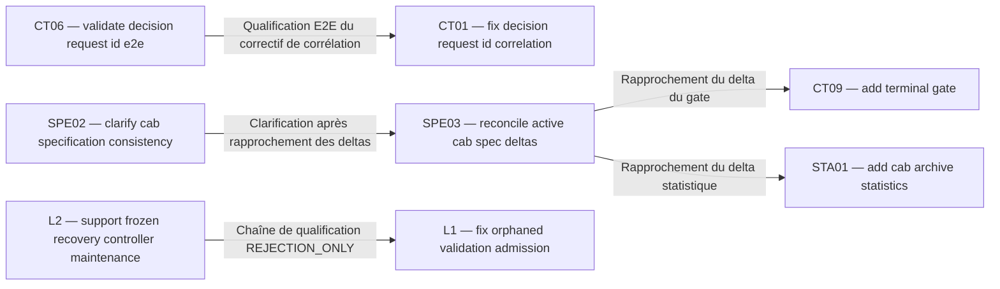

| Dépendant et change | Prérequis et change | Nature / phase affectée | Condition de satisfaction | État et portée | Sources / preuves |
|---|---|---|---|---|---|
| CT06 — validate-decision-request-id-e2e | CT01 — fix-decision-request-id-correlation | Qualification E2E du correctif de corrélation | Disposer du correctif de corrélation et de son parcours contrôleur pour exécuter la qualification E2E | SATISFAITE au niveau documentaire historique ; disponibilité actuelle NON VÉRIFIÉE | [CT06 — proposal.md](openspec/changes/archive/2026-09-25-validate-decision-request-id-e2e/proposal.md) ; [CT01 — tasks.md](openspec/changes/archive/2026-09-11-fix-decision-request-id-correlation/tasks.md) ; [CT06 — tasks.md](openspec/changes/archive/2026-09-25-validate-decision-request-id-e2e/tasks.md) |
| SPE02 — clarify-cab-specification-consistency | SPE03 — reconcile-active-cab-spec-deltas | Clarification après rapprochement des deltas | Rapprochement préalable décrit dans la proposition SPE02, sans restauration d’exigences anciennes | SATISFAITE au niveau documentaire historique | [SPE02 — proposal.md](openspec/changes/archive/2026-10-13-clarify-cab-specification-consistency/proposal.md) ; [SPE03 — tasks.md](openspec/changes/archive/2026-10-13-reconcile-active-cab-spec-deltas/tasks.md) |
| SPE03 — reconcile-active-cab-spec-deltas | CT09 — add-terminal-gate | Rapprochement du delta du gate | Présence du delta du gate et comparaison aux références pour la phase documentaire du rapprochement | SATISFAITE pour l’artefact archivé | [SPE03 — proposal.md](openspec/changes/archive/2026-10-13-reconcile-active-cab-spec-deltas/proposal.md) ; [SPE03 — design.md](openspec/changes/archive/2026-10-13-reconcile-active-cab-spec-deltas/design.md) ; [CT09 — proposal.md](openspec/changes/archive/2026-10-13-add-terminal-gate/proposal.md) |
| SPE03 — reconcile-active-cab-spec-deltas | STA01 — add-cab-archive-statistics | Rapprochement du delta statistique | Présence du delta statistique et comparaison aux références pour la phase documentaire du rapprochement | SATISFAITE pour l’artefact archivé | [SPE03 — proposal.md](openspec/changes/archive/2026-10-13-reconcile-active-cab-spec-deltas/proposal.md) ; [SPE03 — design.md](openspec/changes/archive/2026-10-13-reconcile-active-cab-spec-deltas/design.md) ; [STA01 — proposal.md](openspec/changes/archive/2026-10-13-add-cab-archive-statistics/proposal.md) |
| L2 — support-frozen-recovery-controller-maintenance | L1 — fix-orphaned-validation-admission | Chaîne de qualification REJECTION_ONLY | Qualification de la réconciliation, rejet explicite, polling MCP et retry conservés par la maintenance gelée | SATISFAITE selon la qualification source historique ; activation actuelle NON VÉRIFIÉE | [L2 — QUALIFICATION.md](openspec/changes/archive/2026-10-25-support-frozen-recovery-controller-maintenance/QUALIFICATION.md) ; [L1 — STATISTICS.md](openspec/changes/archive/2026-10-25-fix-orphaned-validation-admission/STATISTICS.md) |

La relation SPE02 → SPE03 entraîne les prérequis documentaires transitifs CT09 et STA01 ; ils ne sont pas redessinés comme de nouvelles dépendances directes. Aucun cycle dans ces cinq relations. Ce constat est limité au graphe documenté ; l’absence de relation recensée ne démontre pas l’absence de toute autre dépendance.

### Relations documentaires et coordination sans flèche de dépendance

| Lots | Relation constatée | Source |
|---|---|---|
| DIS01 / SPE01 | Correction documentaire de l’arborescence annoncée dans le change initial ; aucune réouverture | [DIS01 — proposal.md](openspec/changes/archive/2026-09-11-correct-plugin-layout-traceability/proposal.md) |
| CO03 / STA03 | Fonctions qualifiées et archivées dans un même cycle source 1.3.0 ; aucune dépendance réciproque inventée | [CO03 — proposal.md](openspec/changes/archive/2026-10-17-add-resource-scoped-coordination-1-3-0/proposal.md) ; [STA03 — proposal.md](openspec/changes/archive/2026-10-17-integrate-observation-statistics/proposal.md) |
| CT10 / SUP01 | Référence historique au contrat de supervision ; aucun blocage actuel démontré | [CT10 — design.md](openspec/changes/archive/2026-10-13-reject-invalid-restored-job-contracts/design.md) |
| DIS07 / SPE04 | Préservation d’un change alors actif pendant la préparation des commandes ; état actuel archivé | [DIS07 — proposal.md](openspec/changes/archive/2026-10-27-add-cab-uppercase-update-alias/proposal.md) ; [SPE04 — proposal.md](openspec/changes/archive/2026-10-27-reconcile-pllm-waiting-policy/proposal.md) |

### Prérequis externes et disponibilité actuelle

Les propositions CT13 et MOD05 documentent respectivement le contrat OpenCode V2 authentifié et les couples admissibles de catalogue PLLM. Les accès aux services et catalogues réels ne sont pas vérifiés par ACL : **NON VÉRIFIÉE** pour leur disponibilité actuelle. Les anciens profils et versions cités dans les changes de maintenance sont des conditions de transition à revérifier avant utilisation ; ils ne créent pas une chaîne de dépendances déduite des numéros de version.

Sources : [CT13 — proposal.md](openspec/changes/archive/2026-10-28-support-opencode-v2-only-transport/proposal.md) ; [MOD05 — proposal.md](openspec/changes/archive/2026-10-28-support-pllm-catalog-3-7-2-1-4/proposal.md) ; [cadrage technique](TECHNICAL.md) ; [cadrage de construction](BUILD.md).

## 6. Orientation de la progression

### Complément SCM découverte — 29 octobre 2026

`fix-codemode-discovery-literal-ack` : ARCHIVÉ, **code non attribué**, cible 2.1.9 ; 4/4 lots source validés, Node 487 réussis/26 ignorés/0 échec, Python 74/74. Aucun droit nouveau du diagnostic. [Qualification](openspec/changes/archive/2026-10-29-fix-codemode-discovery-literal-ack/QUALIFICATION.md). Activation 2.1.9 non effectuée ; attribution ultérieure par ACL.

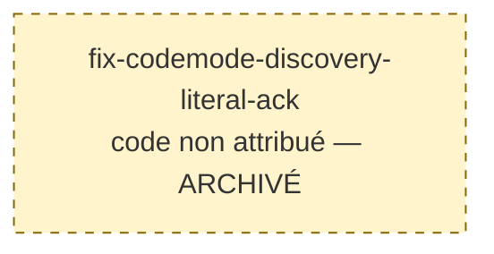

### Actualisation SCM Code Mode — 29 octobre 2026

`fix-opencode-codemode-native-proof-correlation` : ARCHIVÉ, **code non attribué**, cible source commune 2.1.8. Les cinq lots source sont validés : projection stricte, refus, chaîne native MCP/shell/écriture sous once, recovery complete et cohérence documentaire. Global final : Node 487 réussis, 26 ignorés, 0 échec ; Python 74/74. Archivage natif réussi. [Proposition](openspec/changes/archive/2026-10-29-fix-opencode-codemode-native-proof-correlation/proposal.md), [conception](openspec/changes/archive/2026-10-29-fix-opencode-codemode-native-proof-correlation/design.md), [tâches](openspec/changes/archive/2026-10-29-fix-opencode-codemode-native-proof-correlation/tasks.md). CABU 2.1.8 vérifié le 29 octobre ; reprise en cours, complément diagnostique ci-dessus requis. Attribution ultérieure par ACL.

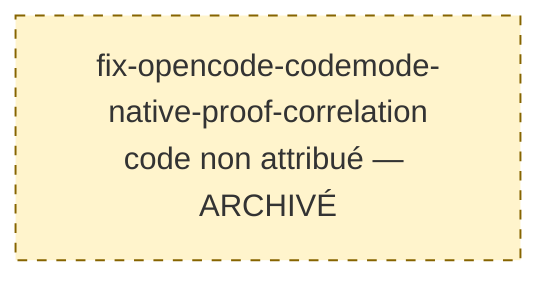

### Actualisation SCM — 29 octobre 2026

Le change `fix-rejected-preflight-recovery-after-restart` est ARCHIVÉ, **code non attribué** : 5/5 tâches source validées, distribution 2.1.7, Node 481 réussis/27 ignorés/0 échec et Python 74/74. Archivage natif réussi ; CABU 2.1.7 vérifié le 29 octobre et transaction globale libérée. La reprise PA01 reste suspendue au raccord Code Mode, traité par le correctif ci-dessus. Sources : [proposition](openspec/changes/archive/2026-10-29-fix-rejected-preflight-recovery-after-restart/proposal.md), [tâches](openspec/changes/archive/2026-10-29-fix-rejected-preflight-recovery-after-restart/tasks.md), [qualification](openspec/changes/archive/2026-10-29-fix-rejected-preflight-recovery-after-restart/QUALIFICATION.md). Aucune dépendance nouvelle entre codes n'est déduite. L'attribution d'un code relève ultérieurement d'ACL.

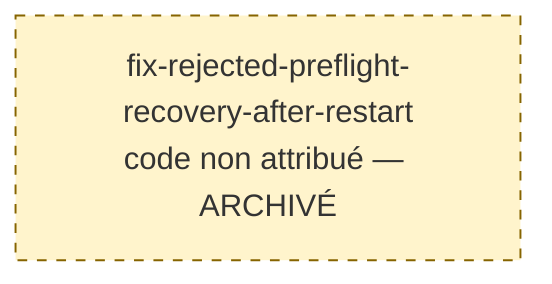

Le change [fix-monitor-historical-lot-codes](openspec/changes/archive/2026-10-28-fix-monitor-historical-lot-codes/proposal.md) est **ARCHIVÉ**, avec le code **OBS09**, attribué rétrospectivement par CAB-ACL-R2. Il appartient à l’observation du moniteur, d’après sa proposition et la capacité local-web-monitor. Cette attribution ne crée aucune dépendance nouvelle. Les 72 archives antérieures conservent leurs codes et leur état.

Le nœud OBS09 figure dans la vue « Observation et statistiques » ; il remplace le repère provisoire, sans doublonner le change.

| Archive complémentaire OBS09 | Réalisabilité et unités | Avancement | Sources et condition de réexamen |
|---|---|---|---|
| OBS09 — fix-monitor-historical-lot-codes | Sans objet après archivage ; correctif source réalisé et validé, sans prérequis externe pour les fixtures locales | Réalisation et validation source achevées : 4/4 tâches, 14/14 tests ciblés, OpenSpec cible valide et global standard/strict 16/16 ; archivage vérifié, déploiement et activation NON EFFECTUÉS | [proposition](openspec/changes/archive/2026-10-28-fix-monitor-historical-lot-codes/proposal.md), [tâches](openspec/changes/archive/2026-10-28-fix-monitor-historical-lot-codes/tasks.md), [tests](tests/web-monitor.test.mjs) ; tout engagement runtime exige un périmètre et des preuves distincts |

Au constat historique de clôture CT14, aucun change actif ne restait à sélectionner ; la clôture de CT14 est consignée ci-dessous. Le correctif source est réalisé, validé et archivé sur demande explicite du développeur. Aucun déploiement ni activation effectué. [STATISTICS.md](openspec/changes/archive/2026-10-28-fix-monitor-historical-lot-codes/STATISTICS.md) conserve le bilan du change. Contrôles après archivage : OpenSpec global standard et strict **15/15** chacun ; tâches des archives **73/73**.

Pour une prochaine demande explicitement autorisée : revérifier l’inventaire, le mandat, les sources de vérité, les BLOCKERS.md éventuels et les preuves des prérequis. Examiner d’abord la réalisabilité immédiate des unités visées, puis le nombre et la difficulté des dépendances manquantes, l’effet de déblocage direct et transitif, la progression vérifiable et enfin l’effort et l’incertitude documentés. Aucun score numérique ou ordre de release n’est utilisé comme priorité.

Les prérequis externes non vérifiés interdisent de déduire une disponibilité. Les conditions de réexamen sont une nouvelle demande de travail, l’apparition d’un change actif ou d’une preuve nouvelle affectant un prérequis. Les données du relevé ACL (72 archives, 597 tâches et 60 rapports) restent historiques : après la clôture CT14, le périmètre courant contient 74 archives, 607 tâches et 62 rapports STATISTICS.md ; les douze absences historiques demeurent. Les estimations d’effort et la disponibilité opérationnelle nécessaires à une sélection future restent à établir pour son périmètre.

### Qualification historique archivée — MAI11

Le change [qualify-historical-bootstrap-2-1-5](openspec/changes/archive/2026-10-28-qualify-historical-bootstrap-2-1-5/proposal.md) est ARCHIVÉ sous le code MAI11, attribué rétrospectivement par CAB-ACL-R4. Il qualifie le paquet 1.7.1 authentifié et la transition 2.1.5 dans une copie complète isolée ; aucun déploiement ni activation réelle effectué.

Le nœud MAI11 figure dans la vue « Maintenance et distribution » et remplace le repère provisoire sans doublonner le change. Les preuves concernent le snapshot 2.1.5 ; elles ne qualifient pas la version 2.1.6. Aucune dépendance nouvelle n’est déduite de cette attribution.

| Identifiant technique | Réalisabilité | Avancement | Sources et limites |
|---|---|---|---|
| MAI11 — qualify-historical-bootstrap-2-1-5 | Sans objet après archivage ; source historique authentifiée et qualification globale 2.1.5 achevée | 4/4 tâches ; suite globale 2.1.5 isolée : Node 494/494 et Python 73/73, aucun échec ni saut. Le banc historique 33/33 est inclus dans Node ; archivage et STATISTICS.md vérifiés | [proposition](openspec/changes/archive/2026-10-28-qualify-historical-bootstrap-2-1-5/proposal.md), [tâches](openspec/changes/archive/2026-10-28-qualify-historical-bootstrap-2-1-5/tasks.md), [design](openspec/changes/archive/2026-10-28-qualify-historical-bootstrap-2-1-5/design.md), [qualification](openspec/changes/archive/2026-10-28-qualify-historical-bootstrap-2-1-5/QUALIFICATION.md), [statistiques](openspec/changes/archive/2026-10-28-qualify-historical-bootstrap-2-1-5/STATISTICS.md). Les compteurs documentaires et les essais locaux ne prouvent aucun déploiement. |

## 7. Incertitudes, anomalies et contrôles

### Limites conservées

- **L1 et L2 :** codes historiques préservés. Lors du relevé ACL, ils n’étaient pas reconnus. Le [correctif source ultérieur](openspec/changes/archive/2026-10-28-fix-monitor-historical-lot-codes/proposal.md) et le [contrat actualisé](openspec/specs/local-web-monitor/spec.md) les admettent exactement, en conservant les autres formats. La reconnaissance est vérifiée dans les tests source ; aucune activation d’un moniteur installé n’en est déduite.
- **Temporalité des propositions :** certaines archives contiennent « reste ouvert » ou « aucun archivage effectué ». Ces passages décrivent leur état lors de la rédaction. L’état ARCHIVÉ du registre décrit leur emplacement vérifié le 28 octobre 2026 ; aucun passage historique n’est réécrit pour effacer cette différence.
- **Métadonnées :** 40 archives possèdent .openspec.yaml ; 32 n’en possèdent pas. Les dates de création renseignées peuvent différer de la date du dossier. Le tri initial des codes utilise les chemins, pas une chronologie certifiée.
- **Designs :** 70 présents ; absents pour [CT03 — proposal.md](openspec/changes/archive/2026-09-15-allow-generic-controller-workspace/proposal.md) et [DIS05 — proposal.md](openspec/changes/archive/2026-10-15-align-cab-components-1-1-0/proposal.md). Aucun document reconstruit.
- **Statistiques :** 60 rapports STATISTICS.md présents ; 12 absents, pour les douze premières archives dans le tri des chemins (du 11 au 25 septembre 2026). ACL ne produit ni ne régénère ces rapports.
- **Propositions :** 35 sans titre de niveau 1, trois avec des sections de niveau 1 sans titre général : ajout de 38 titres autorisés. Les 34 autres titres reçoivent uniquement le préfixe validé, y compris les libellés génériques Proposal et Proposition. Les sections existantes des trois documents concernés sont conservées.
- **Hypothèses :** aucune hypothèse de dépendance supplémentaire utilisée pour une décision. Les effets runtime, la disponibilité présente et les gains de performance ne sont pas déduits des ratios ou de l’archivage.

### Vérifications historiques de l’application ACL

Les résultats documentaires sont à confronter aux artefacts effectifs ; les contrôles globaux OpenSpec couvrent le canon et les changes actifs, le contrôle --archived couvre les tâches d’archives. Ils ne requalifient pas les tests historiques. Les contrôles de contenu couvrent séparément les 72 annotations et leurs liens.

| Contrôle exécuté le 28 octobre 2026 | Résultat |
|---|---|
| Titres et préservation du contenu des propositions | 72/72 : retrait de la seule annotation restitue exactement le contenu préalable ; 38 ajouts et 34 préfixes |
| Registre et cartographie | 72 entrées uniques chacun ; concordance des codes, identifiants et titres ; aucune entrée sans code |
| Inventaire et tâches | 0 actif, 72 archives ; 597/597 ; ratios des 72 archives confirmés avec la fonction pure parseTasks du moniteur |
| Reconnaissance des codes | Fonction pure parseChangeTitle du moniteur : 70 nouveaux codes reconnus ; L1/L2 non reconnus conformément au contrat conservé |
| UTF-8 sans BOM et LF | 74/74 fichiers autorisés |
| Liens relatifs | 470 destinations locales vérifiées, toutes présentes et internes au projet ; aucun lien proposal.md# dans les sources examinées |
| Diagrammes Mermaid | 9 blocs, couverture des 72 codes ; structure du sous-ensemble généré, définitions et références des nœuds contrôlées ; cinq arêtes directes, aucun cycle |
| Parseur et rendu Mermaid | Non exécutés : mmdc, mermaid et mermaid-cli indisponibles localement ; aucune installation ni accès réseau |
| OpenSpec global standard | openspec validate --all --json --no-interactive : 15/15, zéro problème |
| OpenSpec global strict | openspec validate --all --strict --json --no-interactive : 15/15, zéro problème |
| Tâches des archives en strict | openspec validate --archived --strict --json --report findings --no-interactive : 72/72, zéro problème |
| Périmètre | 73 fichiers existants modifiés et un registre créé ; 855 autres fichiers de la base d’empreintes conservés, dont les tâches, deltas, canons et preuves historiques |
| Idempotence | Seconde préparation sans écriture : aucune annotation restante, aucun nouveau code ou doublon, registre et carte identiques à leur contenu attendu |

Les tests produit et constructions ne sont pas exécutés pour ces annotations documentaires. Aucun archivage, commit, publication, installation ou activation effectué. Les limites documentées ci-dessus restent applicables et ne sont pas des corrections fonctionnelles autorisées par ce plan.

<!-- SCM:fix-native-v2-pagination-and-preflight-2-1-5 -->
### Clôture SCM 2.1.5 — CT14

CT14 figure dans la vue « Contrôle et supervision ». Son titre porte le code attribué par CAB-ACL-R3 ; aucune renumérotation ni dépendance inter-change nouvelle.

| Identifiant technique | État documentaire | Avancement source | Sources et limites |
|---|---|---|---|
| CT14 — fix-native-v2-pagination-and-preflight-2-1-5 | ARCHIVÉ | 6/6 tâches cochées sur preuves | [proposition](openspec/changes/archive/2026-10-28-fix-native-v2-pagination-and-preflight-2-1-5/proposal.md), [tâches](openspec/changes/archive/2026-10-28-fix-native-v2-pagination-and-preflight-2-1-5/tasks.md), [preuves SCM](openspec/changes/archive/2026-10-28-fix-native-v2-pagination-and-preflight-2-1-5/PREUVES-SCM.json), [statistiques](openspec/changes/archive/2026-10-28-fix-native-v2-pagination-and-preflight-2-1-5/STATISTICS.md). Qualification source, archivage et rapport vérifiés séparément ; aucun déploiement ni activation dans cette finalisation. |

Contrôles après archive : OpenSpec global standard et strict 15/15 chacun ; archives 74/74. Aucun autre candidat actif à engager ; le change de qualification historique demandé est suivi séparément. Les preuves natives enregistrées restent celles de la qualification antérieure, sans nouvelle génération fournisseur ni exécution de mandat métier.
<!-- /SCM:fix-native-v2-pagination-and-preflight-2-1-5 -->


<!-- SCM:fix-cab-shutdown-on-opencode-exit -->
### Clôture source SCM 2.1.6 — SUP10

Le nœud SUP10 figure dans la vue « Contrôle et supervision » et remplace le repère provisoire sans doublon. Son rattachement repose sur la surveillance de l’identité du serveur et la conservation des sessions et protections décrites dans la proposition et les deltas cab-process-lifecycle / persistent-job-supervision. Aucune dépendance inter-change nouvelle n’est inférée.

| Identifiant technique | État | Avancement | Sources et limites |
|---|---|---|---|
| SUP10 — fix-cab-shutdown-on-opencode-exit | ARCHIVÉ | 7/7 tâches cochées sur preuves | [proposition](openspec/changes/archive/2026-10-28-fix-cab-shutdown-on-opencode-exit/proposal.md), [tâches](openspec/changes/archive/2026-10-28-fix-cab-shutdown-on-opencode-exit/tasks.md), [conception](openspec/changes/archive/2026-10-28-fix-cab-shutdown-on-opencode-exit/design.md). Détection, arrêt des processus, EOF MCP, distribution et horodatage du sceau qualifiés ; validation globale finale acquise : 513 tests Node, 74 Python et deux navigateurs. [Qualification](openspec/changes/archive/2026-10-28-fix-cab-shutdown-on-opencode-exit/QUALIFICATION.md), [statistiques](openspec/changes/archive/2026-10-28-fix-cab-shutdown-on-opencode-exit/STATISTICS.md). Aucune installation ni activation. |

La frontière de qualification historique 2.1.5 est libérée ; ses sources de preuve sont conservées. Cette coordination n’est pas une dépendance fonctionnelle inter-change. ACL reste nécessaire pour attribuer un code ; aucune attribution ni réservation de code effectuée ici.

Attribution documentaire CAB-ACL-R5 : SUP10, sans modification des tâches ni de leurs preuves. Lors de CAB-ACL-R5, 6/7 cases ne prouvaient pas une qualification globale. La réalisation a depuis validé les 7/7 tâches sur les preuves finales ; l’archivage natif est effectué et les statistiques sont produites dans son dossier. Aucune installation ni activation n’est déduite de cette qualification. Avant toute poursuite, revérifier les prérequis natifs et les preuves du périmètre visé. ACL ne lance aucune session de développement.
<!-- /SCM:fix-cab-shutdown-on-opencode-exit -->

## 8. Légende

- **Code de lot :** repère documentaire unique ; L1/L2 historiques conservés ; les autres codes suivent leurs attributions datées dans le registre (CAB-ACL-R1 à CAB-ACL-R4). Aucun code de regroupement ajouté.
- **Ensemble :** appartenance à une responsabilité documentée ; les familles et capacités transverses ne démontrent aucune dépendance. Les identifiants E1 à E7 du premier diagramme servent uniquement à son dessin.
- **ARCHIVÉ :** présence vérifiée dans le dossier d’archives ; ne signifie ni service disponible, ni activation. Chaque nœud porte explicitement son état ; aucune couleur ne véhicule seule une information.
- **Cases cochées / total :** indicateur documentaire du tasks.md, pas pourcentage fonctionnel.
- **Fait documenté :** affirmation ou relation explicite d’une source liée ; **fait vérifié :** constat local daté ; **hypothèse à confirmer :** interprétation exclue d’une décision automatique.
- **SATISFAITE :** condition atteinte dans la portée et la phase indiquées ; **NON SATISFAITE :** condition manquante démontrée ; **NON VÉRIFIÉE :** preuve insuffisante pour conclure.
- **RÉALISABLE / PARTIELLEMENT RÉALISABLE / BLOQUÉ / À VÉRIFIER :** états destinés aux changes actifs selon les prérequis des unités visées ; non appliqués aux archives.
- **Livraison / activation :** distinctes du code, de la documentation, des validations et de l’archivage ; leur état actuel n’est pas vérifié par ACL.
- **Entrée provisoire « code non attribué » :** repère sans code ni réservation, à séparer des correspondances vérifiées ; aucune au relevé ACL ; l’entrée archivée provisoire est remplacée par OBS09 après CAB-ACL-R2 ; l’entrée provisoire est remplacée par CT14 après CAB-ACL-R3, puis archivée ; l’entrée archivée provisoire de qualification historique est remplacée par MAI11 après CAB-ACL-R4 ; l’entrée active 2.1.6 est remplacée par SUP10 après CAB-ACL-R5 ; aucune entrée sans code dans le périmètre actuel.
- **Flèche dirigée : A → B signifie que A dépend de B.** La flèche part du dépendant et pointe vers son prérequis. Les libellés précisent la phase ; les références et coordinations sans dépendance sont présentées en tableau séparé.

### Actualisation SCM édition native et supervision — 29 octobre 2026

`fix-native-edit-and-supervisor-mandates` : ARCHIVÉ, **code non attribué**, cible source commune 2.1.10. Périmètre validé par le développeur ; édition native, supervision, adaptations V2 et priorité medium/high qualifiées ; Node 502 réussis/28 ignorés, Python 75/75, natif 1/1 ; archive vérifiée. [Proposition](openspec/changes/archive/2026-10-29-fix-native-edit-and-supervisor-mandates/proposal.md), [tâches](openspec/changes/archive/2026-10-29-fix-native-edit-and-supervisor-mandates/tasks.md). Aucune activation effectuée. Attribution ultérieure par ACL.


### Actualisation SCM directe — 29 octobre 2026

`fix-direct-native-mcp-error-recovery` : ARCHIVÉ, **code non attribué**, source 2.1.11 ; provenance directe et retry qualifiés sur banc isolé, pagination adaptative testée ; Node519 réussis/28 ignorés, Python75/75 et natif1/1 ; archive vérifiée. [Proposition](openspec/changes/archive/2026-10-29-fix-direct-native-mcp-error-recovery/proposal.md), [tâches](openspec/changes/archive/2026-10-29-fix-direct-native-mcp-error-recovery/tasks.md). Aucune activation ; attribution ACL ultérieure.

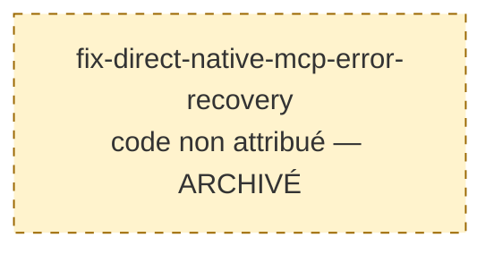

### Actualisation SCM diagnostics — 29 octobre 2026

`fix-notification-admission-diagnostics` : ARCHIVÉ, **code non attribué**, source2.1.12. Sources qualifiées : Node520 réussis/28 ignorés, Python80/80, natif1/1 ; archive vérifiée ; activation CABU à suivre séparément. [Proposition](openspec/changes/archive/2026-10-29-fix-notification-admission-diagnostics/proposal.md), [tâches](openspec/changes/archive/2026-10-29-fix-notification-admission-diagnostics/tasks.md). CABU explicitement autorisé après clôture source et coordination ; attribution ACL ultérieure.

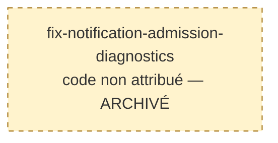

### Restitution sans effet — SCM 2.1.13

`release-unused-test-reservations` : ARCHIVÉ, **code non attribué**, 5/5 unités qualifiées ; Node534/28 ignorés, Python80/80, HTTP7/7, natif1/1 ; archive vérifiée ; aucune activation. [Proposition](openspec/changes/archive/2026-10-29-release-unused-test-reservations/proposal.md), [tâches](openspec/changes/archive/2026-10-29-release-unused-test-reservations/tasks.md). Attribution ACL ultérieure.

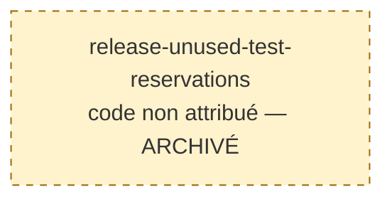

### Isolation MCP — SCM 2.1.14

`isolate-shared-mcp-location` : ARCHIVÉ, **code non attribué**, 5/5 unités qualifiées ; Node543/28 ignorés, Python80/80 et natif1/1 ; archive vérifiée, activation non réalisée. [Proposition](openspec/changes/archive/2026-10-30-isolate-shared-mcp-location/proposal.md), [tâches](openspec/changes/archive/2026-10-30-isolate-shared-mcp-location/tasks.md). Attribution ACL ultérieure.

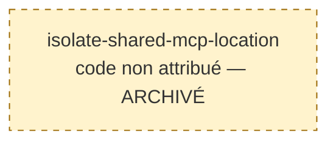

### Récupération CABU — SCM2.1.15

`fix-cabu-startup-recovery` : ARCHIVÉ, **code non attribué**, 4/4 unités qualifiées, Node545/28 ignorés, Python80/80 et natif1/1 ; archive vérifiée, activation non confirmée. [Proposition](openspec/changes/archive/2026-10-30-fix-cabu-startup-recovery/proposal.md), [tâches](openspec/changes/archive/2026-10-30-fix-cabu-startup-recovery/tasks.md). Attribution ACL ultérieure.

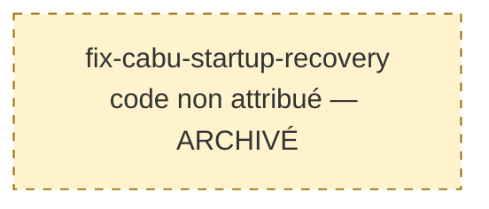

### Lecture du statut CABU — complément2.1.15

`fix-cabu-large-controller-status` : ARCHIVÉ, **code non attribué**, 3/3 unités qualifiées, Node548/28 ignorés, updater48/48 ; archive vérifiée. [Proposition](openspec/changes/archive/2026-10-30-fix-cabu-large-controller-status/proposal.md), [tâches](openspec/changes/archive/2026-10-30-fix-cabu-large-controller-status/tasks.md). Build2.1.15 corrigé, activation non confirmée ; attribution ACL ultérieure.

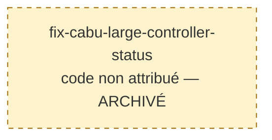

### Diagnostics de décision — SCM2.1.16

`explain-decision-http-refusals` : ARCHIVÉ, **code non attribué**, 4/4 unités qualifiées ; Node560/28 ignorés, Python80/80 et natif1/1 ; archive vérifiée, activation suivie séparément. [Proposition](openspec/changes/archive/2026-10-30-explain-decision-http-refusals/proposal.md), [tâches](openspec/changes/archive/2026-10-30-explain-decision-http-refusals/tasks.md). Attribution ACL ultérieure.

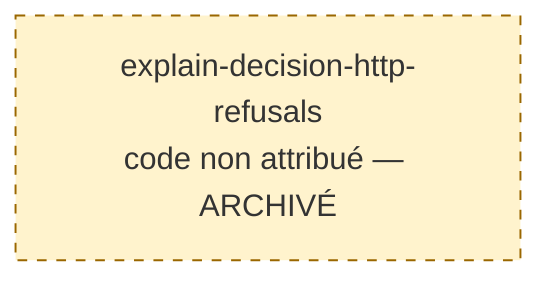

### Coordination des incidents — SCM2.1.17

`coordinate-cab-coding-incidents` : ARCHIVÉ, **code non attribué**, règle documentaire de signalement au chat « Correctif CAB - OC » et suivi jusqu’à CABU ; source qualifiée : Node560/28 ignorés, Python80/80, distribution32/32 ; activation vérifiée séparément. [Proposition](openspec/changes/archive/2026-10-30-coordinate-cab-coding-incidents/proposal.md), [tâches](openspec/changes/archive/2026-10-30-coordinate-cab-coding-incidents/tasks.md). Attribution ACL ultérieure.

```mermaid
flowchart LR
    incidentCoordination["coordinate-cab-coding-incidents<br/>code non attribué — ARCHIVÉ"]
    classDef provisional fill:#fff3cd,stroke:#9a6700,stroke-dasharray:5 5
    class incidentCoordination provisional
```

### Entrées modèle explicites — SCM2.1.18

`reject-native-variant-model-input` : ARCHIVÉ, **code non attribué**, refus du champ natif variant dans les écritures client ; reasoning et lecture native conservés. [Proposition](openspec/changes/archive/2026-10-30-reject-native-variant-model-input/proposal.md), [tâches](openspec/changes/archive/2026-10-30-reject-native-variant-model-input/tasks.md). Source qualifiée : Node568/28 ignorés en deux groupes, Python80/80 et natif1/1 ; activation distincte. Attribution ACL ultérieure.

```mermaid
flowchart LR
    modelInput["reject-native-variant-model-input<br/>code non attribué — ARCHIVÉ"]
    classDef provisional fill:#fff3cd,stroke:#9a6700,stroke-dasharray:5 5
    class modelInput provisional
```

### Transitions à chaud — SCM2.1.19

`support-hot-model-transitions` : ARCHIVÉ, **code non attribué**, raccord fournisseur V2 et transition du même job ; choix explicite libre, PLLM en son absence. [Proposition](openspec/changes/archive/2026-10-30-support-hot-model-transitions/proposal.md), [tâches](openspec/changes/archive/2026-10-30-support-hot-model-transitions/tasks.md). Source qualifiée : Node601/29 ignorés, Python80/80, natif2.2.0 exact2/2 ; activation distincte ; attribution ACL ultérieure.

```mermaid
flowchart LR
    hotModel["support-hot-model-transitions<br/>code non attribué — ARCHIVÉ"]
    classDef provisional fill:#fff3cd,stroke:#9a6700,stroke-dasharray:5 5
    class hotModel provisional
```

### Continuité liée au compte — SCM2.1.20

`qualify-account-bound-history-continuity` : ARCHIVÉ — source2.1.20 qualifiée ; activation non déduite, **code non attribué**, lanceur par lien et qualification de la continuité historique Responses ; une limite native démontrée fait partie du livrable, sans réparation fictive. [Proposition](openspec/changes/archive/2026-10-30-qualify-account-bound-history-continuity/proposal.md), [tâches](openspec/changes/archive/2026-10-30-qualify-account-bound-history-continuity/tasks.md). Qualification et activation distinctes ; attribution ACL ultérieure.

```mermaid
flowchart LR
    historyContinuity["qualify-account-bound-history-continuity<br/>code non attribué — ARCHIVÉ"]
    classDef provisional fill:#fff3cd,stroke:#9a6700,stroke-dasharray:5 5
    class historyContinuity provisional
```


### Projection portable du contexte — SCM2.1.21

`project-stale-context-on-model-transition` : ARCHIVÉ — source2.1.21 qualifiée ; activation non déduite, **code non attribué**, hook natif de projection après transition PLLM/compte. [Proposition](openspec/changes/archive/2026-10-30-project-stale-context-on-model-transition/proposal.md), [tâches](openspec/changes/archive/2026-10-30-project-stale-context-on-model-transition/tasks.md). Qualification source et reprise réelle distinctes ; attribution ACL ultérieure.

```mermaid
flowchart LR
    portableContext["project-stale-context-on-model-transition<br/>code non attribué — ARCHIVÉ"]
    classDef provisional fill:#fff3cd,stroke:#9a6700,stroke-dasharray:5 5
    class portableContext provisional
```
