# DEVELOPMENT_MAP.md - Codex Approval Bridge

## Retrait d’un membre dédié SCM 2.2.33

[withdraw-rejected-dedicated-access-member](openspec/changes/archive/2026-11-05-withdraw-rejected-dedicated-access-member/), code non attribué : ARCHIVÉ, source2.2.33 qualifiée.
Garde recovery monomembre dédiée sous ACK204, retrait puis libération sous
reçus distincts ;918tests finaux uniques réussis. Parent conservé au retrait,
aucun token/once inventé. Publication, activation et récupération opérante
distinctes ; voir QUALIFICATION.md. Attribution/normalisation ACL ultérieure.

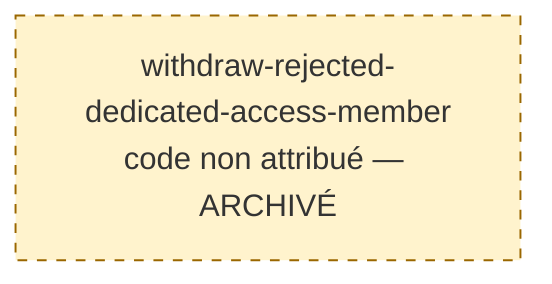

## Libération déléguée après compactage SCM 2.2.32

[delegate-held-access-release-without-token](openspec/changes/archive/2026-11-04-delegate-held-access-release-without-token/), code non attribué : ARCHIVÉ, source2.2.32 qualifiée.
Action owner release-access, token/fencing liés en interne et empreinte stable,
route/gardes ordinaires conservées ;897tests finaux uniques réussis. Publication,
activation et libération opérante distinctes ; voir QUALIFICATION.md. ACL ultérieure.

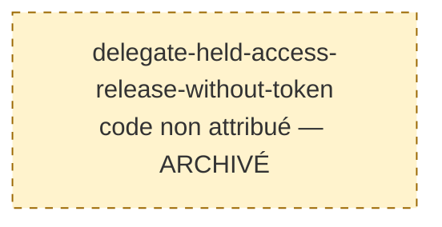

## Recommandation de notification SCM 2.2.31

[qualify-stalled-notification-recommendation](openspec/changes/archive/2026-11-04-qualify-stalled-notification-recommendation/), code non attribué : ARCHIVÉ, source2.2.31 qualifiée.
Choix de recommandation par sous-état stalled, sans action automatique ni levée
de readiness/garde ;355tests finaux uniques réussis. Publication, activation et
récupération opérante distinctes ; voir QUALIFICATION.md. Attribution ACL ultérieure.

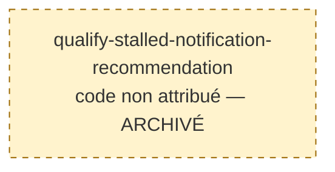

## Retrait avec parent référencé SCM 2.2.30

[withdraw-rejected-edit-with-referenced-parent](openspec/changes/archive/2026-11-04-withdraw-rejected-edit-with-referenced-parent/), code non attribué : ARCHIVÉ, source2.2.30 qualifiée.
Retrait propriétaire shell/edit refusé avant once, parent HELD référencé sans
membership conservé.873tests finaux uniques réussis ; gardes d’émission et
identités exactes inchangées. Publication, activation et retrait propriétaire
distincts ; voir QUALIFICATION.md. Attribution/normalisation ACL ultérieure.

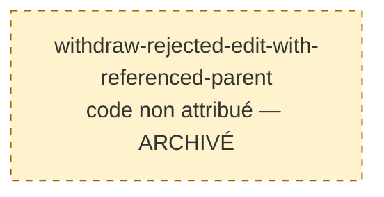

## Accord permanent de restauration ASK SCM 2.2.29

[authorize-bounded-native-ask-maintenance](openspec/changes/archive/2026-11-04-authorize-bounded-native-ask-maintenance/), code non attribué : ARCHIVÉ, source2.2.29 qualifiée.
Mandat partagé permanent du développeur dans skills/plugin/commandes, sans
nouvelle sollicitation par session ; gardes et moteurs inchangés hors version.
347tests finaux uniques réussis. Publication, activation et reprise métier
distinctes ; voir QUALIFICATION.md. Attribution/normalisation par ACL ultérieure.

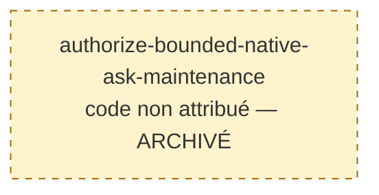

## ASK effectif et revue ciblée SCM 2.2.28

[enforce-effective-native-ask](openspec/changes/archive/2026-11-04-enforce-effective-native-ask/), code non attribué : ARCHIVÉ, source2.2.28 qualifiée.
Audit des grants sauvegardés, maintenance API bornée et revue de lecture sans
liaison rétroactive ;854tests finaux uniques réussis. Parent et protections
conservés. Publication, CABU et reprise propriétaire distincts ; voir
QUALIFICATION.md. Normalisation définitive par ACL ultérieure.

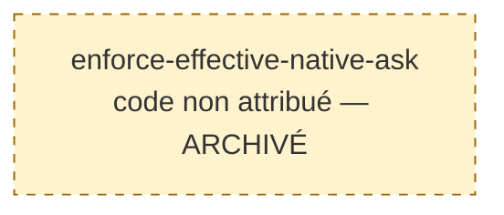

## Annulation Code Mode SCM 2.2.27

[qualify-formatted-native-cancellation](openspec/changes/archive/2026-11-04-qualify-formatted-native-cancellation/), code non attribué : ARCHIVÉ, source2.2.27 qualifiée.
Matcher lexical fermé et diagnostics sans effet ;769tests uniques finaux réussis.
Identités, quiescence et autres protections conservées. Publication/activation
et convergence native distinctes ; QUALIFICATION.md du change. ACL ultérieure.

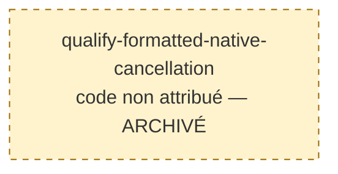

## Lectures et retrait SCM 2.2.26

[recognize-native-reads-during-rejected-withdrawal](openspec/changes/archive/2026-11-04-recognize-native-reads-during-rejected-withdrawal/), code non attribué : ARCHIVÉ, source2.2.26 qualifiée.
Read V2 sans mutation distingué des effets ;745tests uniques finaux réussis.
Rejet/ACK/frontières et parent conservés. Publication/activation distinctes ;
voir QUALIFICATION.md du change. Attribution ultérieure par ACL.

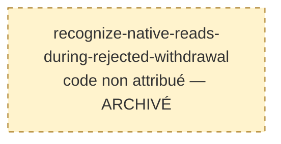

## Retrait edit attaché SCM 2.2.25

[retire-rejected-attached-edit-with-cancelled-history](openspec/changes/archive/2026-11-04-retire-rejected-attached-edit-with-cancelled-history/), code non attribué : ARCHIVÉ, source2.2.25 qualifiée.
Deux gardes ciblées, historique CANCELLED sans émission et retrait edit qualifié ;
655tests uniques finaux réussis, parent et émission crossSID protégés.
Publication/activation distinctes ; voir QUALIFICATION.md du change. ACL ultérieure.

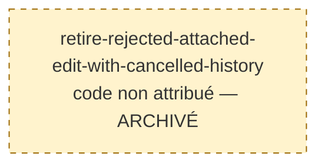

## Réconciliation autonome SCM 2.2.24

[document-autonomous-owner-reconciliation](openspec/changes/archive/2026-11-04-document-autonomous-owner-reconciliation/), code non attribué : ARCHIVÉ, source2.2.24 qualifiée.
Reprise propriétaire, API versus appairage et portée du résumé BLOCKED ;
615tests uniques réussis, moteurs inchangés hors version. Prévol C12 READY
sous2.2.23 et préparation reprise ; publication/activation24 distinctes.
Voir QUALIFICATION.md du change. Attribution ultérieure par ACL.

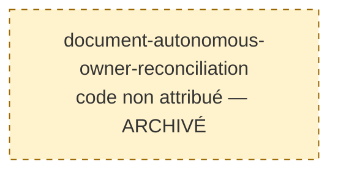

## Accord permanent MCP SCM 2.2.23

[document-standing-bounded-mcp-recovery](openspec/changes/archive/2026-11-04-document-standing-bounded-mcp-recovery/), code non attribué : ARCHIVÉ, source2.2.23 qualifiée.
Politique bornée distribuée dans skills, plugin et commandes ;248tests uniques
réussis, moteurs inchangés hors version. Publication/activation distinctes ;
voir QUALIFICATION.md du change. Attribution ultérieure par ACL.

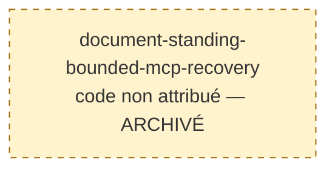

## Reprise des transitions SCM 2.2.22

[clarify-transient-run-transition-retries](openspec/changes/archive/2026-11-04-clarify-transient-run-transition-retries/), code non attribué : ARCHIVÉ, source2.2.22 qualifiée.
Routage de la course BUSY/STABLE et contrôle des identités entre unités ;
622tests uniques finaux réussis, moteurs inchangés hors version.
Publication/activation distinctes ; voir QUALIFICATION.md du change. Attribution par ACL ultérieure.

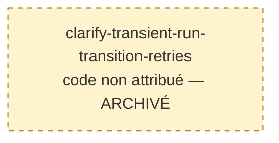

## Documentation de pilotage SCM 2.2.21

[clarify-pilot-state-decisions-and-submission](openspec/changes/archive/2026-11-04-clarify-pilot-state-decisions-and-submission/), code non attribué : ARCHIVÉ, source2.2.21 qualifiée.
54 situations et parcours court ; moteurs inchangés hors version,405 tests uniques réussis.
Publication et activation distinctes ; COVERAGE.md/QUALIFICATION.md du change.

## Convergence NOT_ADMITTED SCM 2.2.20

[reconcile-not-admitted-after-broker-transition](openspec/changes/archive/2026-11-04-reconcile-not-admitted-after-broker-transition/), code non attribué : ARCHIVÉ, source2.2.20 qualifiée.
Readiness absente503 et retrait terminal sans décision ;762 tests uniques réussis.
Publication/activation distinctes, voir QUALIFICATION.md du change.

## Retrait attaché SCM 2.2.19

[withdraw-rejected-attached-shell](openspec/changes/archive/2026-11-04-withdraw-rejected-attached-shell/), code non attribué : ARCHIVÉ, source2.2.19 qualifiée.
Retrait isolé du shell refusé, parent HELD conservé ;738 tests finaux uniques réussis.
Publication et activation distinctes ; voir QUALIFICATION.md du change.

## Assertion native SCM 2.2.18

[recognize-literal-discovery-path-assertion](openspec/changes/archive/2026-11-04-recognize-literal-discovery-path-assertion/), code non attribué : ARCHIVÉ, source 2.2.18 qualifiée.
Wrapper réel reconnu ; admission anticipée prouvée sur native isolée ;333 tests réussis. Livraison distincte.

## Projection native SCM2.2.17

[recognize-awaited-codemode-discovery](openspec/changes/archive/2026-11-04-recognize-awaited-codemode-discovery/), code non attribué : ARCHIVÉ, source 2.2.17 qualifiée.
Projection anticipée prouvée sur OpenCode isolé ;332 tests uniques réussis. Livraison distincte.

## Shell sans accès SCM 2.2.16

[document-approved-shell-retirement](openspec/changes/archive/2026-11-03-document-approved-shell-retirement/), code non attribué : ARCHIVÉ, source2.2.16qualifiée.
Composition conditionnelle documentée ;298cas uniques réussis. Livraison distincte.

## Documentation de reprise SCM 2.2.15

[document-approved-held-retirement](openspec/changes/archive/2026-11-03-document-approved-held-retirement/), code non attribué : ARCHIVÉ, source 2.2.15 qualifiée.
Retrait autonome documenté, moteur conservé ;298cas uniques réussis.
Procédure PA01 déjà confirmée sous2.2.14 ; livraison2.2.15distincte.

## Garde de handoff SCM 2.2.14

[guard-persisted-transitions-during-session-handoff](openspec/changes/archive/2026-11-03-guard-persisted-transitions-during-session-handoff/), code non attribué : ARCHIVÉ, source 2.2.14 qualifiée.
Transitions persistées opposables ; 367 cas uniques réussis. Publication/activation distinctes.

## Changement de session SCM 2.2.13

[handoff-pilot-session-with-protected-history](openspec/changes/archive/2026-11-03-handoff-pilot-session-with-protected-history/), code non attribué : ARCHIVÉ, source 2.2.13 qualifiée.
Même RUN/job/change/checkpoint ; 461 cas uniques réussis, historique protégé.
Publication et activation distinctes.

## Correctif SCM courant2.2.12

[withdraw-rejected-unissued-native-edit](openspec/changes/archive/2026-11-03-withdraw-rejected-unissued-native-edit/), code non attribué :ARCHIVÉ, source2.2.12 qualifiée.
Retrait borné après refus natif edit ;aucun SID ou lease modifié.
266Node,94Python,1natif :361cas ;OpenSpec20/20puis19/19. Activation séparée.

## Clarification documentaire authentification

[clarify-authenticated-opencode-access](openspec/changes/archive/2026-11-03-clarify-authenticated-opencode-access/), code non attribué :ARCHIVÉ.
GET401 sans authentification versus client local ;base2.2.11 inchangée.
37tests etOpenSpec20/20puis19/19 ;publication/CABU séparés.

## Cadrage SCM courant2.2.11

[clarify-incident-triage-and-feedback](openspec/changes/archive/2026-11-03-clarify-incident-triage-and-feedback/), code non attribué :ARCHIVÉ, source2.2.11 qualifiée.
Qualification/capitalisation canonique des faux positifs ;aucune garde modifiée.
236Node et94Python :330cas ;OpenSpec20/20puis19/19. Activation séparée.

## Correctif SCM courant2.2.10

[journal-rejection-of-multipart-shell-permissions](openspec/changes/archive/2026-11-03-journal-rejection-of-multipart-shell-permissions/), code non attribué :ARCHIVÉ, source2.2.10 qualifiée.
Rejet shell journalisé, garde once inchangée.236Node,94Python,1natif :331cas ;
OpenSpec20/20puis19/19. Publication et activation attestées séparément.

## Correctif SCM courant2.2.9

[enforce-private-runtime-creation-modes](openspec/changes/archive/2026-11-03-enforce-private-runtime-creation-modes/), code non attribué :ARCHIVÉ, source2.2.9 qualifiée.
Objet restauré conservé après renotification ;créations privées0600 et verrou
projet0775.154Node,94Python,1natif :249cas qualifiés ;OpenSpec20/20puis19/19.
Publication, activation et reprise métier sont attestées séparément.

## Correctif SCM courant2.2.8

[read-large-legacy-registry-for-private-migration](openspec/changes/archive/2026-11-03-read-large-legacy-registry-for-private-migration/), code non attribué :ARCHIVÉ, source2.2.8 qualifiée.
Registre réel lu à la borne runtime64Mio après refus sûr avant coupure.
153Node,94Python,1natif :248réussites ;OpenSpec20/20puis19/19.
Publication, activation et reprise métier restent séparées.


## Correctif SCM courant2.2.7

[correlate-completed-mcp-call-with-outer-error](openspec/changes/archive/2026-11-03-correlate-completed-mcp-call-with-outer-error/), code non attribué : ARCHIVÉ, source2.2.7 qualifiée.
Admission transitoire et états privés hors projet compatibles0775.
937cas Node uniques qualifiés,94Python,1natif ;31ignorés. Une dernière
fixture en timeout passe isolément ; pas de passe globale entièrement verte.
OpenSpec20/20avant puis19/19après. Publication et activation séparées.


## Correctif SCM courant2.2.6

[reuse-closed-validation-review-evidence](openspec/changes/archive/2026-11-03-reuse-closed-validation-review-evidence/), code non attribué : ARCHIVÉ, source2.2.6 qualifiée.
Réemploi des revues closes et retrait avant émission, sans effet ni once
inventés. Qualification :920Node,93Python,1natif,1014réussites ;31ignorés.
Index final15/15 ; OpenSpec20/20avant puis19/19après archive. Activation séparée.


## Correctif SCM courant 2.2.5

[restore-proven-validation-boundaries](openspec/changes/archive/2026-11-03-restore-proven-validation-boundaries/), code non attribué : ARCHIVÉ, source 2.2.5 qualifiée.
Deux frontières : PENDING perdu par le contexte et terminal de lecture sans
preuve once. Actions propriétaires bornées ; aucun rejeu ou résultat natif
inventé. Qualification finale : 904 Node, 93 Python et 1 native, 998 réussites ;
31 ignorés ; OpenSpec strict 20/20 avant puis 19/19 après archive. Publication
et activation distinctes.

## Correctif autonome courant 2.2.4

[fix-autonomous-scoped-recovery](openspec/changes/archive/2026-11-03-fix-autonomous-scoped-recovery/),
code non attribué : ARCHIVÉ, source 2.2.4 qualifiée. Autorité de l’orchestrateur dans
le change, reçus de refus natifs, diagnostic filtré, revue de validation non
consommée, réconciliation bornée d’un port et extension additive disjointe.
Qualification finale : Node 884/915, 31 ignorés, zéro échec ; Python 93/93 ;
natif 1/1, soit 978 réussites exécutées. OpenSpec strict avant archive 20/20.
Précontrôles réels sans mutation : revue PA01 structurellement admissible ;
instance Vite antérieure retrouvée dans un reçu CABU de même contexte.
Aucune activation 2.2.4 ni clôture métier des deux RUN revendiquée ici.


## Correctif CABU courant 2.2.3

[fix-cabu-stopped-controller-status](openspec/changes/archive/2026-11-02-fix-cabu-stopped-controller-status/),
code non attribué : ARCHIVÉ, source 2.2.3 qualifiée. CABU ciblé 87/87 ; 830 cas
Node uniques validés après reprise isolée d’un démarrage fixture, 31 ignorés ;
Python 93/93 ; natif 1/1. MainPID=0 confirme inactive ou failed ; adoption
certifiée toujours obligatoire. Publication et activation distinctes. Le cas
PA01 demeure protégé sur deux erreurs natives aborted. Attribution ACL ultérieure.


## Correctif CABU courant 2.2.2

[fix-cabu-authority-shutdown](openspec/changes/archive/2026-11-02-fix-cabu-authority-shutdown/),
code non attribué : ARCHIVÉ, source 2.2.2 qualifiée (Node 829/860, 31 ignorés ;
Python 93/93 ; natif 1/1). Arrêt systemd préservant le helper flock et relecture
adaptative. Deux CABU 2.2.1 ont été rétablis après transfert non scellé ;
publication et activation 2.2.2 restent distinctes. PA01 reste protégé sur deux
erreurs natives aborted, sans preuve terminale qualifiée. Attribution ACL ultérieure.


## Correctif courant CAB 2.2.1

`reconcile-approved-native-cancellation`, code non attribué : correctif SCM
sur la validation PREPARED approuvée non consommée et le bootstrap versionné.
Dépendance vérifiée : CAB 2.2.0 actif, opération PA01 observée PREPARED sans
native ni accès au 2 novembre 2026. Qualification source réussie : Node 827/858, 31 ignorés, Python 93/93, natif 1/1.
Publication et activation distinctes ; voir [tâches](openspec/changes/archive/2026-11-02-reconcile-approved-native-cancellation/tasks.md).


## Suivi ciblé SCM — CAB 2.2.0, 2 novembre 2026

Le change archivé [track-background-shell-lifecycle](openspec/changes/archive/2026-11-02-track-background-shell-lifecycle/proposal.md)
est élargi au programme autorisé CAB 2.2.0 : protocole modulaire, continuité,
shells durables, récupération, CABU court et efficacité. **Code non attribué**,
attribution ACL ultérieure. Les [tâches](openspec/changes/archive/2026-11-02-track-background-shell-lifecycle/tasks.md)
conservent leurs identifiants initiaux et décrivent les dépendances internes.
La qualification locale est consignée dans [VALIDATION.md](openspec/changes/archive/2026-11-02-track-background-shell-lifecycle/VALIDATION.md) :
819 tests Node réussis, 93 Python, campagne native à deux RUN et 17 validations
strictes. La migration des 18 renvois prompts est réalisée sur accord explicite, et
le protocole local est retiré. L’archive et la synchronisation des spécifications
sont vérifiées ; statistiques et publication SCM terminent la livraison. Ces preuves ne déclarent aucune activation 2.2.0. Observation ciblée : 147 dossiers
d’archives et aucun change actif. Les totaux historiques ci-dessous restent des
relevés datés et ne constituent pas un inventaire global actualisé.

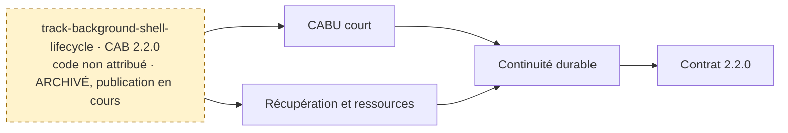

Actualisation SCM du 28 octobre 2026 : **76 changes archivés, 0 change actif**, **618/618 tâches cochées**. Attribution ACL du 28 octobre 2026, plan CAB-ACL-R5 : SUP10 pour la fermeture technique CAB ; 76 correspondances vérifiées, dont les 75 codes antérieurs conservés. MAI11 conserve son attribution rétrospective CAB-ACL-R4. Le suivi de CT14, correctif 2.1.5 archivé avec six tâches validées, est consigné ci-dessous ; les relevés ACL antérieurs restent historiques.

Actualisation SCM du 2 novembre 2026 : OpenSpec dénombre **134 archives et 0 change actif** ; la cartographie documente 76 entrées archivées codées et trente et une archives sans code : [retire-lowercase-cab-command](openspec/changes/archive/2026-10-31-retire-lowercase-cab-command/), [add-monitor-bootstrap-identity](openspec/changes/archive/2026-10-31-add-monitor-bootstrap-identity/), [discard-released-access-tokens](openspec/changes/archive/2026-10-31-discard-released-access-tokens/), [reconcile-native-completion-after-terminal-sse](openspec/changes/archive/2026-11-01-reconcile-native-completion-after-terminal-sse/), [require-native-recovery-preflight](openspec/changes/archive/2026-11-01-require-native-recovery-preflight/), [enforce-recovery-preflight-discovery](openspec/changes/archive/2026-11-01-enforce-recovery-preflight-discovery/), [normalize-literal-request-validation-codemode](openspec/changes/archive/2026-11-01-normalize-literal-request-validation-codemode/), [redact-test-reservation-tokens-from-reads](openspec/changes/archive/2026-11-01-redact-test-reservation-tokens-from-reads/) et [formalize-idempotent-test-reservation-recovery](openspec/changes/archive/2026-11-01-formalize-idempotent-test-reservation-recovery/) et [reconcile-rejected-operations-for-unused-test-leases](openspec/changes/archive/2026-11-01-reconcile-rejected-operations-for-unused-test-leases/) et [prove-unused-test-lease-after-history-compaction](openspec/changes/archive/2026-11-01-prove-unused-test-lease-after-history-compaction/), [recover-authorized-failed-mcp-receipt](openspec/changes/archive/2026-11-01-recover-authorized-failed-mcp-receipt/), [close-deterministic-pre-admission-refusals](openspec/changes/archive/2026-11-01-close-deterministic-pre-admission-refusals/), [read-only-opencode-fs-fallback](openspec/changes/archive/2026-11-01-read-only-opencode-fs-fallback/), [allow-no-effect-release-after-native-edit-failure](openspec/changes/archive/2026-11-01-allow-no-effect-release-after-native-edit-failure/), [correlate-native-codemode-validation-failures](openspec/changes/archive/2026-11-01-correlate-native-codemode-validation-failures/), [correlate-completed-raw-codemode-validation](openspec/changes/archive/2026-11-02-correlate-completed-raw-codemode-validation/), [align-native-codemode-recovery-fixture](openspec/changes/archive/2026-11-02-align-native-codemode-recovery-fixture/), [route-cab-mcp-calls-through-codemode-execute](openspec/changes/archive/2026-11-02-route-cab-mcp-calls-through-codemode-execute/), [advertise-cab-codemode-routing-instructions](openspec/changes/archive/2026-11-02-advertise-cab-codemode-routing-instructions/), [reconcile-terminal-native-operations](openspec/changes/archive/2026-11-02-reconcile-terminal-native-operations/), [correlate-running-codemode-validation](openspec/changes/archive/2026-11-02-correlate-running-codemode-validation/), [reconcile-running-codemode-validation](openspec/changes/archive/2026-11-02-reconcile-running-codemode-validation/). Les changes 2.1.39 précédents sont publiés ; le change de reprise sûre 2.1.40 est lui aussi publié et activé par CABU. Le change 2.1.41 de récupération des opérations rejetées est publié et CABU a terminé ; contrôleur, superviseur, monitor et broker servent 2.1.41. Le change 2.1.42 de preuve ledger-only après compaction est archivé en 8/8 tâches, publié sur main et activé par CABU ; les versions des quatre composants et les trois services actifs sont vérifiés. Le change 2.1.44 de récupération autorisée d’un reçu MCP failed est archivé en 10/10 tâches, publié et activé par CABU. Le change 2.1.45 de clôture des refus déterministes avant admission est archivé en 9/9 tâches, publié et activé par CABU ; l’approval 03 est `NOT_ADMITTED` sans décision. Le change 2.1.52 de restitution NO_EFFECT après erreur native est archivé en 11/11 tâches, publié et activé par CABU ; C12 a confirmé RELEASED/NO_EFFECT sans replay. Validation complète 2.1.54 : Node 708/739 (0 échec, 31 ignorés), Python 87/87, OpenSpec strict 17/17 et archives 118/118. Le change 2.1.54 de corrélation CodeMode native est archivé ; sa limite sur les wrappers dynamiques bruts est suivie par le change `correlate-raw-codemode-mcp-failures`, archivé après qualification de la version source 2.1.56. Le change 2.1.50 de lecture native read-only OpenCode est archivé en 11/11 tâches, publié et activé par CABU ; les lectures natives `list` et `read` sont qualifiées. Node passe 698/729 (0 échec, 31 ignorés), Python 87/87, OpenSpec strict 16/16 et validation stricte des archives 117/117. Le graphe et le registre détaillé couvrent 89 des 119 dossiers observés ; 30 archives restent à réconcilier. Aucun total global de tâches n’est revendiqué. Les 76 codes attestés demeurent inchangés. Exécuter ultérieurement ACL pour réconcilier la cartographie et le registre ; aucune reconstruction globale n’est faite ici. Archive sans code de lot attribué : [fix-native-permission-reply-location-scope](openspec/changes/archive/2026-11-02-fix-native-permission-reply-location-scope/), « Corriger le scope de location des réponses de permission native », ARCHIVÉ, 5/5 tâches ; test client V2 isolé 56/56, Node.js 714/745 (0 échec, 31 ignorés) avant ajout du test négatif final, Python 87/87, OpenSpec strict 17/17 avant archive et 16/16 après, archives strictes 125/125, OpenCode 2.2 isolé 1/1 ; source 2.1.61 qualifiée, CABU et activation vérifiés. Archive sans code de lot attribué : [expose-safe-run-native-operation-state](openspec/changes/archive/2026-11-02-expose-safe-run-native-operation-state/), « Exposer l’état durable d’une opération native par RUN », ARCHIVÉ, 5/5 tâches ; registry 47/47, route HTTP 1/1, distribution 33/33, Node.js 716/747 (31 ignorés, 0 échec) à concurrence 2, Python 87/87, OpenSpec strict 17/17 avant archive, archives strictes 126/126 ; source 2.1.62 qualifiée, CABU/activation distincts.

Archive sans code de lot attribué : [bind-native-requestid-in-literal-codemode-validation](openspec/changes/archive/2026-11-02-bind-native-requestid-in-literal-codemode-validation/), « Lier le requestId Code Mode aux métadonnées natives », ARCHIVÉ, 9/9 tâches ; Node 739/770 (31 ignorés, 0 échec), Python 87/87, OpenSpec strict 17/17 avant archive, 16/16 après archive, validation des archives 130/130 ; source 2.1.66 qualifiée, publication et CABU en cours séparément ; attribution ACL ultérieure.
Archive sans code de lot attribué : [reconcile-persisted-native-rejections](openspec/changes/archive/2026-11-02-reconcile-persisted-native-rejections/), « Réconcilier les rejets natifs persistés après échec de notification », ARCHIVÉ, 6/6 tâches ; Node.js 741/772 (31 ignorés, 0 échec), Python 87/87, OpenSpec strict 17/17 avant archive, 16/16 après archive, archives strictes 131/131 ; source 2.1.67 qualifiée, publication et CABU à vérifier séparément.
Archive sans code de lot attribué : [forward-recover-cabu-after-controller-rollback-failure](openspec/changes/archive/2026-11-02-forward-recover-cabu-after-controller-rollback-failure/), « Reprendre CABU en avant après rollback contrôleur incomplet », ARCHIVÉ, 8/8 tâches ; Node.js 745/776 (31 ignorés, 0 échec), Python 87/87, OpenSpec strict 17/17 avant archive, 16/16 après archive, archives strictes 132/132 ; source 2.1.68 qualifiée, publication et CABU à vérifier séparément.
Archive sans code de lot attribué : [preserve-conflicting-restored-accesses](openspec/changes/archive/2026-11-02-preserve-conflicting-restored-accesses/), « Préserver les accès restaurés qui se chevauchent », ARCHIVÉ, 6/6 tâches ; Node.js 746/777 (31 ignorés, 0 échec), Python 87/87, OpenSpec strict 17/17 avant archive, 16/16 après archive, archives strictes 133/133 ; source 2.1.69 qualifiée, publication et CABU à vérifier séparément.
Archive sans code de lot attribué : [continue-cabu-forward-recovery-after-disconnect](openspec/changes/archive/2026-11-02-continue-cabu-forward-recovery-after-disconnect/), « Continuer une reprise CABU après déconnexion confirmée », ARCHIVÉ, 6/6 tâches ; Node.js 747/778 (31 ignorés, 0 échec), Python 87/87, OpenSpec strict 17/17 avant archive, 16/16 après archive, archives strictes 134/134 ; source 2.1.70 qualifiée, publication et CABU à vérifier séparément.
Archive sans code de lot attribué : [restore-approved-native-operations](openspec/changes/archive/2026-11-02-restore-approved-native-operations/), « Restaurer sûrement les opérations natives approuvées », ARCHIVÉ, 7/7 tâches ; Node.js 723/754 réussis (31 ignorés, 0 échec), Python 87/87, OpenSpec strict 17/17 avant archive, 16/16 après archive, archives strictes 127/127 ; source 2.1.63 qualifiée, CABU/activation distincts.

Archive sans code de lot attribué : [reconcile-terminal-native-operations](openspec/changes/archive/2026-11-02-reconcile-terminal-native-operations/), « Réconcilier les fins natives terminales sans élargir le gel », ARCHIVÉ, 7/7 tâches ; Node.js 728/759 (31 ignorés, 0 échec), Python 87/87, compilation Python réussie, OpenSpec strict 17/17 avant archive, 16/16 après archive, archives strictes 128/128 ; source 2.1.64 qualifiée, publication et CABU/activation distincts.

Archive sans code de lot attribué : [correlate-running-codemode-validation](openspec/changes/archive/2026-11-02-correlate-running-codemode-validation/), « Corrélation de request_validation Code Mode en cours », ARCHIVÉ, 6/6 tâches ; Node.js 735/766 (31 ignorés, 0 échec), Python 87/87, OpenSpec strict 17/17 avant archive, 16/16 après archive, archives strictes 129/129 ; source 2.1.65 publiée et activée via CABU ; les quatre composants ont été vérifiés.

Archive sans code de lot attribué : [reconcile-running-codemode-validation](openspec/changes/archive/2026-11-02-reconcile-running-codemode-validation/), « Corrélation de request_validation Code Mode en cours », ARCHIVÉ, 6/6 tâches ; Node.js 735/766 (31 ignorés, 0 échec), Python 87/87, compilation Python réussie, OpenSpec strict 17/17 avant archive, 16/16 après archive, archives strictes 129/129 ; source 2.1.65 publiée et activée via CABU ; les quatre composants ont été vérifiés.

Archive sans code de lot attribué : [correlate-raw-codemode-mcp-failures](openspec/changes/archive/2026-11-01-correlate-raw-codemode-mcp-failures/), « Corrélation des erreurs MCP CodeMode brutes », **ARCHIVÉ**, 6/6 tâches ; Node.js 710/741 (0 échec, 31 ignorés), Python 87/87, OpenSpec strict 16/16 et archives strictes 120/120 ; source 2.1.56 qualifiée.

Archive sans code de lot attribué : [align-native-codemode-recovery-fixture](openspec/changes/archive/2026-11-02-align-native-codemode-recovery-fixture/), « Prévol natif du fixture CodeMode de reprise », **ARCHIVÉ**, 4/4 tâches ; Node.js 710/741 (0 échec, 31 ignorés), Python 87/87, OpenSpec strict 16/16 et archives strictes 121/121 ; source 2.1.57 qualifiée.

Archive sans code de lot attribué : [route-cab-mcp-calls-through-codemode-execute](openspec/changes/archive/2026-11-02-route-cab-mcp-calls-through-codemode-execute/), « Routage des méthodes MCP CAB via Code Mode », **ARCHIVÉ**, 5/5 tâches ; Node.js 713/744 (0 échec, 31 ignorés), Python 87/87, OpenSpec strict 16/16 et archives strictes 123/123 ; source 2.1.59 qualifiée.

Archive sans code de lot attribué : [advertise-cab-codemode-routing-instructions](openspec/changes/archive/2026-11-02-advertise-cab-codemode-routing-instructions/), « Instructions MCP persistantes pour Code Mode », **ARCHIVÉ**, 5/5 tâches ; Node.js 713/744 (0 échec, 31 ignorés), Python 87/87, OpenSpec strict 16/16 et archives strictes 124/124 ; source 2.1.60 qualifiée.

Archive sans code de lot attribué : [correlate-completed-raw-codemode-validation](openspec/changes/archive/2026-11-02-correlate-completed-raw-codemode-validation/), « Corrélation des CodeMode bruts terminés », **ARCHIVÉ**, 7/7 tâches ; Node.js 713/744 (0 échec, 31 ignorés), Python 87/87, OpenSpec strict 16/16 et archives strictes 122/122 ; source 2.1.58 qualifiée.

Archive sans code de lot attribué : [route-cab-mcp-calls-through-codemode-execute](openspec/changes/archive/2026-11-02-route-cab-mcp-calls-through-codemode-execute/), « Routage des méthodes MCP CAB via Code Mode », **ARCHIVÉ**, 5/5 tâches ; Node.js 713/744 (0 échec, 31 ignorés), Python 87/87, OpenSpec strict 16/16 et archives strictes 123/123 ; source 2.1.59 qualifiée.

Archive sans code de lot attribué : [advertise-cab-codemode-routing-instructions](openspec/changes/archive/2026-11-02-advertise-cab-codemode-routing-instructions/), « Instructions MCP persistantes pour Code Mode », **ARCHIVÉ**, 5/5 tâches ; Node.js 713/744 (0 échec, 31 ignorés), Python 87/87, OpenSpec strict 16/16 et archives strictes 124/124 ; source 2.1.60 qualifiée.

## 1. Périmètre et fraîcheur

Relevé et application : **28 octobre 2026, Europe/Paris**. Plan **CAB-ACL-R1**, validé explicitement par le développeur pour les 72 annotations, le registre et cette cartographie. Le document était un squelette limité à son titre ; le registre était absent.

**Faits du relevé ACL vérifiés par lecture locale :** aucun change actif ; 72 dossiers d’archive distincts ; 72 codes uniques, dont L1 et L2 historiques et 70 attributions rétrospectives ; 597 cases cochées sur 597. Chaque archive possède une proposition, des tâches et des spécifications. Aucun BLOCKER.md ou BLOCKERS.md trouvé dans le périmètre. Aucun lien symbolique ni identifiant technique dupliqué trouvé dans les dossiers examinés.

Sources de cadrage : [AGENTS.md](AGENTS.md), [PROJECT.md](PROJECT.md), [TECHNICAL.md](TECHNICAL.md), [BUILD.md](BUILD.md), [DEVOPS.md](DEVOPS.md), [configuration OpenSpec](openspec/config.yaml), [registre des codes](openspec/BATCH_CODES.md), propositions, tâches et qualifications liées ci-dessous. Les relations explicites sont des faits documentés ; la présence des artefacts et les ratios sont des faits vérifiés le 28 octobre 2026.

Cette synthèse reste subordonnée aux sources de vérité et aux preuves applicables. Les contrôles d’ACL sont documentaires. Les validations fonctionnelles historiques ne sont pas réexécutées. Aucun service, état privé, secret, autre projet ou réseau n’est consulté. Livraison et activation actuelles restent **NON VÉRIFIÉES par ACL** pour chaque entrée, même si des documents historiques rapportent des opérations antérieures.

## 2. Vue d’ensemble

**A → B signifie : A dépend de B.** Les regroupements expriment une appartenance, jamais une dépendance. Les ensembles sont justifiés par les composants des cadrages et les capacités de chaque proposition, pas par le seul préfixe. Les sept ensembles de cette vue sont développés en section 3, sans omission de lot.

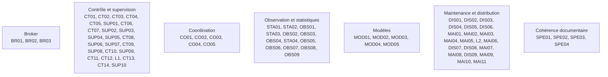

La seule lecture du classement ne démontre ni succession chronologique ni effet de déblocage. Les dépendances établies et leurs conditions figurent en section 5.

## 3. Vues détaillées

Le graphe ci-dessous représente les 76 changes **ARCHIVÉS avec code attribué** déjà cartographiés, dont CT14, MAI11 et SUP10. Les cinq archives sans code sont répertoriées séparément en section 4. Le contrôle OpenSpec dénombre 107 dossiers d’archive ; la cartographie détaillée reste partielle dans l’attente d’ACL. Le suivi documentaire reste séparé des preuves opérationnelles. Les titres complets, identifiants techniques et sources figurent en section 4. Les intitulés génériques historiques Proposal et Proposition sont conservés dans les propositions ; les libellés courts des nœuds explicitent leur objet à partir de leurs artefacts.

### 3.1 Broker

Rattachement documenté dans les propositions et capacités : `approval-persistence`, `codex-integration-distribution`. Une capacité transverse ne crée pas de dépendance entre les lots.


### 3.2 Contrôle et supervision

Rattachement documenté dans les propositions et capacités : `approval-workflow`, `controller-transport`, `supervision-remediation`, `codex-integration-distribution`, `persistent-job-supervision`, `archive-session-statistics`, `concurrent-run-coordination`, `native-session-statistics`, `approval-persistence`, `active-component-update`, `opencode-v2-transport`. Une capacité transverse ne crée pas de dépendance entre les lots.


### 3.3 Coordination

Rattachement documenté dans les propositions et capacités : `approval-persistence`, `approval-workflow`, `archive-session-statistics`, `codex-integration-distribution`, `concurrent-run-coordination`, `controller-transport`, `persistent-job-supervision`, `supervision-remediation`, `native-session-statistics`, `active-component-update`, `coding-model-policy`, `local-web-monitor`. Une capacité transverse ne crée pas de dépendance entre les lots.

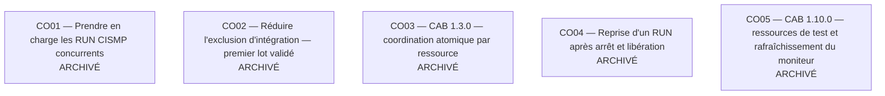

### 3.4 Observation et statistiques

Rattachement documenté dans les propositions et capacités : `archive-session-statistics`, `codex-integration-distribution`, `concurrent-run-coordination`, `native-session-statistics`, `controller-transport`, `local-web-monitor`, `monitor-management`, `persistent-job-supervision`, `web-statistics-retention`, `active-component-update`, `coding-model-policy`. Une capacité transverse ne crée pas de dépendance entre les lots.

```mermaid
flowchart TB
    STA01["STA01 — Ajouter les statistiques d’archivage CAB<br/>ARCHIVÉ"]
    STA02["STA02 — Statistiques natives et réduction des attentes CAB<br/>ARCHIVÉ"]
    OBS01["OBS01 — Ajouter le résumé des RUN à cab status<br/>ARCHIVÉ"]
    STA03["STA03 — Intégrer les statistiques d’observation<br/>ARCHIVÉ"]
    OBS02["OBS02 — Supervision web locale CAB<br/>ARCHIVÉ"]
    OBS03["OBS03 — Gestion locale du moniteur CAB 1.7.0<br/>ARCHIVÉ"]
    OBS04["OBS04 — Étapes du RUN et versions observées<br/>ARCHIVÉ"]
    STA04["STA04 — Statistiques web et purge des historiques CAB 1.6.0<br/>ARCHIVÉ"]
    OBS05["OBS05 — Préparer le moniteur avant les prévols<br/>ARCHIVÉ"]
    OBS06["OBS06 — Démarrage du monitoring par /cab start<br/>ARCHIVÉ"]
    OBS07["OBS07 — CAB Monitor : vue manuelle persistante, en-tête et classement<br/>ARCHIVÉ"]
    OBS08["OBS08 — Colonne codes de lot du moniteur — CAB 2.1.2<br/>ARCHIVÉ"]
    OBS09["OBS09 — Codes historiques du moniteur<br/>ARCHIVÉ"]
```

### 3.5 Modèles

Rattachement documenté dans les propositions et capacités : `codex-integration-distribution`, `active-component-update`, `coding-model-policy`, `concurrent-run-coordination`, `native-session-statistics`. Une capacité transverse ne crée pas de dépendance entre les lots.


### 3.6 Maintenance et distribution

Rattachement documenté dans les propositions et capacités : `codex-integration-distribution`, `active-component-update`, `concurrent-run-coordination`, `native-session-statistics`, `coding-model-policy`, `controller-transport`, `opencode-v2-transport`, `archive-session-statistics`. Une capacité transverse ne crée pas de dépendance entre les lots.


### 3.7 Cohérence documentaire

Rattachement documenté dans les propositions et capacités : `approval-persistence`, `approval-workflow`, `codex-integration-distribution`, `controller-transport`, `supervision-remediation`, `archive-session-statistics`, `persistent-job-supervision`. Une capacité transverse ne crée pas de dépendance entre les lots.

```mermaid
flowchart TB
    SPE01["SPE01 — Établir la cohérence du projet CAB<br/>ARCHIVÉ"]
    SPE02["SPE02 — Clarifier la cohérence des spécifications CAB<br/>ARCHIVÉ"]
    SPE03["SPE03 — Réconcilier les deltas OpenSpec CAB actifs<br/>ARCHIVÉ"]
    SPE04["SPE04 — Réconcilier la politique d’attente PLLM<br/>ARCHIVÉ"]
```

## 4. Registre des lots et changes


Archive sans code de lot attribué : [correlate-raw-codemode-mcp-failures](openspec/changes/archive/2026-11-01-correlate-raw-codemode-mcp-failures/), « Corrélation des erreurs MCP CodeMode brutes », **ARCHIVÉ**, 6/6 tâches ; Node.js 710/741 (0 échec, 31 ignorés), Python 87/87, OpenSpec strict 16/16 et archives strictes 120/120 ; source 2.1.56 qualifiée.

Archive sans code de lot attribué : [correlate-native-codemode-validation-failures](openspec/changes/archive/2026-11-01-correlate-native-codemode-validation-failures/), « Corrélation des erreurs natives CodeMode », **ARCHIVÉ**, 10/10 tâches ; Node.js 708/739 (0 échec, 31 ignorés), Python 87/87, OpenSpec strict 17/17 et archives strictes 119/119 ; CAB/CABU 2.1.54 publiés, CABU terminé.

Archive sans code de lot attribué : [allow-no-effect-release-after-native-edit-failure](openspec/changes/archive/2026-11-01-allow-no-effect-release-after-native-edit-failure/), « Libération sans effet après échec natif », **ARCHIVÉ**, 11/11 tâches ; Node.js 706/737 (0 échec, 31 ignorés), Python 87/87, OpenSpec strict 17/17 et archives strictes 118/118 ; CAB/CABU 2.1.52 publiés, CABU terminé, restitution C12 NO_EFFECT confirmée.

Archive sans code de lot attribué : [read-only-opencode-fs-fallback](openspec/changes/archive/2026-11-01-read-only-opencode-fs-fallback/), « Exposer une lecture native OpenCode bornée au RUN pour les pilotes », **ARCHIVÉ**, 11/11 tâches ; Node.js 698/729 (0 échec, 31 ignorés), Python 87/87, OpenSpec strict 17/17 et archives strictes 117/117 ; versions 2.1.50 publiées, CABU terminé, listing et lecture native vérifiés.

Archive sans code de lot attribué : [close-deterministic-pre-admission-refusals](openspec/changes/archive/2026-11-01-close-deterministic-pre-admission-refusals/), « Fermer les refus déterministes avant admission sans décision humaine », **ARCHIVÉ**, 9/9 tâches ; Node.js 690/721 (0 échec, 31 ignorés), Python 87/87, OpenSpec strict 17/17 ; source 2.1.45 publiée et CABU terminal.

Archive sans code de lot attribué : [recover-authorized-failed-mcp-receipt](openspec/changes/archive/2026-11-01-recover-authorized-failed-mcp-receipt/), « Récupérer un reçu CABU autorisé lorsque le broker MCP est failed », **ARCHIVÉ**, 10/10 tâches ; Node.js 690/721 (0 échec, 31 ignorés), Python 83/83, OpenSpec strict 17/17 ; source 2.1.44 publiée et CABU terminal, versions des quatre briques confirmées.

Archive sans code de lot attribué : [prove-unused-test-lease-after-history-compaction](openspec/changes/archive/2026-11-01-prove-unused-test-lease-after-history-compaction/), « Preuve durable de l’absence d’effet après compaction native », **ARCHIVÉ**, 8/8 tâches ; suite JavaScript 681/712 (0 échec, 31 ignorés), Python 83/83, OpenSpec strict 17/17 et archives 114/114 ; source publiée et CABU terminal en 2.1.42.

Archive sans code de lot attribué : [reconcile-rejected-operations-for-unused-test-leases](openspec/changes/archive/2026-11-01-reconcile-rejected-operations-for-unused-test-leases/), « Réconcilier les opérations rejetées lors d’un bail de test inutilisé », **ARCHIVÉ**, 9/9 tâches ; suite JavaScript 679/710 (0 échec, 31 ignorés), Python 83/83, OpenSpec strict 17/17 et archives 113/113. Source 2.1.41 publiée et CABU terminal ; les versions des composants et services sont vérifiées.

Archive sans code de lot attribué : [add-monitor-bootstrap-identity](openspec/changes/archive/2026-10-31-add-monitor-bootstrap-identity/), « Projection d’identité minimale pour le bootstrap CAB Monitor », **ARCHIVÉ**, 5/5 tâches. Attribution ACL ultérieure ; aucune ligne ni réservation n’est ajoutée à `openspec/BATCH_CODES.md`.

Les ratios ci-dessous comptent les cases cochées du fichier tasks.md, sans assimiler une case à une validation actuelle ou à un pourcentage de réalisation fonctionnelle. Les preuves de réalisation et de validation historique sont celles rapportées par les tâches et, lorsqu’ils existent, les documents de qualification et statistiques liés. Leur présence et leur lecture ne constituent pas une réexécution.

Le contrôle OpenSpec a validé les tâches cochées dans 109 dossiers d’archive. La cartographie détaillée et le registre de codes réconcilient les 76 entrées codées et six archives sans code listées ci-dessous ; 27 archives restent à réconcilier. SUP10 est archivé avec 7/7 tâches et qualification source finale acquise ; aucune installation ni activation. CT14 est clôturé avec 6/6 tâches ; l’archivage ne vaut ni déploiement ni activation. Réalisabilité d’une nouvelle session : **sans objet pour les entrées cartographiées**. Validations, intégrations ou qualifications nouvelles nécessaires avant réutilisation : **À VÉRIFIER selon le futur périmètre**. Livraison et activation actuelles restent **NON VÉRIFIÉES par ACL**.

Archive sans code de lot attribué : [retire-lowercase-cab-command](openspec/changes/archive/2026-10-31-retire-lowercase-cab-command/), « Retirer l’alias minuscule de la commande CAB », **ARCHIVÉ**, 5/5 tâches. L’attribution reste en attente d’ACL ; aucune ligne ni réservation n’est ajoutée à `openspec/BATCH_CODES.md`.

Archive sans code de lot attribué : [discard-released-access-tokens](openspec/changes/archive/2026-10-31-discard-released-access-tokens/), « Retirer les jetons d’accès libérés », **ARCHIVÉ**, 5/5 tâches. Attribution ACL ultérieure ; aucune ligne ni réservation de code.

Archive sans code de lot attribué : [add-monitor-bootstrap-identity](openspec/changes/archive/2026-10-31-add-monitor-bootstrap-identity/), « Ajouter une identité minimale au bootstrap CAB Monitor », **ARCHIVÉ**. Attribution ACL ultérieure ; aucune ligne ni réservation de code.

Archive sans code de lot attribué : [reconcile-native-completion-after-terminal-sse](openspec/changes/archive/2026-11-01-reconcile-native-completion-after-terminal-sse/), « Réconcilier la fin native après un événement SSE terminal », **ARCHIVÉ**, 4/4 tâches ; source 2.1.36 qualifiée, activation distincte et non réalisée. Attribution ACL ultérieure ; aucune ligne ni réservation de code.

Archive sans code de lot attribué : [require-native-recovery-preflight](openspec/changes/archive/2026-11-01-require-native-recovery-preflight/), « Prévol natif obligatoire avant récupération CAB adossée à un RUN », **ARCHIVÉ**, 11 tâches source livrées ; source 2.1.37 qualifiée. L’activation CABU reste une preuve distincte ; attribution ACL ultérieure, sans code ni réservation.

Archive sans code de lot attribué : [enforce-recovery-preflight-discovery](openspec/changes/archive/2026-11-01-enforce-recovery-preflight-discovery/), « Réconciliation sûre d’une discovery héritée », **ARCHIVÉ**, 8/8 tâches ; source 2.1.38 qualifiée. L’activation CABU reste une preuve distincte ; attribution ACL ultérieure, sans code ni réservation.

Archive sans code de lot attribué : [normalize-literal-request-validation-codemode](openspec/changes/archive/2026-11-01-normalize-literal-request-validation-codemode/), « Normaliser les littéraux sûrs de `request_validation` en Code Mode », **ARCHIVÉ**, 8/8 tâches ; suite JavaScript complète 669/700 (0 échec, 31 ignorés), Python 83/83 et OpenSpec strict archives 111/111 ; source CAB 2.1.39 publiée et activée par CABU. Attribution ACL ultérieure, sans code ni réservation.

Archive sans code de lot attribué : [redact-test-reservation-tokens-from-reads](openspec/changes/archive/2026-11-01-redact-test-reservation-tokens-from-reads/), « Retirer les jetons de réservation des lectures CAB », **ARCHIVÉ**, 8/8 tâches ; la suite JavaScript complète inclut les tests GET et passe 669/700 (0 échec, 31 ignorés), Python 83/83 et OpenSpec strict archives 111/111 ; source CAB 2.1.39 publiée et activée par CABU. Attribution ACL ultérieure, sans code ni réservation.

Archive sans code de lot attribué : [formalize-idempotent-test-reservation-recovery](openspec/changes/archive/2026-11-01-formalize-idempotent-test-reservation-recovery/), « Reprise sûre d’un bail de test restauré sans jeton disponible », **ARCHIVÉ**, 8/8 tâches ; suite JavaScript complète 674/705 (0 échec, 31 ignorés), Python 83/83 et OpenSpec strict 16/16 ; source 2.1.40 publiée et activée. Attribution ACL ultérieure, sans code ni réservation.


| Code | Identifiant technique et dossier | Titre | Ensemble | État | Cases cochées / total | Sources de réalisation et validation historique |
|---|---|---|---|---|---|---|
| BR01 | [fix-crash-recovery-journal-scans](openspec/changes/archive/2026-10-03-fix-crash-recovery-journal-scans/) | Indexer le journal pendant la récupération après crash | Broker | ARCHIVÉ | 10/10 | [proposition](openspec/changes/archive/2026-10-03-fix-crash-recovery-journal-scans/proposal.md) ; [tâches](openspec/changes/archive/2026-10-03-fix-crash-recovery-journal-scans/tasks.md) ; [STATISTICS.md](openspec/changes/archive/2026-10-03-fix-crash-recovery-journal-scans/STATISTICS.md) |
| BR02 | [fix-pending-list-journal-index](openspec/changes/archive/2026-10-05-fix-pending-list-journal-index/) | Indexer le journal pendant la liste des approbations | Broker | ARCHIVÉ | 7/7 | [proposition](openspec/changes/archive/2026-10-05-fix-pending-list-journal-index/proposal.md) ; [tâches](openspec/changes/archive/2026-10-05-fix-pending-list-journal-index/tasks.md) ; [STATISTICS.md](openspec/changes/archive/2026-10-05-fix-pending-list-journal-index/STATISTICS.md) |
| BR03 | [reset-cab-state-before-new-session](openspec/changes/archive/2026-10-05-reset-cab-state-before-new-session/) | Réinitialiser l’état CAB avant une nouvelle session | Broker | ARCHIVÉ | 10/10 | [proposition](openspec/changes/archive/2026-10-05-reset-cab-state-before-new-session/proposal.md) ; [tâches](openspec/changes/archive/2026-10-05-reset-cab-state-before-new-session/tasks.md) ; [STATISTICS.md](openspec/changes/archive/2026-10-05-reset-cab-state-before-new-session/STATISTICS.md) |
| CO01 | [add-concurrent-cismp-runs](openspec/changes/archive/2026-10-13-add-concurrent-cismp-runs/) | Prendre en charge les RUN CISMP concurrents | Coordination | ARCHIVÉ | 10/10 | [proposition](openspec/changes/archive/2026-10-13-add-concurrent-cismp-runs/proposal.md) ; [tâches](openspec/changes/archive/2026-10-13-add-concurrent-cismp-runs/tasks.md) ; [STATISTICS.md](openspec/changes/archive/2026-10-13-add-concurrent-cismp-runs/STATISTICS.md) |
| CO02 | [minimize-integration-exclusion](openspec/changes/archive/2026-10-16-minimize-integration-exclusion/) | Réduire l'exclusion d'intégration — premier lot validé | Coordination | ARCHIVÉ | 8/8 | [proposition](openspec/changes/archive/2026-10-16-minimize-integration-exclusion/proposal.md) ; [tâches](openspec/changes/archive/2026-10-16-minimize-integration-exclusion/tasks.md) ; [STATISTICS.md](openspec/changes/archive/2026-10-16-minimize-integration-exclusion/STATISTICS.md) |
| CO03 | [add-resource-scoped-coordination-1-3-0](openspec/changes/archive/2026-10-17-add-resource-scoped-coordination-1-3-0/) | CAB 1.3.0 — coordination atomique par ressource | Coordination | ARCHIVÉ | 39/39 | [proposition](openspec/changes/archive/2026-10-17-add-resource-scoped-coordination-1-3-0/proposal.md) ; [tâches](openspec/changes/archive/2026-10-17-add-resource-scoped-coordination-1-3-0/tasks.md) ; [STATISTICS.md](openspec/changes/archive/2026-10-17-add-resource-scoped-coordination-1-3-0/STATISTICS.md) |
| CO04 | [fix-stopped-run-rereservation](openspec/changes/archive/2026-10-20-fix-stopped-run-rereservation/) | Reprise d'un RUN après arrêt et libération | Coordination | ARCHIVÉ | 8/8 | [proposition](openspec/changes/archive/2026-10-20-fix-stopped-run-rereservation/proposal.md) ; [tâches](openspec/changes/archive/2026-10-20-fix-stopped-run-rereservation/tasks.md) ; [STATISTICS.md](openspec/changes/archive/2026-10-20-fix-stopped-run-rereservation/STATISTICS.md) |
| CO05 | [add-container-test-resource-locking](openspec/changes/archive/2026-10-25-add-container-test-resource-locking/) | CAB 1.10.0 — ressources de test et rafraîchissement du moniteur | Coordination | ARCHIVÉ | 15/15 | [proposition](openspec/changes/archive/2026-10-25-add-container-test-resource-locking/proposal.md) ; [tâches](openspec/changes/archive/2026-10-25-add-container-test-resource-locking/tasks.md) ; [QUALIFICATION.md](openspec/changes/archive/2026-10-25-add-container-test-resource-locking/QUALIFICATION.md) ; [STATISTICS.md](openspec/changes/archive/2026-10-25-add-container-test-resource-locking/STATISTICS.md) |
| CT01 | [fix-decision-request-id-correlation](openspec/changes/archive/2026-09-11-fix-decision-request-id-correlation/) | Corriger la corrélation des décisions par requestId | Contrôle et supervision | ARCHIVÉ | 5/5 | [proposition](openspec/changes/archive/2026-09-11-fix-decision-request-id-correlation/proposal.md) ; [tâches](openspec/changes/archive/2026-09-11-fix-decision-request-id-correlation/tasks.md) |
| CT02 | [add-manual-cab-decision-mode](openspec/changes/archive/2026-09-15-add-manual-cab-decision-mode/) | Ajouter le mode de décision manuelle CAB | Contrôle et supervision | ARCHIVÉ | 4/4 | [proposition](openspec/changes/archive/2026-09-15-add-manual-cab-decision-mode/proposal.md) ; [tâches](openspec/changes/archive/2026-09-15-add-manual-cab-decision-mode/tasks.md) |
| CT03 | [allow-generic-controller-workspace](openspec/changes/archive/2026-09-15-allow-generic-controller-workspace/) | Accepter un workspace générique pour le contrôleur | Contrôle et supervision | ARCHIVÉ | 4/4 | [proposition](openspec/changes/archive/2026-09-15-allow-generic-controller-workspace/proposal.md) ; [tâches](openspec/changes/archive/2026-09-15-allow-generic-controller-workspace/tasks.md) |
| CT04 | [fix-native-command-correlation](openspec/changes/archive/2026-09-15-fix-native-command-correlation/) | Corriger la corrélation des commandes natives | Contrôle et supervision | ARCHIVÉ | 5/5 | [proposition](openspec/changes/archive/2026-09-15-fix-native-command-correlation/proposal.md) ; [tâches](openspec/changes/archive/2026-09-15-fix-native-command-correlation/tasks.md) |
| CT05 | [add-pending-approval-controller-reminders](openspec/changes/archive/2026-09-18-add-pending-approval-controller-reminders/) | Proposition | Contrôle et supervision | ARCHIVÉ | 6/6 | [proposition](openspec/changes/archive/2026-09-18-add-pending-approval-controller-reminders/proposal.md) ; [tâches](openspec/changes/archive/2026-09-18-add-pending-approval-controller-reminders/tasks.md) |
| CT06 | [validate-decision-request-id-e2e](openspec/changes/archive/2026-09-25-validate-decision-request-id-e2e/) | Valider de bout en bout la corrélation requestId | Contrôle et supervision | ARCHIVÉ | 7/7 | [proposition](openspec/changes/archive/2026-09-25-validate-decision-request-id-e2e/proposal.md) ; [tâches](openspec/changes/archive/2026-09-25-validate-decision-request-id-e2e/tasks.md) |
| CT07 | [fix-manual-controller-reminders](openspec/changes/archive/2026-10-06-fix-manual-controller-reminders/) | Préserver la décision manuelle pendant les rappels | Contrôle et supervision | ARCHIVÉ | 8/8 | [proposition](openspec/changes/archive/2026-10-06-fix-manual-controller-reminders/proposal.md) ; [tâches](openspec/changes/archive/2026-10-06-fix-manual-controller-reminders/tasks.md) ; [STATISTICS.md](openspec/changes/archive/2026-10-06-fix-manual-controller-reminders/STATISTICS.md) |
| CT08 | [fix-controller-job-restoration-errors](openspec/changes/archive/2026-10-10-fix-controller-job-restoration-errors/) | Traiter explicitement les erreurs de restauration du job | Contrôle et supervision | ARCHIVÉ | 10/10 | [proposition](openspec/changes/archive/2026-10-10-fix-controller-job-restoration-errors/proposal.md) ; [tâches](openspec/changes/archive/2026-10-10-fix-controller-job-restoration-errors/tasks.md) ; [STATISTICS.md](openspec/changes/archive/2026-10-10-fix-controller-job-restoration-errors/STATISTICS.md) |
| CT09 | [add-terminal-gate](openspec/changes/archive/2026-10-13-add-terminal-gate/) | Proposal | Contrôle et supervision | ARCHIVÉ | 6/6 | [proposition](openspec/changes/archive/2026-10-13-add-terminal-gate/proposal.md) ; [tâches](openspec/changes/archive/2026-10-13-add-terminal-gate/tasks.md) ; [STATISTICS.md](openspec/changes/archive/2026-10-13-add-terminal-gate/STATISTICS.md) |
| CT10 | [reject-invalid-restored-job-contracts](openspec/changes/archive/2026-10-13-reject-invalid-restored-job-contracts/) | Refuser les contrats de job restaurés invalides | Contrôle et supervision | ARCHIVÉ | 8/8 | [proposition](openspec/changes/archive/2026-10-13-reject-invalid-restored-job-contracts/proposal.md) ; [tâches](openspec/changes/archive/2026-10-13-reject-invalid-restored-job-contracts/tasks.md) ; [STATISTICS.md](openspec/changes/archive/2026-10-13-reject-invalid-restored-job-contracts/STATISTICS.md) |
| CT11 | [prevent-native-permission-bypass](openspec/changes/archive/2026-10-14-prevent-native-permission-bypass/) | Prévenir les exécutions natives sans permission CAB | Contrôle et supervision | ARCHIVÉ | 8/8 | [proposition](openspec/changes/archive/2026-10-14-prevent-native-permission-bypass/proposal.md) ; [tâches](openspec/changes/archive/2026-10-14-prevent-native-permission-bypass/tasks.md) ; [STATISTICS.md](openspec/changes/archive/2026-10-14-prevent-native-permission-bypass/STATISTICS.md) |
| CT12 | [configure-controller-command-length-limit](openspec/changes/archive/2026-10-20-configure-controller-command-length-limit/) | Limite configurable des commandes du contrôleur CAB | Contrôle et supervision | ARCHIVÉ | 11/11 | [proposition](openspec/changes/archive/2026-10-20-configure-controller-command-length-limit/proposal.md) ; [tâches](openspec/changes/archive/2026-10-20-configure-controller-command-length-limit/tasks.md) ; [STATISTICS.md](openspec/changes/archive/2026-10-20-configure-controller-command-length-limit/STATISTICS.md) |
| CT13 | [support-opencode-v2-only-transport](openspec/changes/archive/2026-10-28-support-opencode-v2-only-transport/) | Migration exclusive vers OpenCode V2 | Contrôle et supervision | ARCHIVÉ | 14/14 | [proposition](openspec/changes/archive/2026-10-28-support-opencode-v2-only-transport/proposal.md) ; [tâches](openspec/changes/archive/2026-10-28-support-opencode-v2-only-transport/tasks.md) ; [STATISTICS.md](openspec/changes/archive/2026-10-28-support-opencode-v2-only-transport/STATISTICS.md) |
| CT14 | [fix-native-v2-pagination-and-preflight-2-1-5](openspec/changes/archive/2026-10-28-fix-native-v2-pagination-and-preflight-2-1-5/) | Pagination et preuve native OpenCode — CAB 2.1.5 | Contrôle et supervision | ARCHIVÉ | 6/6 | [proposition](openspec/changes/archive/2026-10-28-fix-native-v2-pagination-and-preflight-2-1-5/proposal.md) ; [tâches](openspec/changes/archive/2026-10-28-fix-native-v2-pagination-and-preflight-2-1-5/tasks.md) ; [design](openspec/changes/archive/2026-10-28-fix-native-v2-pagination-and-preflight-2-1-5/design.md) |
| DIS01 | [correct-plugin-layout-traceability](openspec/changes/archive/2026-09-11-correct-plugin-layout-traceability/) | Corriger la traçabilité de l’arborescence du plugin | Maintenance et distribution | ARCHIVÉ | 4/4 | [proposition](openspec/changes/archive/2026-09-11-correct-plugin-layout-traceability/proposal.md) ; [tâches](openspec/changes/archive/2026-09-11-correct-plugin-layout-traceability/tasks.md) |
| DIS02 | [add-cab-plugin-update-command](openspec/changes/archive/2026-09-19-add-cab-plugin-update-command/) | Ajouter la commande de mise à jour du plugin CAB | Maintenance et distribution | ARCHIVÉ | 6/6 | [proposition](openspec/changes/archive/2026-09-19-add-cab-plugin-update-command/proposal.md) ; [tâches](openspec/changes/archive/2026-09-19-add-cab-plugin-update-command/tasks.md) |
| DIS03 | [add-cab-command-profile-update](openspec/changes/archive/2026-09-21-add-cab-command-profile-update/) | Actualiser la commande CAB du profil Codex | Maintenance et distribution | ARCHIVÉ | 8/8 | [proposition](openspec/changes/archive/2026-09-21-add-cab-command-profile-update/proposal.md) ; [tâches](openspec/changes/archive/2026-09-21-add-cab-command-profile-update/tasks.md) |
| DIS04 | [add-cab-update-version-summary](openspec/changes/archive/2026-09-21-add-cab-update-version-summary/) | Résumer les versions après mise à jour CAB | Maintenance et distribution | ARCHIVÉ | 5/5 | [proposition](openspec/changes/archive/2026-09-21-add-cab-update-version-summary/proposal.md) ; [tâches](openspec/changes/archive/2026-09-21-add-cab-update-version-summary/tasks.md) |
| DIS05 | [align-cab-components-1-1-0](openspec/changes/archive/2026-10-15-align-cab-components-1-1-0/) | Alignement des briques CAB sur 1.1.0 | Maintenance et distribution | ARCHIVÉ | 7/7 | [proposition](openspec/changes/archive/2026-10-15-align-cab-components-1-1-0/proposal.md) ; [tâches](openspec/changes/archive/2026-10-15-align-cab-components-1-1-0/tasks.md) ; [STATISTICS.md](openspec/changes/archive/2026-10-15-align-cab-components-1-1-0/STATISTICS.md) |
| DIS06 | [align-cab-components-1-2-0](openspec/changes/archive/2026-10-16-align-cab-components-1-2-0/) | Aligner les briques CAB sur 1.2.0 | Maintenance et distribution | ARCHIVÉ | 6/6 | [proposition](openspec/changes/archive/2026-10-16-align-cab-components-1-2-0/proposal.md) ; [tâches](openspec/changes/archive/2026-10-16-align-cab-components-1-2-0/tasks.md) ; [STATISTICS.md](openspec/changes/archive/2026-10-16-align-cab-components-1-2-0/STATISTICS.md) |
| DIS07 | [add-cab-uppercase-update-alias](openspec/changes/archive/2026-10-27-add-cab-uppercase-update-alias/) | Ajouter les commandes canoniques CAB et CABU | Maintenance et distribution | ARCHIVÉ | 7/7 | [proposition](openspec/changes/archive/2026-10-27-add-cab-uppercase-update-alias/proposal.md) ; [tâches](openspec/changes/archive/2026-10-27-add-cab-uppercase-update-alias/tasks.md) ; [STATISTICS.md](openspec/changes/archive/2026-10-27-add-cab-uppercase-update-alias/STATISTICS.md) |
| DIS08 | [add-cabu-skill-plugin-command](openspec/changes/archive/2026-10-27-add-cabu-skill-plugin-command/) | Proposal | Maintenance et distribution | ARCHIVÉ | 6/6 | [proposition](openspec/changes/archive/2026-10-27-add-cabu-skill-plugin-command/proposal.md) ; [tâches](openspec/changes/archive/2026-10-27-add-cabu-skill-plugin-command/tasks.md) ; [STATISTICS.md](openspec/changes/archive/2026-10-27-add-cabu-skill-plugin-command/STATISTICS.md) |
| DIS09 | [align-uppercase-cab-identities-2-1-1](openspec/changes/archive/2026-10-28-align-uppercase-cab-identities-2-1-1/) | Aligner les identités publiques CAB sur 2.1.1 | Maintenance et distribution | ARCHIVÉ | 6/6 | [proposition](openspec/changes/archive/2026-10-28-align-uppercase-cab-identities-2-1-1/proposal.md) ; [tâches](openspec/changes/archive/2026-10-28-align-uppercase-cab-identities-2-1-1/tasks.md) ; [STATISTICS.md](openspec/changes/archive/2026-10-28-align-uppercase-cab-identities-2-1-1/STATISTICS.md) |
| L1 | [fix-orphaned-validation-admission](openspec/changes/archive/2026-10-25-fix-orphaned-validation-admission/) | Corriger l’admission des validations orphelines | Contrôle et supervision | ARCHIVÉ | 10/10 | [proposition](openspec/changes/archive/2026-10-25-fix-orphaned-validation-admission/proposal.md) ; [tâches](openspec/changes/archive/2026-10-25-fix-orphaned-validation-admission/tasks.md) ; [QUALIFICATION.md](openspec/changes/archive/2026-10-25-fix-orphaned-validation-admission/QUALIFICATION.md) ; [STATISTICS.md](openspec/changes/archive/2026-10-25-fix-orphaned-validation-admission/STATISTICS.md) |
| L2 | [support-frozen-recovery-controller-maintenance](openspec/changes/archive/2026-10-25-support-frozen-recovery-controller-maintenance/) | Maintenir le contrôleur pendant une récupération gelée | Maintenance et distribution | ARCHIVÉ | 14/14 | [proposition](openspec/changes/archive/2026-10-25-support-frozen-recovery-controller-maintenance/proposal.md) ; [tâches](openspec/changes/archive/2026-10-25-support-frozen-recovery-controller-maintenance/tasks.md) ; [QUALIFICATION.md](openspec/changes/archive/2026-10-25-support-frozen-recovery-controller-maintenance/QUALIFICATION.md) ; [STATISTICS.md](openspec/changes/archive/2026-10-25-support-frozen-recovery-controller-maintenance/STATISTICS.md) |
| MAI01 | [update-active-cab-components](openspec/changes/archive/2026-10-20-update-active-cab-components/) | Mise à jour contrôlée des briques CAB actives | Maintenance et distribution | ARCHIVÉ | 11/11 | [proposition](openspec/changes/archive/2026-10-20-update-active-cab-components/proposal.md) ; [tâches](openspec/changes/archive/2026-10-20-update-active-cab-components/tasks.md) ; [STATISTICS.md](openspec/changes/archive/2026-10-20-update-active-cab-components/STATISTICS.md) |
| MAI02 | [fix-broker-worker-child-proof](openspec/changes/archive/2026-10-25-fix-broker-worker-child-proof/) | Reconnaissance du broker créé depuis un thread OpenCode | Maintenance et distribution | ARCHIVÉ | 5/5 | [proposition](openspec/changes/archive/2026-10-25-fix-broker-worker-child-proof/proposal.md) ; [tâches](openspec/changes/archive/2026-10-25-fix-broker-worker-child-proof/tasks.md) ; [QUALIFICATION.md](openspec/changes/archive/2026-10-25-fix-broker-worker-child-proof/QUALIFICATION.md) ; [STATISTICS.md](openspec/changes/archive/2026-10-25-fix-broker-worker-child-proof/STATISTICS.md) |
| MAI03 | [fix-historical-test-resource-recovery](openspec/changes/archive/2026-10-25-fix-historical-test-resource-recovery/) | Compatibilité historique et récupération en avant 1.10.1 | Maintenance et distribution | ARCHIVÉ | 6/6 | [proposition](openspec/changes/archive/2026-10-25-fix-historical-test-resource-recovery/proposal.md) ; [tâches](openspec/changes/archive/2026-10-25-fix-historical-test-resource-recovery/tasks.md) ; [QUALIFICATION.md](openspec/changes/archive/2026-10-25-fix-historical-test-resource-recovery/QUALIFICATION.md) ; [STATISTICS.md](openspec/changes/archive/2026-10-25-fix-historical-test-resource-recovery/STATISTICS.md) |
| MAI04 | [fix-large-maintenance-registry-1-10-1](openspec/changes/archive/2026-10-25-fix-large-maintenance-registry-1-10-1/) | CAB 1.10.1 — lectures bornées du registre de maintenance | Maintenance et distribution | ARCHIVÉ | 7/7 | [proposition](openspec/changes/archive/2026-10-25-fix-large-maintenance-registry-1-10-1/proposal.md) ; [tâches](openspec/changes/archive/2026-10-25-fix-large-maintenance-registry-1-10-1/tasks.md) ; [QUALIFICATION.md](openspec/changes/archive/2026-10-25-fix-large-maintenance-registry-1-10-1/QUALIFICATION.md) ; [STATISTICS.md](openspec/changes/archive/2026-10-25-fix-large-maintenance-registry-1-10-1/STATISTICS.md) |
| MAI05 | [fix-readonly-broker-1-9-upgrade-1-10](openspec/changes/archive/2026-10-25-fix-readonly-broker-1-9-upgrade-1-10/) | Maintenance reuse-readonly 1.9.0 vers 1.10.0 | Maintenance et distribution | ARCHIVÉ | 5/5 | [proposition](openspec/changes/archive/2026-10-25-fix-readonly-broker-1-9-upgrade-1-10/proposal.md) ; [tâches](openspec/changes/archive/2026-10-25-fix-readonly-broker-1-9-upgrade-1-10/tasks.md) ; [STATISTICS.md](openspec/changes/archive/2026-10-25-fix-readonly-broker-1-9-upgrade-1-10/STATISTICS.md) |
| MAI06 | [support-readonly-broker-reuse](openspec/changes/archive/2026-10-25-support-readonly-broker-reuse/) | Réutiliser le broker externe en lecture seule | Maintenance et distribution | ARCHIVÉ | 11/11 | [proposition](openspec/changes/archive/2026-10-25-support-readonly-broker-reuse/proposal.md) ; [tâches](openspec/changes/archive/2026-10-25-support-readonly-broker-reuse/tasks.md) ; [QUALIFICATION.md](openspec/changes/archive/2026-10-25-support-readonly-broker-reuse/QUALIFICATION.md) ; [STATISTICS.md](openspec/changes/archive/2026-10-25-support-readonly-broker-reuse/STATISTICS.md) |
| MAI07 | [automate-cab-update-lifecycle-1-10-8](openspec/changes/archive/2026-10-27-automate-cab-update-lifecycle-1-10-8/) | Forcer la mise à jour CABU et aligner les briques en 1.10.9 | Maintenance et distribution | ARCHIVÉ | 7/7 | [proposition](openspec/changes/archive/2026-10-27-automate-cab-update-lifecycle-1-10-8/proposal.md) ; [tâches](openspec/changes/archive/2026-10-27-automate-cab-update-lifecycle-1-10-8/tasks.md) ; [STATISTICS.md](openspec/changes/archive/2026-10-27-automate-cab-update-lifecycle-1-10-8/STATISTICS.md) |
| MAI08 | [fix-maintenance-ownership-and-paused-orphan-rejection](openspec/changes/archive/2026-10-27-fix-maintenance-ownership-and-paused-orphan-rejection/) | CAB 1.10.7 — propriétaires et demande orpheline en pause | Maintenance et distribution | ARCHIVÉ | 10/10 | [proposition](openspec/changes/archive/2026-10-27-fix-maintenance-ownership-and-paused-orphan-rejection/proposal.md) ; [tâches](openspec/changes/archive/2026-10-27-fix-maintenance-ownership-and-paused-orphan-rejection/tasks.md) ; [VALIDATION.md](openspec/changes/archive/2026-10-27-fix-maintenance-ownership-and-paused-orphan-rejection/VALIDATION.md) ; [STATISTICS.md](openspec/changes/archive/2026-10-27-fix-maintenance-ownership-and-paused-orphan-rejection/STATISTICS.md) |
| MAI09 | [fix-runtime-recovery-and-fast-cabu-update](openspec/changes/archive/2026-10-28-fix-runtime-recovery-and-fast-cabu-update/) | Fiabiliser la récupération runtime et accélérer CABU | Maintenance et distribution | ARCHIVÉ | 9/9 | [proposition](openspec/changes/archive/2026-10-28-fix-runtime-recovery-and-fast-cabu-update/proposal.md) ; [tâches](openspec/changes/archive/2026-10-28-fix-runtime-recovery-and-fast-cabu-update/tasks.md) ; [STATISTICS.md](openspec/changes/archive/2026-10-28-fix-runtime-recovery-and-fast-cabu-update/STATISTICS.md) |
| MAI10 | [fix-update-credentials-and-mixed-layout-2-1-3](openspec/changes/archive/2026-10-28-fix-update-credentials-and-mixed-layout-2-1-3/) | Fiabiliser la mise à jour CAB 2.1.3 | Maintenance et distribution | ARCHIVÉ | 8/8 | [proposition](openspec/changes/archive/2026-10-28-fix-update-credentials-and-mixed-layout-2-1-3/proposal.md) ; [tâches](openspec/changes/archive/2026-10-28-fix-update-credentials-and-mixed-layout-2-1-3/tasks.md) ; [STATISTICS.md](openspec/changes/archive/2026-10-28-fix-update-credentials-and-mixed-layout-2-1-3/STATISTICS.md) |
| MAI11 | [qualify-historical-bootstrap-2-1-5](openspec/changes/archive/2026-10-28-qualify-historical-bootstrap-2-1-5/) | Qualifier le banc historique CAB 1.7.1 vers 2.1.5 | Maintenance et distribution | ARCHIVÉ | 4/4 | [proposition](openspec/changes/archive/2026-10-28-qualify-historical-bootstrap-2-1-5/proposal.md) ; [tâches](openspec/changes/archive/2026-10-28-qualify-historical-bootstrap-2-1-5/tasks.md) ; [QUALIFICATION.md](openspec/changes/archive/2026-10-28-qualify-historical-bootstrap-2-1-5/QUALIFICATION.md) ; [STATISTICS.md](openspec/changes/archive/2026-10-28-qualify-historical-bootstrap-2-1-5/STATISTICS.md) |
| MOD01 | [add-opencode-model-preflight](openspec/changes/archive/2026-10-13-add-opencode-model-preflight/) | Ajouter le prévol du modèle OpenCode | Modèles | ARCHIVÉ | 5/5 | [proposition](openspec/changes/archive/2026-10-13-add-opencode-model-preflight/proposal.md) ; [tâches](openspec/changes/archive/2026-10-13-add-opencode-model-preflight/tasks.md) ; [STATISTICS.md](openspec/changes/archive/2026-10-13-add-opencode-model-preflight/STATISTICS.md) |
| MOD02 | [add-session-provider-read-limit](openspec/changes/archive/2026-10-26-add-session-provider-read-limit/) | Budget de lecture fournisseur défini par la session | Modèles | ARCHIVÉ | 5/5 | [proposition](openspec/changes/archive/2026-10-26-add-session-provider-read-limit/proposal.md) ; [tâches](openspec/changes/archive/2026-10-26-add-session-provider-read-limit/tasks.md) ; [QUALIFICATION.md](openspec/changes/archive/2026-10-26-add-session-provider-read-limit/QUALIFICATION.md) ; [STATISTICS.md](openspec/changes/archive/2026-10-26-add-session-provider-read-limit/STATISTICS.md) |
| MOD03 | [fix-pllm-controller-binding-and-native-preflight](openspec/changes/archive/2026-10-26-fix-pllm-controller-binding-and-native-preflight/) | Raccord PLLM, fournisseur natif et variante OpenCode | Modèles | ARCHIVÉ | 6/6 | [proposition](openspec/changes/archive/2026-10-26-fix-pllm-controller-binding-and-native-preflight/proposal.md) ; [tâches](openspec/changes/archive/2026-10-26-fix-pllm-controller-binding-and-native-preflight/tasks.md) ; [QUALIFICATION.md](openspec/changes/archive/2026-10-26-fix-pllm-controller-binding-and-native-preflight/QUALIFICATION.md) ; [STATISTICS.md](openspec/changes/archive/2026-10-26-fix-pllm-controller-binding-and-native-preflight/STATISTICS.md) |
| MOD04 | [use-medium-coding-reasoning-1-10-6](openspec/changes/archive/2026-10-27-use-medium-coding-reasoning-1-10-6/) | Utiliser medium comme raisonnement automatique par défaut | Modèles | ARCHIVÉ | 10/10 | [proposition](openspec/changes/archive/2026-10-27-use-medium-coding-reasoning-1-10-6/proposal.md) ; [tâches](openspec/changes/archive/2026-10-27-use-medium-coding-reasoning-1-10-6/tasks.md) ; [STATISTICS.md](openspec/changes/archive/2026-10-27-use-medium-coding-reasoning-1-10-6/STATISTICS.md) |
| MOD05 | [support-pllm-catalog-3-7-2-1-4](openspec/changes/archive/2026-10-28-support-pllm-catalog-3-7-2-1-4/) | Compatibilité PLLM 2/6 et 3/7 — CAB 2.1.4 | Modèles | ARCHIVÉ | 5/5 | [proposition](openspec/changes/archive/2026-10-28-support-pllm-catalog-3-7-2-1-4/proposal.md) ; [tâches](openspec/changes/archive/2026-10-28-support-pllm-catalog-3-7-2-1-4/tasks.md) ; [STATISTICS.md](openspec/changes/archive/2026-10-28-support-pllm-catalog-3-7-2-1-4/STATISTICS.md) |
| OBS01 | [add-cab-status-run-summary](openspec/changes/archive/2026-10-16-add-cab-status-run-summary/) | Ajouter le résumé des RUN à cab status | Observation et statistiques | ARCHIVÉ | 10/10 | [proposition](openspec/changes/archive/2026-10-16-add-cab-status-run-summary/proposal.md) ; [tâches](openspec/changes/archive/2026-10-16-add-cab-status-run-summary/tasks.md) ; [STATISTICS.md](openspec/changes/archive/2026-10-16-add-cab-status-run-summary/STATISTICS.md) |
| OBS02 | [add-local-web-monitor](openspec/changes/archive/2026-10-20-add-local-web-monitor/) | Supervision web locale CAB | Observation et statistiques | ARCHIVÉ | 10/10 | [proposition](openspec/changes/archive/2026-10-20-add-local-web-monitor/proposal.md) ; [tâches](openspec/changes/archive/2026-10-20-add-local-web-monitor/tasks.md) ; [STATISTICS.md](openspec/changes/archive/2026-10-20-add-local-web-monitor/STATISTICS.md) |
| OBS03 | [add-monitor-management-1-7-0](openspec/changes/archive/2026-10-20-add-monitor-management-1-7-0/) | Gestion locale du moniteur CAB 1.7.0 | Observation et statistiques | ARCHIVÉ | 10/10 | [proposition](openspec/changes/archive/2026-10-20-add-monitor-management-1-7-0/proposal.md) ; [tâches](openspec/changes/archive/2026-10-20-add-monitor-management-1-7-0/tasks.md) ; [STATISTICS.md](openspec/changes/archive/2026-10-20-add-monitor-management-1-7-0/STATISTICS.md) |
| OBS04 | [add-run-lifecycle-steps](openspec/changes/archive/2026-10-20-add-run-lifecycle-steps/) | Étapes du RUN et versions observées | Observation et statistiques | ARCHIVÉ | 9/9 | [proposition](openspec/changes/archive/2026-10-20-add-run-lifecycle-steps/proposal.md) ; [tâches](openspec/changes/archive/2026-10-20-add-run-lifecycle-steps/tasks.md) ; [STATISTICS.md](openspec/changes/archive/2026-10-20-add-run-lifecycle-steps/STATISTICS.md) |
| OBS05 | [bootstrap-monitor-before-preflight](openspec/changes/archive/2026-10-20-bootstrap-monitor-before-preflight/) | Préparer le moniteur avant les prévols | Observation et statistiques | ARCHIVÉ | 8/8 | [proposition](openspec/changes/archive/2026-10-20-bootstrap-monitor-before-preflight/proposal.md) ; [tâches](openspec/changes/archive/2026-10-20-bootstrap-monitor-before-preflight/tasks.md) ; [STATISTICS.md](openspec/changes/archive/2026-10-20-bootstrap-monitor-before-preflight/STATISTICS.md) |
| OBS06 | [start-monitor-with-cab](openspec/changes/archive/2026-10-20-start-monitor-with-cab/) | Démarrage du monitoring par /cab start | Observation et statistiques | ARCHIVÉ | 9/9 | [proposition](openspec/changes/archive/2026-10-20-start-monitor-with-cab/proposal.md) ; [tâches](openspec/changes/archive/2026-10-20-start-monitor-with-cab/tasks.md) ; [STATISTICS.md](openspec/changes/archive/2026-10-20-start-monitor-with-cab/STATISTICS.md) |
| OBS07 | [fix-monitor-manual-view-and-task-order](openspec/changes/archive/2026-10-26-fix-monitor-manual-view-and-task-order/) | CAB Monitor : vue manuelle persistante, en-tête et classement | Observation et statistiques | ARCHIVÉ | 6/6 | [proposition](openspec/changes/archive/2026-10-26-fix-monitor-manual-view-and-task-order/proposal.md) ; [tâches](openspec/changes/archive/2026-10-26-fix-monitor-manual-view-and-task-order/tasks.md) ; [STATISTICS.md](openspec/changes/archive/2026-10-26-fix-monitor-manual-view-and-task-order/STATISTICS.md) |
| OBS08 | [add-monitor-lot-code-column](openspec/changes/archive/2026-10-28-add-monitor-lot-code-column/) | Colonne codes de lot du moniteur — CAB 2.1.2 | Observation et statistiques | ARCHIVÉ | 5/5 | [proposition](openspec/changes/archive/2026-10-28-add-monitor-lot-code-column/proposal.md) ; [tâches](openspec/changes/archive/2026-10-28-add-monitor-lot-code-column/tasks.md) ; [VALIDATION.md](openspec/changes/archive/2026-10-28-add-monitor-lot-code-column/VALIDATION.md) ; [STATISTICS.md](openspec/changes/archive/2026-10-28-add-monitor-lot-code-column/STATISTICS.md) |
| OBS09 | [fix-monitor-historical-lot-codes](openspec/changes/archive/2026-10-28-fix-monitor-historical-lot-codes/) | Reconnaître les codes historiques L1 et L2 dans le moniteur | Observation et statistiques | ARCHIVÉ | 4/4 | [proposition](openspec/changes/archive/2026-10-28-fix-monitor-historical-lot-codes/proposal.md) ; [tâches](openspec/changes/archive/2026-10-28-fix-monitor-historical-lot-codes/tasks.md) ; [STATISTICS.md](openspec/changes/archive/2026-10-28-fix-monitor-historical-lot-codes/STATISTICS.md) |
| SPE01 | [establish-project-consistency](openspec/changes/archive/2026-09-11-establish-project-consistency/) | Établir la cohérence du projet CAB | Cohérence documentaire | ARCHIVÉ | 9/9 | [proposition](openspec/changes/archive/2026-09-11-establish-project-consistency/proposal.md) ; [tâches](openspec/changes/archive/2026-09-11-establish-project-consistency/tasks.md) |
| SPE02 | [clarify-cab-specification-consistency](openspec/changes/archive/2026-10-13-clarify-cab-specification-consistency/) | Clarifier la cohérence des spécifications CAB | Cohérence documentaire | ARCHIVÉ | 10/10 | [proposition](openspec/changes/archive/2026-10-13-clarify-cab-specification-consistency/proposal.md) ; [tâches](openspec/changes/archive/2026-10-13-clarify-cab-specification-consistency/tasks.md) ; [STATISTICS.md](openspec/changes/archive/2026-10-13-clarify-cab-specification-consistency/STATISTICS.md) |
| SPE03 | [reconcile-active-cab-spec-deltas](openspec/changes/archive/2026-10-13-reconcile-active-cab-spec-deltas/) | Réconcilier les deltas OpenSpec CAB actifs | Cohérence documentaire | ARCHIVÉ | 9/9 | [proposition](openspec/changes/archive/2026-10-13-reconcile-active-cab-spec-deltas/proposal.md) ; [tâches](openspec/changes/archive/2026-10-13-reconcile-active-cab-spec-deltas/tasks.md) ; [STATISTICS.md](openspec/changes/archive/2026-10-13-reconcile-active-cab-spec-deltas/STATISTICS.md) |
| SPE04 | [reconcile-pllm-waiting-policy](openspec/changes/archive/2026-10-27-reconcile-pllm-waiting-policy/) | Réconcilier la politique d’attente PLLM | Cohérence documentaire | ARCHIVÉ | 6/6 | [proposition](openspec/changes/archive/2026-10-27-reconcile-pllm-waiting-policy/proposal.md) ; [tâches](openspec/changes/archive/2026-10-27-reconcile-pllm-waiting-policy/tasks.md) ; [STATISTICS.md](openspec/changes/archive/2026-10-27-reconcile-pllm-waiting-policy/STATISTICS.md) |
| STA01 | [add-cab-archive-statistics](openspec/changes/archive/2026-10-13-add-cab-archive-statistics/) | Ajouter les statistiques d’archivage CAB | Observation et statistiques | ARCHIVÉ | 7/7 | [proposition](openspec/changes/archive/2026-10-13-add-cab-archive-statistics/proposal.md) ; [tâches](openspec/changes/archive/2026-10-13-add-cab-archive-statistics/tasks.md) ; [STATISTICS.md](openspec/changes/archive/2026-10-13-add-cab-archive-statistics/STATISTICS.md) |
| STA02 | [optimize-cab-statistics-and-integration](openspec/changes/archive/2026-10-15-optimize-cab-statistics-and-integration/) | Statistiques natives et réduction des attentes CAB | Observation et statistiques | ARCHIVÉ | 13/13 | [proposition](openspec/changes/archive/2026-10-15-optimize-cab-statistics-and-integration/proposal.md) ; [tâches](openspec/changes/archive/2026-10-15-optimize-cab-statistics-and-integration/tasks.md) ; [STATISTICS.md](openspec/changes/archive/2026-10-15-optimize-cab-statistics-and-integration/STATISTICS.md) |
| STA03 | [integrate-observation-statistics](openspec/changes/archive/2026-10-17-integrate-observation-statistics/) | Intégrer les statistiques d’observation | Observation et statistiques | ARCHIVÉ | 6/6 | [proposition](openspec/changes/archive/2026-10-17-integrate-observation-statistics/proposal.md) ; [tâches](openspec/changes/archive/2026-10-17-integrate-observation-statistics/tasks.md) ; [STATISTICS.md](openspec/changes/archive/2026-10-17-integrate-observation-statistics/STATISTICS.md) |
| STA04 | [add-web-statistics-and-retention-1-6-0](openspec/changes/archive/2026-10-20-add-web-statistics-and-retention-1-6-0/) | Statistiques web et purge des historiques CAB 1.6.0 | Observation et statistiques | ARCHIVÉ | 12/12 | [proposition](openspec/changes/archive/2026-10-20-add-web-statistics-and-retention-1-6-0/proposal.md) ; [tâches](openspec/changes/archive/2026-10-20-add-web-statistics-and-retention-1-6-0/tasks.md) ; [STATISTICS.md](openspec/changes/archive/2026-10-20-add-web-statistics-and-retention-1-6-0/STATISTICS.md) |
| SUP01 | [add-persistent-job-supervisor](openspec/changes/archive/2026-09-25-add-persistent-job-supervisor/) | Proposal | Contrôle et supervision | ARCHIVÉ | 8/8 | [proposition](openspec/changes/archive/2026-09-25-add-persistent-job-supervisor/proposal.md) ; [tâches](openspec/changes/archive/2026-09-25-add-persistent-job-supervisor/tasks.md) |
| SUP02 | [fix-cab-session-recovery](openspec/changes/archive/2026-10-08-fix-cab-session-recovery/) | Proposal | Contrôle et supervision | ARCHIVÉ | 8/8 | [proposition](openspec/changes/archive/2026-10-08-fix-cab-session-recovery/proposal.md) ; [tâches](openspec/changes/archive/2026-10-08-fix-cab-session-recovery/tasks.md) ; [STATISTICS.md](openspec/changes/archive/2026-10-08-fix-cab-session-recovery/STATISTICS.md) |
| SUP03 | [allow-cab-reset-after-failed-recovery](openspec/changes/archive/2026-10-10-allow-cab-reset-after-failed-recovery/) | Autoriser la réinitialisation après récupération échouée | Contrôle et supervision | ARCHIVÉ | 6/6 | [proposition](openspec/changes/archive/2026-10-10-allow-cab-reset-after-failed-recovery/proposal.md) ; [tâches](openspec/changes/archive/2026-10-10-allow-cab-reset-after-failed-recovery/tasks.md) ; [STATISTICS.md](openspec/changes/archive/2026-10-10-allow-cab-reset-after-failed-recovery/STATISTICS.md) |
| SUP04 | [fix-automatic-preflight-recovery](openspec/changes/archive/2026-10-10-fix-automatic-preflight-recovery/) | Corriger la récupération des prévols automatiques | Contrôle et supervision | ARCHIVÉ | 8/8 | [proposition](openspec/changes/archive/2026-10-10-fix-automatic-preflight-recovery/proposal.md) ; [tâches](openspec/changes/archive/2026-10-10-fix-automatic-preflight-recovery/tasks.md) ; [STATISTICS.md](openspec/changes/archive/2026-10-10-fix-automatic-preflight-recovery/STATISTICS.md) |
| SUP05 | [fix-cab-terminal-gate-and-supervision-scope](openspec/changes/archive/2026-10-10-fix-cab-terminal-gate-and-supervision-scope/) | Corriger le gate terminal et le périmètre de supervision | Contrôle et supervision | ARCHIVÉ | 6/6 | [proposition](openspec/changes/archive/2026-10-10-fix-cab-terminal-gate-and-supervision-scope/proposal.md) ; [tâches](openspec/changes/archive/2026-10-10-fix-cab-terminal-gate-and-supervision-scope/tasks.md) ; [STATISTICS.md](openspec/changes/archive/2026-10-10-fix-cab-terminal-gate-and-supervision-scope/STATISTICS.md) |
| SUP06 | [retain-session-after-divergent-recovery-preflight](openspec/changes/archive/2026-10-10-retain-session-after-divergent-recovery-preflight/) | Conserver la session après un prévol de récupération divergent | Contrôle et supervision | ARCHIVÉ | 7/7 | [proposition](openspec/changes/archive/2026-10-10-retain-session-after-divergent-recovery-preflight/proposal.md) ; [tâches](openspec/changes/archive/2026-10-10-retain-session-after-divergent-recovery-preflight/tasks.md) ; [STATISTICS.md](openspec/changes/archive/2026-10-10-retain-session-after-divergent-recovery-preflight/STATISTICS.md) |
| SUP07 | [update-cab-orchestration-cadences](openspec/changes/archive/2026-10-10-update-cab-orchestration-cadences/) | Définir les cadences de l’orchestration CAB | Contrôle et supervision | ARCHIVÉ | 7/7 | [proposition](openspec/changes/archive/2026-10-10-update-cab-orchestration-cadences/proposal.md) ; [tâches](openspec/changes/archive/2026-10-10-update-cab-orchestration-cadences/tasks.md) ; [STATISTICS.md](openspec/changes/archive/2026-10-10-update-cab-orchestration-cadences/STATISTICS.md) |
| SUP08 | [complete-supervisor-public-status](openspec/changes/archive/2026-10-13-complete-supervisor-public-status/) | Compléter le statut public du superviseur | Contrôle et supervision | ARCHIVÉ | 8/8 | [proposition](openspec/changes/archive/2026-10-13-complete-supervisor-public-status/proposal.md) ; [tâches](openspec/changes/archive/2026-10-13-complete-supervisor-public-status/tasks.md) ; [STATISTICS.md](openspec/changes/archive/2026-10-13-complete-supervisor-public-status/STATISTICS.md) |
| SUP09 | [fix-recovery-retry-after-mcp-timeout](openspec/changes/archive/2026-10-14-fix-recovery-retry-after-mcp-timeout/) | Autoriser le retry réconcilié après timeout MCP | Contrôle et supervision | ARCHIVÉ | 8/8 | [proposition](openspec/changes/archive/2026-10-14-fix-recovery-retry-after-mcp-timeout/proposal.md) ; [tâches](openspec/changes/archive/2026-10-14-fix-recovery-retry-after-mcp-timeout/tasks.md) ; [STATISTICS.md](openspec/changes/archive/2026-10-14-fix-recovery-retry-after-mcp-timeout/STATISTICS.md) |
| SUP10 | [fix-cab-shutdown-on-opencode-exit](openspec/changes/archive/2026-10-28-fix-cab-shutdown-on-opencode-exit/) | Fermeture propre de CAB avec OpenCode — 2.1.6 | Contrôle et supervision | ARCHIVÉ | 7/7 | [proposition](openspec/changes/archive/2026-10-28-fix-cab-shutdown-on-opencode-exit/proposal.md) ; [tâches](openspec/changes/archive/2026-10-28-fix-cab-shutdown-on-opencode-exit/tasks.md) ; [design](openspec/changes/archive/2026-10-28-fix-cab-shutdown-on-opencode-exit/design.md) |

**État vérifié : 105 dossiers d’archive OpenSpec ; 76 codes attestés et 78 entrées documentées ici**, dont les deux archives sans code. Les 27 autres dossiers restent hors cartographie détaillée jusqu’à ACL ; le total de leurs tâches et codes n’est pas inféré. Les attributions CAB-ACL-R4 et CAB-ACL-R5 et les 76 codes connus sont conservés. Le relevé ACL initial portait sur 72 archives et 597 tâches ; il reste historique. Les suivis distincts de CT14 et SUP10 restent consignés. Aucune attribution n’est déduite de cette cartographie. Le [registre](openspec/BATCH_CODES.md) conserve les preuves d’attribution, y compris les annotations rétrospectives.

Archive sans code attribué : [restore-approved-native-operations](openspec/changes/archive/2026-11-02-restore-approved-native-operations/), « Restaurer sûrement les opérations natives approuvées », contrôle et supervision, source 2.1.63 qualifiée et archivée ; publication et activation CABU sont suivies séparément. Aucune attribution ou réservation ACL n’est faite.

Archive sans code attribué : [reconcile-terminal-native-operations](openspec/changes/archive/2026-11-02-reconcile-terminal-native-operations/), contrôle et supervision, source 2.1.64 qualifiée et archivée ; publication et activation CABU sont suivies séparément. Aucune attribution ou réservation ACL n’est faite.

Archive sans code attribué : [correlate-running-codemode-validation](openspec/changes/archive/2026-11-02-correlate-running-codemode-validation/), contrôle et supervision, source 2.1.65 publiée et activée via CABU ; les quatre composants ont été vérifiés. Aucune attribution ou réservation ACL n’est faite.

Archive sans code attribué : [reconcile-running-codemode-validation](openspec/changes/archive/2026-11-02-reconcile-running-codemode-validation/), contrôle et supervision, source 2.1.65 qualifiée et archivée ; publication et activation CABU sont suivies séparément. Aucune attribution ou réservation ACL n’est faite.

## 5. Registre des dépendances

Les cinq relations suivantes sont **directes et documentées**. Leur satisfaction est limitée à la phase historique indiquée ; elle ne vaut pas disponibilité actuelle des composants. Vérification documentaire des sources et tâches : 28 octobre 2026. Les sources conservent les dates et résultats de leurs propres qualifications. Une dépendance de phase ne bloque pas par elle-même tout le change.

```mermaid
flowchart LR
    CT06["CT06 — validate decision request id e2e"]
    CT01["CT01 — fix decision request id correlation"]
    SPE02["SPE02 — clarify cab specification consistency"]
    SPE03["SPE03 — reconcile active cab spec deltas"]
    CT09["CT09 — add terminal gate"]
    STA01["STA01 — add cab archive statistics"]
    L2["L2 — support frozen recovery controller maintenance"]
    L1["L1 — fix orphaned validation admission"]
    CT06 -->|"Qualification E2E du correctif de corrélation"| CT01
    SPE02 -->|"Clarification après rapprochement des deltas"| SPE03
    SPE03 -->|"Rapprochement du delta du gate"| CT09
    SPE03 -->|"Rapprochement du delta statistique"| STA01
    L2 -->|"Chaîne de qualification REJECTION_ONLY"| L1
```

| Dépendant et change | Prérequis et change | Nature / phase affectée | Condition de satisfaction | État et portée | Sources / preuves |
|---|---|---|---|---|---|
| CT06 — validate-decision-request-id-e2e | CT01 — fix-decision-request-id-correlation | Qualification E2E du correctif de corrélation | Disposer du correctif de corrélation et de son parcours contrôleur pour exécuter la qualification E2E | SATISFAITE au niveau documentaire historique ; disponibilité actuelle NON VÉRIFIÉE | [CT06 — proposal.md](openspec/changes/archive/2026-09-25-validate-decision-request-id-e2e/proposal.md) ; [CT01 — tasks.md](openspec/changes/archive/2026-09-11-fix-decision-request-id-correlation/tasks.md) ; [CT06 — tasks.md](openspec/changes/archive/2026-09-25-validate-decision-request-id-e2e/tasks.md) |
| SPE02 — clarify-cab-specification-consistency | SPE03 — reconcile-active-cab-spec-deltas | Clarification après rapprochement des deltas | Rapprochement préalable décrit dans la proposition SPE02, sans restauration d’exigences anciennes | SATISFAITE au niveau documentaire historique | [SPE02 — proposal.md](openspec/changes/archive/2026-10-13-clarify-cab-specification-consistency/proposal.md) ; [SPE03 — tasks.md](openspec/changes/archive/2026-10-13-reconcile-active-cab-spec-deltas/tasks.md) |
| SPE03 — reconcile-active-cab-spec-deltas | CT09 — add-terminal-gate | Rapprochement du delta du gate | Présence du delta du gate et comparaison aux références pour la phase documentaire du rapprochement | SATISFAITE pour l’artefact archivé | [SPE03 — proposal.md](openspec/changes/archive/2026-10-13-reconcile-active-cab-spec-deltas/proposal.md) ; [SPE03 — design.md](openspec/changes/archive/2026-10-13-reconcile-active-cab-spec-deltas/design.md) ; [CT09 — proposal.md](openspec/changes/archive/2026-10-13-add-terminal-gate/proposal.md) |
| SPE03 — reconcile-active-cab-spec-deltas | STA01 — add-cab-archive-statistics | Rapprochement du delta statistique | Présence du delta statistique et comparaison aux références pour la phase documentaire du rapprochement | SATISFAITE pour l’artefact archivé | [SPE03 — proposal.md](openspec/changes/archive/2026-10-13-reconcile-active-cab-spec-deltas/proposal.md) ; [SPE03 — design.md](openspec/changes/archive/2026-10-13-reconcile-active-cab-spec-deltas/design.md) ; [STA01 — proposal.md](openspec/changes/archive/2026-10-13-add-cab-archive-statistics/proposal.md) |
| L2 — support-frozen-recovery-controller-maintenance | L1 — fix-orphaned-validation-admission | Chaîne de qualification REJECTION_ONLY | Qualification de la réconciliation, rejet explicite, polling MCP et retry conservés par la maintenance gelée | SATISFAITE selon la qualification source historique ; activation actuelle NON VÉRIFIÉE | [L2 — QUALIFICATION.md](openspec/changes/archive/2026-10-25-support-frozen-recovery-controller-maintenance/QUALIFICATION.md) ; [L1 — STATISTICS.md](openspec/changes/archive/2026-10-25-fix-orphaned-validation-admission/STATISTICS.md) |

La relation SPE02 → SPE03 entraîne les prérequis documentaires transitifs CT09 et STA01 ; ils ne sont pas redessinés comme de nouvelles dépendances directes. Aucun cycle dans ces cinq relations. Ce constat est limité au graphe documenté ; l’absence de relation recensée ne démontre pas l’absence de toute autre dépendance.

### Relations documentaires et coordination sans flèche de dépendance

| Lots | Relation constatée | Source |
|---|---|---|
| DIS01 / SPE01 | Correction documentaire de l’arborescence annoncée dans le change initial ; aucune réouverture | [DIS01 — proposal.md](openspec/changes/archive/2026-09-11-correct-plugin-layout-traceability/proposal.md) |
| CO03 / STA03 | Fonctions qualifiées et archivées dans un même cycle source 1.3.0 ; aucune dépendance réciproque inventée | [CO03 — proposal.md](openspec/changes/archive/2026-10-17-add-resource-scoped-coordination-1-3-0/proposal.md) ; [STA03 — proposal.md](openspec/changes/archive/2026-10-17-integrate-observation-statistics/proposal.md) |
| CT10 / SUP01 | Référence historique au contrat de supervision ; aucun blocage actuel démontré | [CT10 — design.md](openspec/changes/archive/2026-10-13-reject-invalid-restored-job-contracts/design.md) |
| DIS07 / SPE04 | Préservation d’un change alors actif pendant la préparation des commandes ; état actuel archivé | [DIS07 — proposal.md](openspec/changes/archive/2026-10-27-add-cab-uppercase-update-alias/proposal.md) ; [SPE04 — proposal.md](openspec/changes/archive/2026-10-27-reconcile-pllm-waiting-policy/proposal.md) |

### Prérequis externes et disponibilité actuelle

Les propositions CT13 et MOD05 documentent respectivement le contrat OpenCode V2 authentifié et les couples admissibles de catalogue PLLM. Les accès aux services et catalogues réels ne sont pas vérifiés par ACL : **NON VÉRIFIÉE** pour leur disponibilité actuelle. Les anciens profils et versions cités dans les changes de maintenance sont des conditions de transition à revérifier avant utilisation ; ils ne créent pas une chaîne de dépendances déduite des numéros de version.

Sources : [CT13 — proposal.md](openspec/changes/archive/2026-10-28-support-opencode-v2-only-transport/proposal.md) ; [MOD05 — proposal.md](openspec/changes/archive/2026-10-28-support-pllm-catalog-3-7-2-1-4/proposal.md) ; [cadrage technique](TECHNICAL.md) ; [cadrage de construction](BUILD.md).

## 6. Orientation de la progression

### Complément SCM découverte — 29 octobre 2026

`fix-codemode-discovery-literal-ack` : ARCHIVÉ, **code non attribué**, cible 2.1.9 ; 4/4 lots source validés, Node 487 réussis/26 ignorés/0 échec, Python 74/74. Aucun droit nouveau du diagnostic. [Qualification](openspec/changes/archive/2026-10-29-fix-codemode-discovery-literal-ack/QUALIFICATION.md). Activation 2.1.9 non effectuée ; attribution ultérieure par ACL.

```mermaid
flowchart TB
 discoveryAck["fix-codemode-discovery-literal-ack<br/>code non attribué — ARCHIVÉ"]
 classDef provisional fill:#fff4cc,stroke:#866400,stroke-dasharray:5 5
 class discoveryAck provisional
```

### Actualisation SCM Code Mode — 29 octobre 2026

`fix-opencode-codemode-native-proof-correlation` : ARCHIVÉ, **code non attribué**, cible source commune 2.1.8. Les cinq lots source sont validés : projection stricte, refus, chaîne native MCP/shell/écriture sous once, recovery complete et cohérence documentaire. Global final : Node 487 réussis, 26 ignorés, 0 échec ; Python 74/74. Archivage natif réussi. [Proposition](openspec/changes/archive/2026-10-29-fix-opencode-codemode-native-proof-correlation/proposal.md), [conception](openspec/changes/archive/2026-10-29-fix-opencode-codemode-native-proof-correlation/design.md), [tâches](openspec/changes/archive/2026-10-29-fix-opencode-codemode-native-proof-correlation/tasks.md). CABU 2.1.8 vérifié le 29 octobre ; reprise en cours, complément diagnostique ci-dessus requis. Attribution ultérieure par ACL.

```mermaid
flowchart TB
    codemodeProof["fix-opencode-codemode-native-proof-correlation<br/>code non attribué — ARCHIVÉ"]
    classDef provisional fill:#fff4cc,stroke:#866400,stroke-dasharray:5 5
    class codemodeProof provisional
```

### Actualisation SCM — 29 octobre 2026

Le change `fix-rejected-preflight-recovery-after-restart` est ARCHIVÉ, **code non attribué** : 5/5 tâches source validées, distribution 2.1.7, Node 481 réussis/27 ignorés/0 échec et Python 74/74. Archivage natif réussi ; CABU 2.1.7 vérifié le 29 octobre et transaction globale libérée. La reprise PA01 reste suspendue au raccord Code Mode, traité par le correctif ci-dessus. Sources : [proposition](openspec/changes/archive/2026-10-29-fix-rejected-preflight-recovery-after-restart/proposal.md), [tâches](openspec/changes/archive/2026-10-29-fix-rejected-preflight-recovery-after-restart/tasks.md), [qualification](openspec/changes/archive/2026-10-29-fix-rejected-preflight-recovery-after-restart/QUALIFICATION.md). Aucune dépendance nouvelle entre codes n'est déduite. L'attribution d'un code relève ultérieurement d'ACL.

```mermaid
flowchart TB
    rejectedRecovery["fix-rejected-preflight-recovery-after-restart<br/>code non attribué — ARCHIVÉ"]
    classDef provisional fill:#fff4cc,stroke:#866400,stroke-dasharray:5 5
    class rejectedRecovery provisional
```

Le change [fix-monitor-historical-lot-codes](openspec/changes/archive/2026-10-28-fix-monitor-historical-lot-codes/proposal.md) est **ARCHIVÉ**, avec le code **OBS09**, attribué rétrospectivement par CAB-ACL-R2. Il appartient à l’observation du moniteur, d’après sa proposition et la capacité local-web-monitor. Cette attribution ne crée aucune dépendance nouvelle. Les 72 archives antérieures conservent leurs codes et leur état.

Le nœud OBS09 figure dans la vue « Observation et statistiques » ; il remplace le repère provisoire, sans doublonner le change.

| Archive complémentaire OBS09 | Réalisabilité et unités | Avancement | Sources et condition de réexamen |
|---|---|---|---|
| OBS09 — fix-monitor-historical-lot-codes | Sans objet après archivage ; correctif source réalisé et validé, sans prérequis externe pour les fixtures locales | Réalisation et validation source achevées : 4/4 tâches, 14/14 tests ciblés, OpenSpec cible valide et global standard/strict 16/16 ; archivage vérifié, déploiement et activation NON EFFECTUÉS | [proposition](openspec/changes/archive/2026-10-28-fix-monitor-historical-lot-codes/proposal.md), [tâches](openspec/changes/archive/2026-10-28-fix-monitor-historical-lot-codes/tasks.md), [tests](tests/web-monitor.test.mjs) ; tout engagement runtime exige un périmètre et des preuves distincts |

Au constat historique de clôture CT14, aucun change actif ne restait à sélectionner ; la clôture de CT14 est consignée ci-dessous. Le correctif source est réalisé, validé et archivé sur demande explicite du développeur. Aucun déploiement ni activation effectué. [STATISTICS.md](openspec/changes/archive/2026-10-28-fix-monitor-historical-lot-codes/STATISTICS.md) conserve le bilan du change. Contrôles après archivage : OpenSpec global standard et strict **15/15** chacun ; tâches des archives **73/73**.

Pour une prochaine demande explicitement autorisée : revérifier l’inventaire, le mandat, les sources de vérité, les BLOCKERS.md éventuels et les preuves des prérequis. Examiner d’abord la réalisabilité immédiate des unités visées, puis le nombre et la difficulté des dépendances manquantes, l’effet de déblocage direct et transitif, la progression vérifiable et enfin l’effort et l’incertitude documentés. Aucun score numérique ou ordre de release n’est utilisé comme priorité.

Les prérequis externes non vérifiés interdisent de déduire une disponibilité. Les conditions de réexamen sont une nouvelle demande de travail, l’apparition d’un change actif ou d’une preuve nouvelle affectant un prérequis. Les données du relevé ACL (72 archives, 597 tâches et 60 rapports) restent historiques : après la clôture CT14, le périmètre courant contient 74 archives, 607 tâches et 62 rapports STATISTICS.md ; les douze absences historiques demeurent. Les estimations d’effort et la disponibilité opérationnelle nécessaires à une sélection future restent à établir pour son périmètre.

### Qualification historique archivée — MAI11

Le change [qualify-historical-bootstrap-2-1-5](openspec/changes/archive/2026-10-28-qualify-historical-bootstrap-2-1-5/proposal.md) est ARCHIVÉ sous le code MAI11, attribué rétrospectivement par CAB-ACL-R4. Il qualifie le paquet 1.7.1 authentifié et la transition 2.1.5 dans une copie complète isolée ; aucun déploiement ni activation réelle effectué.

Le nœud MAI11 figure dans la vue « Maintenance et distribution » et remplace le repère provisoire sans doublonner le change. Les preuves concernent le snapshot 2.1.5 ; elles ne qualifient pas la version 2.1.6. Aucune dépendance nouvelle n’est déduite de cette attribution.

| Identifiant technique | Réalisabilité | Avancement | Sources et limites |
|---|---|---|---|
| MAI11 — qualify-historical-bootstrap-2-1-5 | Sans objet après archivage ; source historique authentifiée et qualification globale 2.1.5 achevée | 4/4 tâches ; suite globale 2.1.5 isolée : Node 494/494 et Python 73/73, aucun échec ni saut. Le banc historique 33/33 est inclus dans Node ; archivage et STATISTICS.md vérifiés | [proposition](openspec/changes/archive/2026-10-28-qualify-historical-bootstrap-2-1-5/proposal.md), [tâches](openspec/changes/archive/2026-10-28-qualify-historical-bootstrap-2-1-5/tasks.md), [design](openspec/changes/archive/2026-10-28-qualify-historical-bootstrap-2-1-5/design.md), [qualification](openspec/changes/archive/2026-10-28-qualify-historical-bootstrap-2-1-5/QUALIFICATION.md), [statistiques](openspec/changes/archive/2026-10-28-qualify-historical-bootstrap-2-1-5/STATISTICS.md). Les compteurs documentaires et les essais locaux ne prouvent aucun déploiement. |

## 7. Incertitudes, anomalies et contrôles

### Limites conservées

- **L1 et L2 :** codes historiques préservés. Lors du relevé ACL, ils n’étaient pas reconnus. Le [correctif source ultérieur](openspec/changes/archive/2026-10-28-fix-monitor-historical-lot-codes/proposal.md) et le [contrat actualisé](openspec/specs/local-web-monitor/spec.md) les admettent exactement, en conservant les autres formats. La reconnaissance est vérifiée dans les tests source ; aucune activation d’un moniteur installé n’en est déduite.
- **Temporalité des propositions :** certaines archives contiennent « reste ouvert » ou « aucun archivage effectué ». Ces passages décrivent leur état lors de la rédaction. L’état ARCHIVÉ du registre décrit leur emplacement vérifié le 28 octobre 2026 ; aucun passage historique n’est réécrit pour effacer cette différence.
- **Métadonnées :** 40 archives possèdent .openspec.yaml ; 32 n’en possèdent pas. Les dates de création renseignées peuvent différer de la date du dossier. Le tri initial des codes utilise les chemins, pas une chronologie certifiée.
- **Designs :** 70 présents ; absents pour [CT03 — proposal.md](openspec/changes/archive/2026-09-15-allow-generic-controller-workspace/proposal.md) et [DIS05 — proposal.md](openspec/changes/archive/2026-10-15-align-cab-components-1-1-0/proposal.md). Aucun document reconstruit.
- **Statistiques :** 60 rapports STATISTICS.md présents ; 12 absents, pour les douze premières archives dans le tri des chemins (du 11 au 25 septembre 2026). ACL ne produit ni ne régénère ces rapports.
- **Propositions :** 35 sans titre de niveau 1, trois avec des sections de niveau 1 sans titre général : ajout de 38 titres autorisés. Les 34 autres titres reçoivent uniquement le préfixe validé, y compris les libellés génériques Proposal et Proposition. Les sections existantes des trois documents concernés sont conservées.
- **Hypothèses :** aucune hypothèse de dépendance supplémentaire utilisée pour une décision. Les effets runtime, la disponibilité présente et les gains de performance ne sont pas déduits des ratios ou de l’archivage.

### Vérifications historiques de l’application ACL

Les résultats documentaires sont à confronter aux artefacts effectifs ; les contrôles globaux OpenSpec couvrent le canon et les changes actifs, le contrôle --archived couvre les tâches d’archives. Ils ne requalifient pas les tests historiques. Les contrôles de contenu couvrent séparément les 72 annotations et leurs liens.

| Contrôle exécuté le 28 octobre 2026 | Résultat |
|---|---|
| Titres et préservation du contenu des propositions | 72/72 : retrait de la seule annotation restitue exactement le contenu préalable ; 38 ajouts et 34 préfixes |
| Registre et cartographie | 72 entrées uniques chacun ; concordance des codes, identifiants et titres ; aucune entrée sans code |
| Inventaire et tâches | 0 actif, 72 archives ; 597/597 ; ratios des 72 archives confirmés avec la fonction pure parseTasks du moniteur |
| Reconnaissance des codes | Fonction pure parseChangeTitle du moniteur : 70 nouveaux codes reconnus ; L1/L2 non reconnus conformément au contrat conservé |
| UTF-8 sans BOM et LF | 74/74 fichiers autorisés |
| Liens relatifs | 470 destinations locales vérifiées, toutes présentes et internes au projet ; aucun lien proposal.md# dans les sources examinées |
| Diagrammes Mermaid | 9 blocs, couverture des 72 codes ; structure du sous-ensemble généré, définitions et références des nœuds contrôlées ; cinq arêtes directes, aucun cycle |
| Parseur et rendu Mermaid | Non exécutés : mmdc, mermaid et mermaid-cli indisponibles localement ; aucune installation ni accès réseau |
| OpenSpec global standard | openspec validate --all --json --no-interactive : 15/15, zéro problème |
| OpenSpec global strict | openspec validate --all --strict --json --no-interactive : 15/15, zéro problème |
| Tâches des archives en strict | openspec validate --archived --strict --json --report findings --no-interactive : 72/72, zéro problème |
| Périmètre | 73 fichiers existants modifiés et un registre créé ; 855 autres fichiers de la base d’empreintes conservés, dont les tâches, deltas, canons et preuves historiques |
| Idempotence | Seconde préparation sans écriture : aucune annotation restante, aucun nouveau code ou doublon, registre et carte identiques à leur contenu attendu |

Les tests produit et constructions ne sont pas exécutés pour ces annotations documentaires. Aucun archivage, commit, publication, installation ou activation effectué. Les limites documentées ci-dessus restent applicables et ne sont pas des corrections fonctionnelles autorisées par ce plan.

<!-- SCM:fix-native-v2-pagination-and-preflight-2-1-5 -->
### Clôture SCM 2.1.5 — CT14

CT14 figure dans la vue « Contrôle et supervision ». Son titre porte le code attribué par CAB-ACL-R3 ; aucune renumérotation ni dépendance inter-change nouvelle.

| Identifiant technique | État documentaire | Avancement source | Sources et limites |
|---|---|---|---|
| CT14 — fix-native-v2-pagination-and-preflight-2-1-5 | ARCHIVÉ | 6/6 tâches cochées sur preuves | [proposition](openspec/changes/archive/2026-10-28-fix-native-v2-pagination-and-preflight-2-1-5/proposal.md), [tâches](openspec/changes/archive/2026-10-28-fix-native-v2-pagination-and-preflight-2-1-5/tasks.md), [preuves SCM](openspec/changes/archive/2026-10-28-fix-native-v2-pagination-and-preflight-2-1-5/PREUVES-SCM.json), [statistiques](openspec/changes/archive/2026-10-28-fix-native-v2-pagination-and-preflight-2-1-5/STATISTICS.md). Qualification source, archivage et rapport vérifiés séparément ; aucun déploiement ni activation dans cette finalisation. |

Contrôles après archive : OpenSpec global standard et strict 15/15 chacun ; archives 74/74. Aucun autre candidat actif à engager ; le change de qualification historique demandé est suivi séparément. Les preuves natives enregistrées restent celles de la qualification antérieure, sans nouvelle génération fournisseur ni exécution de mandat métier.
<!-- /SCM:fix-native-v2-pagination-and-preflight-2-1-5 -->


<!-- SCM:fix-cab-shutdown-on-opencode-exit -->
### Clôture source SCM 2.1.6 — SUP10

Le nœud SUP10 figure dans la vue « Contrôle et supervision » et remplace le repère provisoire sans doublon. Son rattachement repose sur la surveillance de l’identité du serveur et la conservation des sessions et protections décrites dans la proposition et les deltas cab-process-lifecycle / persistent-job-supervision. Aucune dépendance inter-change nouvelle n’est inférée.

| Identifiant technique | État | Avancement | Sources et limites |
|---|---|---|---|
| SUP10 — fix-cab-shutdown-on-opencode-exit | ARCHIVÉ | 7/7 tâches cochées sur preuves | [proposition](openspec/changes/archive/2026-10-28-fix-cab-shutdown-on-opencode-exit/proposal.md), [tâches](openspec/changes/archive/2026-10-28-fix-cab-shutdown-on-opencode-exit/tasks.md), [conception](openspec/changes/archive/2026-10-28-fix-cab-shutdown-on-opencode-exit/design.md). Détection, arrêt des processus, EOF MCP, distribution et horodatage du sceau qualifiés ; validation globale finale acquise : 513 tests Node, 74 Python et deux navigateurs. [Qualification](openspec/changes/archive/2026-10-28-fix-cab-shutdown-on-opencode-exit/QUALIFICATION.md), [statistiques](openspec/changes/archive/2026-10-28-fix-cab-shutdown-on-opencode-exit/STATISTICS.md). Aucune installation ni activation. |

La frontière de qualification historique 2.1.5 est libérée ; ses sources de preuve sont conservées. Cette coordination n’est pas une dépendance fonctionnelle inter-change. ACL reste nécessaire pour attribuer un code ; aucune attribution ni réservation de code effectuée ici.

Attribution documentaire CAB-ACL-R5 : SUP10, sans modification des tâches ni de leurs preuves. Lors de CAB-ACL-R5, 6/7 cases ne prouvaient pas une qualification globale. La réalisation a depuis validé les 7/7 tâches sur les preuves finales ; l’archivage natif est effectué et les statistiques sont produites dans son dossier. Aucune installation ni activation n’est déduite de cette qualification. Avant toute poursuite, revérifier les prérequis natifs et les preuves du périmètre visé. ACL ne lance aucune session de développement.
<!-- /SCM:fix-cab-shutdown-on-opencode-exit -->

## 8. Légende

- **Code de lot :** repère documentaire unique ; L1/L2 historiques conservés ; les autres codes suivent leurs attributions datées dans le registre (CAB-ACL-R1 à CAB-ACL-R4). Aucun code de regroupement ajouté.
- **Ensemble :** appartenance à une responsabilité documentée ; les familles et capacités transverses ne démontrent aucune dépendance. Les identifiants E1 à E7 du premier diagramme servent uniquement à son dessin.
- **ARCHIVÉ :** présence vérifiée dans le dossier d’archives ; ne signifie ni service disponible, ni activation. Chaque nœud porte explicitement son état ; aucune couleur ne véhicule seule une information.
- **Cases cochées / total :** indicateur documentaire du tasks.md, pas pourcentage fonctionnel.
- **Fait documenté :** affirmation ou relation explicite d’une source liée ; **fait vérifié :** constat local daté ; **hypothèse à confirmer :** interprétation exclue d’une décision automatique.
- **SATISFAITE :** condition atteinte dans la portée et la phase indiquées ; **NON SATISFAITE :** condition manquante démontrée ; **NON VÉRIFIÉE :** preuve insuffisante pour conclure.
- **RÉALISABLE / PARTIELLEMENT RÉALISABLE / BLOQUÉ / À VÉRIFIER :** états destinés aux changes actifs selon les prérequis des unités visées ; non appliqués aux archives.
- **Livraison / activation :** distinctes du code, de la documentation, des validations et de l’archivage ; leur état actuel n’est pas vérifié par ACL.
- **Entrée provisoire « code non attribué » :** repère sans code ni réservation, à séparer des correspondances vérifiées ; aucune au relevé ACL ; l’entrée archivée provisoire est remplacée par OBS09 après CAB-ACL-R2 ; l’entrée provisoire est remplacée par CT14 après CAB-ACL-R3, puis archivée ; l’entrée archivée provisoire de qualification historique est remplacée par MAI11 après CAB-ACL-R4 ; l’entrée active 2.1.6 est remplacée par SUP10 après CAB-ACL-R5 ; `restore-approved-native-operations`, `reconcile-terminal-native-operations`, `correlate-running-codemode-validation` et `reconcile-running-codemode-validation` sont archivés sans code, attribution ultérieure par ACL.
- **Flèche dirigée : A → B signifie que A dépend de B.** La flèche part du dépendant et pointe vers son prérequis. Les libellés précisent la phase ; les références et coordinations sans dépendance sont présentées en tableau séparé.

### Actualisation SCM édition native et supervision — 29 octobre 2026

`fix-native-edit-and-supervisor-mandates` : ARCHIVÉ, **code non attribué**, cible source commune 2.1.10. Périmètre validé par le développeur ; édition native, supervision, adaptations V2 et priorité medium/high qualifiées ; Node 502 réussis/28 ignorés, Python 75/75, natif 1/1 ; archive vérifiée. [Proposition](openspec/changes/archive/2026-10-29-fix-native-edit-and-supervisor-mandates/proposal.md), [tâches](openspec/changes/archive/2026-10-29-fix-native-edit-and-supervisor-mandates/tasks.md). Aucune activation effectuée. Attribution ultérieure par ACL.

```mermaid
flowchart LR
    nativeEditMandate["fix-native-edit-and-supervisor-mandates<br/>code non attribué — ARCHIVÉ"]
    classDef provisional fill:#fff3cd,stroke:#9a6700,stroke-dasharray:5 5
    class nativeEditMandate provisional
```

### Actualisation SCM directe — 29 octobre 2026

`fix-direct-native-mcp-error-recovery` : ARCHIVÉ, **code non attribué**, source 2.1.11 ; provenance directe et retry qualifiés sur banc isolé, pagination adaptative testée ; Node519 réussis/28 ignorés, Python75/75 et natif1/1 ; archive vérifiée. [Proposition](openspec/changes/archive/2026-10-29-fix-direct-native-mcp-error-recovery/proposal.md), [tâches](openspec/changes/archive/2026-10-29-fix-direct-native-mcp-error-recovery/tasks.md). Aucune activation ; attribution ACL ultérieure.

```mermaid
flowchart LR
    directRecovery["fix-direct-native-mcp-error-recovery<br/>code non attribué — ARCHIVÉ"]
    classDef provisional fill:#fff3cd,stroke:#9a6700,stroke-dasharray:5 5
    class directRecovery provisional
```

### Actualisation SCM diagnostics — 29 octobre 2026

`fix-notification-admission-diagnostics` : ARCHIVÉ, **code non attribué**, source2.1.12. Sources qualifiées : Node520 réussis/28 ignorés, Python80/80, natif1/1 ; archive vérifiée ; activation CABU à suivre séparément. [Proposition](openspec/changes/archive/2026-10-29-fix-notification-admission-diagnostics/proposal.md), [tâches](openspec/changes/archive/2026-10-29-fix-notification-admission-diagnostics/tasks.md). CABU explicitement autorisé après clôture source et coordination ; attribution ACL ultérieure.

```mermaid
flowchart LR
    notificationDiagnostics["fix-notification-admission-diagnostics<br/>code non attribué — ARCHIVÉ"]
    classDef provisional fill:#fff3cd,stroke:#9a6700,stroke-dasharray:5 5
    class notificationDiagnostics provisional
```

### Restitution sans effet — SCM 2.1.13

`release-unused-test-reservations` : ARCHIVÉ, **code non attribué**, 5/5 unités qualifiées ; Node534/28 ignorés, Python80/80, HTTP7/7, natif1/1 ; archive vérifiée ; aucune activation. [Proposition](openspec/changes/archive/2026-10-29-release-unused-test-reservations/proposal.md), [tâches](openspec/changes/archive/2026-10-29-release-unused-test-reservations/tasks.md). Attribution ACL ultérieure.

```mermaid
flowchart LR
    unusedTests["release-unused-test-reservations<br/>code non attribué — ARCHIVÉ"]
    classDef provisional fill:#fff3cd,stroke:#9a6700,stroke-dasharray:5 5
    class unusedTests provisional
```

### Isolation MCP — SCM 2.1.14

`isolate-shared-mcp-location` : ARCHIVÉ, **code non attribué**, 5/5 unités qualifiées ; Node543/28 ignorés, Python80/80 et natif1/1 ; archive vérifiée, activation non réalisée. [Proposition](openspec/changes/archive/2026-10-30-isolate-shared-mcp-location/proposal.md), [tâches](openspec/changes/archive/2026-10-30-isolate-shared-mcp-location/tasks.md). Attribution ACL ultérieure.

```mermaid
flowchart LR
    mcpIsolation["isolate-shared-mcp-location<br/>code non attribué — ARCHIVÉ"]
    classDef provisional fill:#fff3cd,stroke:#9a6700,stroke-dasharray:5 5
    class mcpIsolation provisional
```

### Récupération CABU — SCM2.1.15

`fix-cabu-startup-recovery` : ARCHIVÉ, **code non attribué**, 4/4 unités qualifiées, Node545/28 ignorés, Python80/80 et natif1/1 ; archive vérifiée, activation non confirmée. [Proposition](openspec/changes/archive/2026-10-30-fix-cabu-startup-recovery/proposal.md), [tâches](openspec/changes/archive/2026-10-30-fix-cabu-startup-recovery/tasks.md). Attribution ACL ultérieure.

```mermaid
flowchart LR
    cabuStartup["fix-cabu-startup-recovery<br/>code non attribué — ARCHIVÉ"]
    classDef provisional fill:#fff3cd,stroke:#9a6700,stroke-dasharray:5 5
    class cabuStartup provisional
```

### Lecture du statut CABU — complément2.1.15

`fix-cabu-large-controller-status` : ARCHIVÉ, **code non attribué**, 3/3 unités qualifiées, Node548/28 ignorés, updater48/48 ; archive vérifiée. [Proposition](openspec/changes/archive/2026-10-30-fix-cabu-large-controller-status/proposal.md), [tâches](openspec/changes/archive/2026-10-30-fix-cabu-large-controller-status/tasks.md). Build2.1.15 corrigé, activation non confirmée ; attribution ACL ultérieure.

```mermaid
flowchart LR
    cabuStatus["fix-cabu-large-controller-status<br/>code non attribué — ARCHIVÉ"]
    classDef provisional fill:#fff3cd,stroke:#9a6700,stroke-dasharray:5 5
    class cabuStatus provisional
```

### Diagnostics de décision — SCM2.1.16

`explain-decision-http-refusals` : ARCHIVÉ, **code non attribué**, 4/4 unités qualifiées ; Node560/28 ignorés, Python80/80 et natif1/1 ; archive vérifiée, activation suivie séparément. [Proposition](openspec/changes/archive/2026-10-30-explain-decision-http-refusals/proposal.md), [tâches](openspec/changes/archive/2026-10-30-explain-decision-http-refusals/tasks.md). Attribution ACL ultérieure.

```mermaid
flowchart LR
    decisionDiagnostics["explain-decision-http-refusals<br/>code non attribué — ARCHIVÉ"]
    classDef provisional fill:#fff3cd,stroke:#9a6700,stroke-dasharray:5 5
    class decisionDiagnostics provisional
```

### Coordination des incidents — SCM2.1.17

`coordinate-cab-coding-incidents` : ARCHIVÉ, **code non attribué**, règle documentaire de signalement au chat « Correctif CAB - OC » et suivi jusqu’à CABU ; source qualifiée : Node560/28 ignorés, Python80/80, distribution32/32 ; activation vérifiée séparément. [Proposition](openspec/changes/archive/2026-10-30-coordinate-cab-coding-incidents/proposal.md), [tâches](openspec/changes/archive/2026-10-30-coordinate-cab-coding-incidents/tasks.md). Attribution ACL ultérieure.

```mermaid
flowchart LR
    incidentCoordination["coordinate-cab-coding-incidents<br/>code non attribué — ARCHIVÉ"]
    classDef provisional fill:#fff3cd,stroke:#9a6700,stroke-dasharray:5 5
    class incidentCoordination provisional
```

### Entrées modèle explicites — SCM2.1.18

`reject-native-variant-model-input` : ARCHIVÉ, **code non attribué**, refus du champ natif variant dans les écritures client ; reasoning et lecture native conservés. [Proposition](openspec/changes/archive/2026-10-30-reject-native-variant-model-input/proposal.md), [tâches](openspec/changes/archive/2026-10-30-reject-native-variant-model-input/tasks.md). Source qualifiée : Node568/28 ignorés en deux groupes, Python80/80 et natif1/1 ; activation distincte. Attribution ACL ultérieure.

```mermaid
flowchart LR
    modelInput["reject-native-variant-model-input<br/>code non attribué — ARCHIVÉ"]
    classDef provisional fill:#fff3cd,stroke:#9a6700,stroke-dasharray:5 5
    class modelInput provisional
```

### Transitions à chaud — SCM2.1.19

`support-hot-model-transitions` : ARCHIVÉ, **code non attribué**, raccord fournisseur V2 et transition du même job ; choix explicite libre, PLLM en son absence. [Proposition](openspec/changes/archive/2026-10-30-support-hot-model-transitions/proposal.md), [tâches](openspec/changes/archive/2026-10-30-support-hot-model-transitions/tasks.md). Source qualifiée : Node601/29 ignorés, Python80/80, natif2.2.0 exact2/2 ; activation distincte ; attribution ACL ultérieure.

```mermaid
flowchart LR
    hotModel["support-hot-model-transitions<br/>code non attribué — ARCHIVÉ"]
    classDef provisional fill:#fff3cd,stroke:#9a6700,stroke-dasharray:5 5
    class hotModel provisional
```

### Continuité liée au compte — SCM2.1.20

`qualify-account-bound-history-continuity` : ARCHIVÉ — source2.1.20 qualifiée ; activation non déduite, **code non attribué**, lanceur par lien et qualification de la continuité historique Responses ; une limite native démontrée fait partie du livrable, sans réparation fictive. [Proposition](openspec/changes/archive/2026-10-30-qualify-account-bound-history-continuity/proposal.md), [tâches](openspec/changes/archive/2026-10-30-qualify-account-bound-history-continuity/tasks.md). Qualification et activation distinctes ; attribution ACL ultérieure.

```mermaid
flowchart LR
    historyContinuity["qualify-account-bound-history-continuity<br/>code non attribué — ARCHIVÉ"]
    classDef provisional fill:#fff3cd,stroke:#9a6700,stroke-dasharray:5 5
    class historyContinuity provisional
```


### Projection portable du contexte — SCM2.1.21

`project-stale-context-on-model-transition` : ARCHIVÉ — source2.1.21 qualifiée ; activation non déduite, **code non attribué**, hook natif de projection après transition PLLM/compte. [Proposition](openspec/changes/archive/2026-10-30-project-stale-context-on-model-transition/proposal.md), [tâches](openspec/changes/archive/2026-10-30-project-stale-context-on-model-transition/tasks.md). Qualification source et reprise réelle distinctes ; attribution ACL ultérieure.

```mermaid
flowchart LR
    portableContext["project-stale-context-on-model-transition<br/>code non attribué — ARCHIVÉ"]
    classDef provisional fill:#fff3cd,stroke:#9a6700,stroke-dasharray:5 5
    class portableContext provisional
```


### Entrée native exacte — SCM2.1.22

`bind-native-write-input-before-once` : ARCHIVÉ — source2.1.22 qualifiée ; activation non déduite, **code non attribué**, empreinte des arguments write/edit et garde avant once. [Proposition](openspec/changes/archive/2026-10-30-bind-native-write-input-before-once/proposal.md), [tâches](openspec/changes/archive/2026-10-30-bind-native-write-input-before-once/tasks.md). Qualification, publication et activation distinctes ; attribution ACL ultérieure.

```mermaid
flowchart LR
    nativeInput["bind-native-write-input-before-once<br/>code non attribué — ARCHIVÉ"]
    classDef provisional fill:#fff3cd,stroke:#9a6700,stroke-dasharray:5 5
    class nativeInput provisional
```


### Readiness vide — SCM2.1.23

`qualify-empty-readiness-metadata-input` : ARCHIVÉ — source2.1.23 qualifiée ; activation non déduite, **code non attribué**, projection native de l’omission input du seul diagnostic readiness vide. [Proposition](openspec/changes/archive/2026-10-30-qualify-empty-readiness-metadata-input/proposal.md), [tâches](openspec/changes/archive/2026-10-30-qualify-empty-readiness-metadata-input/tasks.md). Qualification et activation distinctes ; attribution ACL ultérieure.

```mermaid
flowchart LR
    emptyReadiness["qualify-empty-readiness-metadata-input<br/>code non attribué — ARCHIVÉ"]
    classDef provisional fill:#fff3cd,stroke:#9a6700,stroke-dasharray:5 5
    class emptyReadiness provisional
```


### Admission observée — SCM2.1.24

`expose-run-admission-state` : ARCHIVÉ — source2.1.24 qualifiée ; activation non déduite, **code non attribué**, instantanés d’admission et refus de transition explicites sans contournement. [Proposition](openspec/changes/archive/2026-10-30-expose-run-admission-state/proposal.md), [tâches](openspec/changes/archive/2026-10-30-expose-run-admission-state/tasks.md). Qualification et activation distinctes ; attribution ACL ultérieure.

```mermaid
flowchart LR
    admissionState["expose-run-admission-state<br/>code non attribué — ARCHIVÉ"]
    classDef provisional fill:#fff3cd,stroke:#9a6700,stroke-dasharray:5 5
    class admissionState provisional
```


### Transport shell scellé — SCM 2.1.25

`stage-exact-shell-payloads` : ARCHIVÉ — source 2.1.25 qualifiée, **code non attribué**. Corps Bash privé immuable, invocation courte, contrôle SHA256 et revue du corps ; décision, accès et once natifs conservés. [Proposition](openspec/changes/archive/2026-10-30-stage-exact-shell-payloads/proposal.md), [tâches](openspec/changes/archive/2026-10-30-stage-exact-shell-payloads/tasks.md), [qualification](openspec/changes/archive/2026-10-30-stage-exact-shell-payloads/QUALIFICATION.md). Publication et activation restent distinctes ; attribution ACL ultérieure.


### Incidents natifs et moniteur — SCM 2.1.26

`remediate-native-coding-and-monitor-incidents` : ARCHIVÉ — source 2.1.26 qualifiée, **code non attribué**. Projection compacte du registre, pannes de source explicites, helpers natifs et protocole de reprise sans assouplir les gardes. [Proposition](openspec/changes/archive/2026-10-30-remediate-native-coding-and-monitor-incidents/proposal.md), [tâches](openspec/changes/archive/2026-10-30-remediate-native-coding-and-monitor-incidents/tasks.md), [qualification](openspec/changes/archive/2026-10-30-remediate-native-coding-and-monitor-incidents/QUALIFICATION.md). Publication et activation distinctes ; attribution ACL ultérieure.


### Rangement et couleurs Web — SCM2.1.27

`fix-monitor-catalog-feedback-and-state-colors` : ARCHIVÉ — source2.1.27 qualifiée, **code non attribué**. Vue catalogue immédiate en Manuel sans rollback par lecture ancienne ; lignes BLOCKED bleues, DONE vertes, STOPPED orange. [Proposition](openspec/changes/archive/2026-10-30-fix-monitor-catalog-feedback-and-state-colors/proposal.md), [tâches](openspec/changes/archive/2026-10-30-fix-monitor-catalog-feedback-and-state-colors/tasks.md), [qualification](openspec/changes/archive/2026-10-30-fix-monitor-catalog-feedback-and-state-colors/QUALIFICATION.md). Publication et activation distinctes ; attribution ACL ultérieure.


### MCP pending et récupération — SCM2.1.28

`recover-cabu-pending-mcp` : ARCHIVÉ — source2.1.28 qualifiée, **code non attribué**. Attente bornée, reçuMCP_RECOVERY_REQUIRED et récupération globale explicitement liée avec intention durable unique ; PID/sessions/versions contrôlés. [Proposition](openspec/changes/archive/2026-10-30-recover-cabu-pending-mcp/proposal.md), [tâches](openspec/changes/archive/2026-10-30-recover-cabu-pending-mcp/tasks.md), [qualification](openspec/changes/archive/2026-10-30-recover-cabu-pending-mcp/QUALIFICATION.md). Publication et activation distinctes ; attribution ACL ultérieure.


### Permissions avant prévol — SCM2.1.29

`check-native-ask-before-preflight` : ARCHIVÉ — source2.1.29 qualifiée, **code non attribué**. Garde client requiredNativeAsk avant prompt, politique partagée sans changement et sortie explicite des deny de revue ; aucune restauration automatique. [Proposition](openspec/changes/archive/2026-10-30-check-native-ask-before-preflight/proposal.md), [tâches](openspec/changes/archive/2026-10-30-check-native-ask-before-preflight/tasks.md), [qualification](openspec/changes/archive/2026-10-30-check-native-ask-before-preflight/QUALIFICATION.md). Publication et activation distinctes ; attribution ACL ultérieure.


### Distribution du garde de permissions — SCM2.1.30

`close-monitor-permission-policy-distribution` : ARCHIVÉ — source2.1.30 qualifiée, **code non attribué**. Dépendance permission-policy incluse dans le moniteur et imports relatifs vérifiés par destination ; correction de livraison liée au29, sans changement de permissions. [Proposition](openspec/changes/archive/2026-10-30-close-monitor-permission-policy-distribution/proposal.md), [tâches](openspec/changes/archive/2026-10-30-close-monitor-permission-policy-distribution/tasks.md), [qualification](openspec/changes/archive/2026-10-30-close-monitor-permission-policy-distribution/QUALIFICATION.md). Publication et activation distinctes ; attribution ACL ultérieure.


### Rattachement après fin native — SCM 2.1.31

`fix-native-completion-before-attach` : ARCHIVÉ — source 2.1.31 qualifiée, **code non attribué**, attribution ACL ultérieure. [Proposition](openspec/changes/archive/2026-10-31-fix-native-completion-before-attach/proposal.md), [tâches](openspec/changes/archive/2026-10-31-fix-native-completion-before-attach/tasks.md). Validation source acquise ; publication et activation distinctes.


### Réattachement du plugin de contexte après arrêt — CAB 2.1.32

`rebind-portability-plugin-after-dead-pid` : ARCHIVÉ — CAB 2.1.32 qualifié, code non attribué, attribution ACL ultérieure. Un PID préparé mort permet le rattachement au processus courant en mémoire ; PID actif ou état inconnu restent bloquants. Tests ciblés, globaux et OpenCode privé réussis ; activation distincte selon CABU. [Proposition](openspec/changes/archive/2026-10-31-rebind-portability-plugin-after-dead-pid/proposal.md), [tâches](openspec/changes/archive/2026-10-31-rebind-portability-plugin-after-dead-pid/tasks.md).
