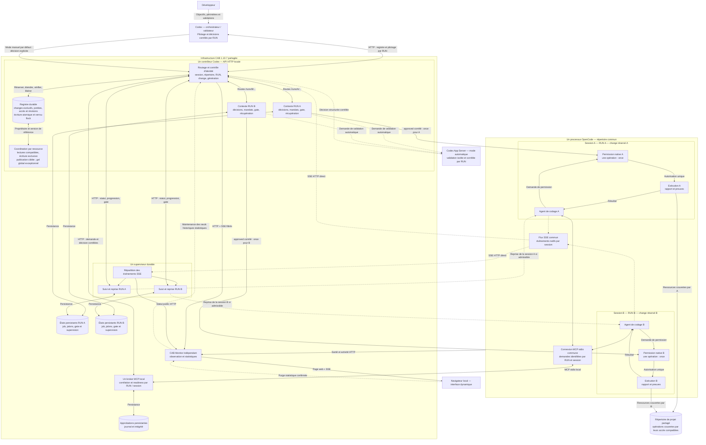

# PROJECT.md — Codex Approval Bridge (CAB)

## 1. Objet

Version de référence des briques CAB : `2.1.28`.

CAB 2.1.28 communique uniquement avec OpenCode V2 par HTTP Basic Auth et les
routes `/api`. Le nom Basic Auth V2 est `opencode`, le serveur reçoit le mot de
passe via `OPENCODE_PASSWORD`, et CAB le lit depuis un fichier local privé
transmis aux services par systemd credentials. OpenCode 1.x est refusé ; aucune
route V1 n'est utilisée comme repli.

La maintenance conserve les propriétaires réels des artefacts et des processus, qui peuvent être distincts lorsqu'ils sont explicitement prouvés. Une demande orpheline du job courant en pause ne peut être reconstruite que pour son rejet après exclusion native de tout effet ; cette réconciliation n'autorise aucune exécution.

Codex Approval Bridge, abrégé **CAB**, est un projet autonome de liaison, de validation et de supervision entre **OpenCode** et **Codex**.

CAB permet à OpenCode de soumettre à Codex des demandes de validation explicites pendant une session de travail, puis de recevoir une décision corrélée. Le pont transporte, persiste et supervise ces échanges sans décider à la place de Codex et sans modifier le projet piloté.

## 2. Finalité

CAB vise un pilotage OpenCode–Codex explicite, observable, traçable, persistant, résilient aux interruptions, contrôlable et indépendant du projet suivi.

CAB est une infrastructure de coordination. Il n'est ni un agent de codage, ni un moteur de décision autonome, ni une source de vérité fonctionnelle du projet piloté.

## 3. Principes architecturaux

CAB 1.10.7 réserve durablement chaque change et son intention, puis protège les opérations par des accès temporaires aux ressources partagées. Les lectures compatibles coexistent ; une écriture attend les seuls accès recouvrants. Les ensembles sont attribués atomiquement, avec reprise durable et révisions ciblées. Une exclusivité de fichier prouvée évite un verrou partagé supplémentaire.

Validation, synchronisation, archivage, publication et rapport protègent leurs périmètres réels sans demander la stabilité de tous les RUN. Le gel global est réservé à la réconciliation commune, la maintenance partagée, la pause globale ou l'arrêt global explicites. Les décisions unitaires, ask/once, preuves et gates sont conservés. Le contrat détaillé est dans ORCHESTRATED_CODING.md et OpenSpec.

Les statistiques intégrées distinguent réservations, activité native observée, contention et exceptions. Des fenêtres 24 h/7 j/30 j et des imports filtrés permettent de consulter l'audit arrêté sans réactiver son job ni additionner des sources recouvrantes.

### 3.1 Séparation des responsabilités

1. **OpenCode** réalise le travail et émet les demandes de validation.
2. **Le broker CAB** transporte, corrèle, persiste et restitue les validations.
3. **Le contrôleur Codex** sollicite Codex et conserve la décision destinée au broker.
4. **La supervision CAB** observe l'ensemble et expose un état synthétique.
5. **CAB Monitor** agrège les observations et fournit leur affichage web indépendant.

### 3.2 Broker neutre

Le broker peut recevoir, corréler, persister, notifier, récupérer une décision, la restituer et effectuer des remédiations techniques explicitement autorisées.

Il ne doit jamais décider à la place de Codex, transformer une absence de réponse en approbation, modifier le projet OpenCode ou lancer un travail de développement.

### 3.3 Orchestrateur validateur

Codex est l’orchestrateur de la session de codage persistante. Il la pilote du
démarrage jusqu’à son état terminal : il confie les mandats, examine leurs
résultats, décide de la poursuite, de la correction, du refus ou de la
suspension, puis prononce la clôture.

Toute opération nécessitant une permission OpenCode est un mandat unitaire
soumis à sa décision explicite et corrélée : édition, commande Bash ou système,
commande OpenSpec, test à effet de bord, correction ou archivage OpenSpec.
L’agent de codage exécute les mandats approuvés sans décider lui-même de leur
validité ni d’un élargissement de périmètre. Un archivage OpenSpec reste un
mandat distinct, décidé seulement après vérification des critères d’acceptation,
des validations et de la cohérence finale.

Le protocole impose le SSE en temps réel et le contrôle des demandes et
rapports toutes les 3 secondes. Les vérifications de progression pendant
l'analyse ou la rédaction sont espacées de 7 secondes fixes. La fraîcheur PLLM
de huit heures est vérifiée au démarrage initial ; le choix du RUN est ensuite
conservé pendant la session. Une panne réelle ou une instruction explicite peut
imposer une réévaluation. Sans choix admissible, attendre une instruction sans
benchmark ni réessai automatique, avec preuves et état conservés.
Les sondes statistiques suivent une cadence de 30 minutes sans arrêter le
travail pour attendre l'échéance. `AGENTS.md` et le skill distribué précisent
les contrôles et preuves exigés avant reprise.

### 3.4 Corrélation explicite

Chaque demande est corrélée par un `requestId` stable. Une décision doit correspondre à la demande exacte qui l'a provoquée. Une décision déjà consommée ne doit pas pouvoir être remplacée par une décision contradictoire.

### 3.5 Persistance et traçabilité

CAB conserve l'état courant des approbations, leur historique, les éléments nécessaires à la reprise après interruption et les informations de diagnostic.

Cette persistance couvre le RUN courant et sa reprise. Une réinitialisation globale exclusive
CAB purge d'abord l'intégralité de son ancien état technique, y compris les
conflits Syncthing, puis réinitialise le broker et la supervision. Les rapports
et historiques natifs des agents sont conservés hors de cet espace runtime.

Les identifiants logiques conservés dans l'histoire restent lisibles sans conversion. Les nouvelles réservations de test restent canoniques et distinctes des permissions. Une récupération de mise à jour conserve l'autorité de maintenance, les données métier et les anciennes releases jusqu'à vérification des composants réellement chargés.

### 3.6 Supervision indépendante

CAB distingue disponibilité des processus, activité des transports et progression métier réelle. Un processus vivant ou un échange réseau actif ne suffit pas à déclarer le système sain.

## 4. Architecture fonctionnelle

```text
OpenCode unique : sessions A, B, … — un RUN par session
   │ MCP stdio commun
   ▼
Broker CAB unique — corrélation et readiness par RUN
   │ HTTP local
   ▼
Contrôleur unique ──► contextes A, B, … ──► Codex / Codex App Server
   │
   └── Registre : changes exclusifs, accès atomiques et gels exceptionnels

OpenCode ── SSE HTTP commun ──► superviseur unique ──► suivi par RUN

Contrôleur + superviseur + OpenCode ── observations ──► CAB Monitor ──► navigateur local
```

Le transport entre OpenCode et le broker est exclusivement **MCP stdio local**. Le broker n'expose pas de serveur MCP réseau.

### 4.1 Architecture technique détaillée

Cette vue détaille le profil concurrent CAB 1.10.7 : un processus OpenCode,
un broker MCP stdio, un contrôleur et un superviseur communs, avec des
contextes isolés par RUN. A et B illustrent deux sessions ; le même modèle
s'applique aux autres RUN admis. Les contextes et la barrière sont des
éléments internes, pas des services supplémentaires.



- **Un mandat = une opération** : un fichier ou une commande, avec
  corrélation de `requestId`, `approval_id`, `change_id`, `run_id`,
  `reservation_version`, de la session et du répertoire.
- Le broker transporte et persiste ; **Codex décide**. Le contrôleur transmet
  l'approbation à la permission native correspondante avec une réponse
  `once`, consommable une seule fois.
- Les événements SSE et les relances techniques ne donnent aucune
  autorisation. Une décision absente ne vaut jamais approbation.
- Le gate terminal contrôle la clôture du job ; il reste distinct des
  décisions unitaires et ne remplace pas une permission OpenCode.
- Le mode manuel, utilisé par défaut, attend une décision HTTP explicite de
  l'orchestrateur sur `POST /decision/<requestId>`. Le mode automatique
  sollicite une session Codex de validation via Codex App Server.
- Le broker notifie le contrôleur sur `POST /validation/request` et récupère
  la décision sur `GET /decision/<requestId>`. La readiness est publiée
  séparément ; `READY` ne vaut jamais approbation.
- Avant de travailler, chaque RUN réserve atomiquement son change, son
  intention et son manifeste, après examen des dépendances. Les périmètres
  peuvent se recouvrir ; les accès temporaires coordonnent lectures compatibles
  et écritures exclusives. Codex examine aussi les dépendances sémantiques.
- Le contrôleur vérifie la couverture de chaque mandat et sa génération
  avant de transmettre `once` à la permission native de la bonne session.
  Les décisions, gates, reprises et checkpoints restent propres au RUN.
- La publication protège les ressources utiles et leurs révisions ; les pairs
  indépendants poursuivent. La quiescence commune concerne les opérations
  globales explicitement autorisées. Une libération exige ses preuves.
- Ajouter un RUN ne purge ni ne reconnecte le broker. Les opérations
  globales de cycle de vie exigent une réconciliation coordonnée.

Les cylindres représentent les états persistants des composants, sans
imposer un fichier ou un emplacement partagé. Les flèches en pointillés
identifient les voies SSE, les reprises techniques et le chemin de décision
du mode automatique. La publication désigne l'intégration dans la référence
commune du projet ; elle n'autorise pas un commit ou un déploiement.

## 5. Composants

### 5.1 Broker MCP

Le broker constitue le cœur de CAB. Il gère les validations, la corrélation, la persistance, le journal, les expirations, la reprise, la readiness, le diagnostic et les remédiations techniques contrôlées.

### 5.2 Contrôleur Codex

Le contrôleur reçoit les demandes du broker, sollicite Codex dans un contexte de validation dédié et rend les décisions disponibles au broker. Il ne remplace pas le broker et ne modifie pas le projet suivi.

Après une décision explicite `approved`, il transmet uniquement cette décision
à l’unique permission native OpenCode corrélée, puis la considère consommée.
Il ne peut jamais transformer un objectif de job ou une liste de fichiers et de
commandes en approbation générale.

### 5.3 Supervision

CAB observe OpenCode par une voie SSE directe indépendante du cycle MCP. Cette voie sert à confirmer l'activité réelle et à réconcilier l'état après reconnexion ou divergence.

### 5.3.1 Moniteur web indépendant

CAB Monitor 1.10.7 fournit une vue locale des briques, des RUN et des changes,
sans appel LLM. Son processus indépendant reste accessible pendant une panne
du contrôleur ou du superviseur. Il agrège des observations filtrées, avec
fraîcheur explicite, puis actualise les navigateurs par SSE. Le port par
défaut est 8790, configurable, avec écoute loopback uniquement.

L'avancement X/Y correspond aux tâches cochées dans le change OpenSpec. La
phase observée, le jalon prouvé et le gate du RUN restent distincts de ce
compteur. La page expose aussi la limite effective de commande du contrôleur.
Le moniteur ne décide, ne relance et ne modifie aucun RUN.
Depuis 1.7.1, il propose des commandes explicites de cycle de vie des briques,
protégées par leur propriété et la quiescence CAB, ainsi qu'un rangement privé
des lignes. Les archives et suppressions du moniteur ne touchent pas les
sources du projet observé. ARCHIVES conserve les RUN et changes rangés ;
désarchiver un RUN rétablit uniquement son affichage. La carte Web possède
son propre redémarrage, indépendant des RUN et des autres services.
/CAB start et toute entrée ou reprise de session de codage pilotée autorisée
préparent ou vérifient son service systemd indépendant dès la résolution du
workspace, avant PLLM et les prévols, même avec services CAB réutilisés.
Aucune activation au login n’est effectuée. Une instance active conforme est
réutilisée sans redémarrage. /CAB stop et la réinitialisation CAB le préservent pour afficher
les composants indisponibles. Son état de démarrage est signalé séparément
et sa vérification compare version et workspace réels.


ETAT présente la situation opérationnelle observée et ÉTAPE le cycle du
change, par exemple WAITING et Implémentation 6/11. La phase technique reste
consultable dans le détail. Les onze étapes ont des positions stables et
acceptent les retours, notamment de Revue vers Implémentation, avec historique
persistant. Les versions affichées proviennent des composants observés.

Le menu STATS présente les agrégats statistiques JSON filtrés du contrôleur,
avec sélection courante, dernière livraison, 24 h, 7 jours, 30 jours et filtre
RUN. Les sources natives et importées restent séparées ; couverture, fraîcheur
et compteurs cumulatifs sont explicites. La maintenance statistique permet
une purge manuelle des historiques antérieurs à 1/3/7/30/365 jours, après
prévisualisation puis confirmation. Elle préserve les contextes actifs ou
référencés, les états opérationnels et les preuves métier. Cette exception
de maintenance ne permet aucune décision, permission ou modification de RUN.

### 5.4 Plugin Codex

Le plugin `cab-approval-bridge` regroupe les skills `approval-bridge` et `coding-session-statistics`, les scripts du contrôleur et de supervision ainsi que les métadonnées nécessaires à son intégration Codex. Le plugin autonome `cabu` fournit l’entrée skill pour l’update CAB. La marketplace versionnée à la racine du dépôt dans `.agents/plugins/marketplace.json` distribue les deux plugins depuis `plugins/`.

L'orchestrateur prépare la collecte dès le début de chaque change. Après
chaque archivage OpenSpec autorisé et réussi, il fait produire et vérifier
`STATISTIQUES.md` dans le dossier d'archive avant la clôture normale. Un lot
exige un rapport par archive. Les mesures absentes restent `N/A` motivées ;
une publication échouée laisse le cycle incomplet, sans réarchivage.

### 5.5 Commande `/CAB`

La forme canonique est `/CAB`, définie dans `.codex/commands/CAB.md`.
`/CABU` sans argument équivaut exactement à `/CAB update`. L'ancienne entrée
`/cab` reste un alias de compatibilité et transmet ses arguments inchangés.
Les alias chargent le fichier frère canonique de même version, sans dupliquer
la procédure ni télécharger une dépendance implicite.


`/CAB` est une commande destinée à l'agent Codex et versionnée avec CAB dans
`.codex/commands/CAB.md`. Elle orchestre l'exploitation du dispositif de
communication entre le broker MCP et l'agent Codex ; elle ne rend aucune
décision d'approbation.

Le skill du plugin `cabu` et la commande `/CABU` sont deux entrées vers la
même procédure canonique `/CAB update` ; aucune ne duplique sa logique.

- `/CAB status` : affiche en lecture seule un tableau synthétique par RUN et
  change, avec réalisé, en cours, restant, activité ou attente explicite d’un
  pair ; les preuves actuelles sont recoupées sans modifier le projet suivi ;
- `/CAB start` : purge l'ancien état technique après contrôle d'inactivité,
  vérifie le MCP actif, initialise la supervision et crée une nouvelle session
  maîtresse ; la reprise ordinaire conserve son état et sa session, sauf
  remplacement vérifié par `/job/recover`. Un prévol divergent conserve sa
  candidate et le runtime selon la section 7 ;
- `/CAB test` : vérifie le chemin complet de validation dans cette session ;
- `/CAB run` : maintient le job piloté et ses mandats unitaires dans cette
  même session, sauf récupération explicite contrôlée conservant le RUN ;
- `/CAB update` (`/CABU` sans argument) : valide le jeu, arrête systématiquement
  les trois unités systemd CAB, remplace les fichiers du broker, contrôleur,
  superviseur et Web, puis redémarre les unités sans activation au login. Il ne
  consulte pas les états RUN ou de coordination en précondition. Si OpenCode est
  absent, les fichiers broker sont quand même installés et sa version runtime
  est rapportée `INDISPONIBLE` ; le bilan sépare fichiers et processus ;
- `/CAB stop` : arrête uniquement les ressources CAB qu'elle a créées, sans
  arrêter OpenCode ni le broker MCP géré par OpenCode.

## 6. Readiness

CAB expose quatre états synthétiques :

- `READY` : fonctionnement nominal ;
- `DEGRADED` : fonctionnement dégradé mais potentiellement récupérable ;
- `BLOCKED` : progression impossible sans résolution du blocage ;
- `HUMAN_REQUIRED` : intervention humaine explicite nécessaire.

## 7. Résilience

CAB est conçu pour supporter les redémarrages, arrêts non propres, validations en attente, notifications interrompues, indisponibilités temporaires du contrôleur, pertes de SSE et tentatives de remédiation interrompues.

La récupération ne doit jamais inventer une décision métier. L'orchestrateur
peut demander au contrôleur un remplacement explicite de session dans le même
job après gel, réconciliation technique et prévol natif prouvé. Le périmètre,
les critères et le dernier jalon sont conservés ; les anciennes autorisations
exécutables sont invalidées. Le superviseur ne crée pas la nouvelle session.
Après un prévol de récupération divergent ou incomplet refusé sans effet,
l'orchestrateur conserve sa candidate, le job et le runtime sans renouvellement
ni purge. Il réconcilie les demandes, permissions et preuves avant retry
explicite dans /job/recover, avec requête et approbation neuves. Le contrôleur
conserve le gel jusqu'au prévol exact et complete prouvé ; les preuves
historiques restent intactes et aucun travail validé n'est rejoué. Un délai
MCP seul conserve le polling de la même approbation. Effet inconnu ou preuve
manquante suspend la reprise ; OpenCode reste ouvert.

Les mandats lecture seule désactivent les outils natifs et d'écriture via
l'API de messagerie, plutôt que de dépendre du seul texte du mandat.

Depuis CAB 1.0.2, retry accepte aussi le REJECTED obtenu par poll_approval ou
get_approval après timeout de request_validation, pour la même approbation,
avec décision locale rejected non consommée et identités/opération exactes.
Un timeout seul ou PENDING seul reste insuffisant ; chaque demande enregistrée
doit avoir un refus terminal. Un arrêt ciblé explicitement demandé par le
développeur reste distinct de retry : gate BLOQUÉ et réconciliation avant
désarmement et libération, sans purge ni interruption des autres RUN.

## 8. Remédiation

CAB distingue observation, diagnostic, remédiation contrôlée et intervention manuelle.

Les actions automatiques sont désactivées par défaut et doivent être explicitement autorisées. Une remédiation automatique ne peut concerner qu'un état technique déterministe et sans ambiguïté métier.

## 9. Sécurité

CAB applique le moindre privilège, des interfaces locales, l'absence de MCP réseau, des décisions explicites et corrélées, l'absence de secrets dans les journaux, le refus des incohérences ambiguës et la séparation entre supervision, décision et projet piloté.

## 10. Indépendance et distribution

CAB est versionné et distribué indépendamment des projets qu'il pilote.

Il a vocation à être distribué sous forme de dépôt Git source, plugin Codex, skill Codex embarquée et commande `/CAB`. Un paquet système ou une image de déploiement pourront être ajoutés lorsqu'ils auront été spécifiés.

## 11. Spécifications OpenSpec

OpenSpec est la source de vérité normative des capacités CAB. La décomposition de référence est la suivante :

- `approval-workflow` : demandes, corrélation et décisions explicites ;
- `approval-persistence` : magasin durable, journal intègre et reprise ;
- `controller-transport` : contrôleur Codex local et contrat HTTP ;
- `supervision-remediation` : readiness, SSE et remédiations contrôlées ;
- `persistent-job-supervision` : contrat durable, gate terminal et reprise
  corrélée de la session ;
- `codex-integration-distribution` : plugin Codex, commande d'orchestration
  `/CAB` et distribution.
- `archive-session-statistics` : collecte auditable et rapport obligatoire
  après chaque archivage OpenSpec réussi.
- `concurrent-run-coordination` : réservations, accès et exceptions communes ;
- `native-session-statistics` : agrégats filtrés et attribution ;
- `local-web-monitor` : supervision web indépendante ;
- `monitor-management` : commandes des briques et catalogue privé ;
- `web-statistics-retention` : consultation et purge confirmée des historiques ;
- `active-component-update` : transactions de mise à jour et maintenance.

Les spécifications détaillent les comportements attendus ; ce document conserve le cadrage architectural général.

## 12. Évolutivité

CAB peut évoluer vers de nouveaux diagnostics, remédiations contrôlées, mécanismes de supervision, modes de packaging ou intégrations compatibles, tout en conservant la neutralité du broker et la corrélation explicite des décisions.

## 13. Hors périmètre

CAB n'a pas vocation à remplacer OpenCode ou Codex, fournir un système d'authentification, exposer un MCP public, modifier automatiquement le code d'un projet, approuver implicitement une action ou stocker des secrets applicatifs.

## 14. Chaîne de développement

Outils :

* OpenSpec : spécifications ;
* OpenCode : agent de codage ;
* Codex    : orchestrateur ;
* Git local et distant : versionnement ;
* VS Code / Geany : développement ;

Architecture :

```text
                    Développeur
                        │
            interaction / validation
                        │
             ┌──────────┴──────────┐
             ▼                     ▼
         OpenCode               Codex
      Agent de codage        Orchestrateur
             ▲                     │
             └──── Bridge MCP ─────┘
                                   │
                                   ▼
                                  GPT
                     Analyse / Revue / Validation
```

OpenCode fournit les travaux des sessions pilotées ; Codex les contrôle et
les valide explicitement. Une demande SCM explicite place son destinataire
dans le rôle de codeur direct, sans initialiser un pilotage OpenCode.

Codex intervient en analyse, en revue de code, et en validateur.

## 15. Documents complémentaires

- `AGENTS.md` : règles applicables aux agents ;
- `TECHNICAL.md` : fonctionnement technique et configuration ;
- `BUILD.md` : construction, installation, packaging et distribution ;
- `README.md` : présentation publique synthétique ;
- `CHANGELOG.md` : historique des évolutions ;
- `openspec/specs/` : contrats fonctionnels et techniques normatifs.

## 16. Documentation officiel

## Pilotage concurrent 1.10.7

Le profil concurrent partage un OpenCode, un broker MCP stdio et un contexte
absolu de projet. Plusieurs RUN possèdent chacun leur session, contrat,
permissions et preuves. Un registre technique réserve atomiquement changes et
intentions, puis attribue les accès temporaires aux ressources ; Codex examine les dépendances et conserve l'autorité
de décision. Une réservation ne vaut jamais approbation.

Le même RUN peut enchaîner des changes après libération prouvée, avec une
nouvelle session et une génération fraîche. La publication protège ses ressources et leurs révisions sans suspendre les pairs indépendants.
Le cycle parent reste en attente si le travail restant dépend d'un autre RUN.
Le démarrage d'un RUN rejoint l'infrastructure sans purge. Les procédures de
purge et d'arrêt communes décrites ailleurs s'appliquent seulement à une
réinitialisation globale exclusive, après quiescence et réconciliation.

La capacité OpenSpec concurrent-run-coordination définit ces garanties.
Le protocole détaillé est dans ORCHESTRATED_CODING.md. Les worktrees ne font
pas partie du profil concurrent initial. Les prompts directs ne sont pas
exécutés en concurrence avec ces RUN et ne sont pas modifiés par cette évolution.

## Réutilisation du broker externe — 1.10.7

La maintenance ordinaire peut réutiliser un jeu broker déjà cible sous un
autre compte, avec preuve explicite et sans écrire ses artefacts. Les versions
sur disque et chargées restent distinctes. Après intention de déconnexion,
une panne conserve le gel pour récupération vers le jeu autorisé ; elle ne
prétend pas restaurer le processus disparu. OpenCode, sa configuration et les
PAUSE restent conservés. La préparation SCM et ses essais ne déploient rien.

## Environnements de test — 1.10.7

Un change réserve durablement ses environnements Docker/LXC avant préparation et les conserve entre ses commandes. La fin des tests, le nettoyage et la vérification de restitution sont distincts et corrélés. Les pairs attendent seulement les environnements incompatibles ; interruption et délai ne libèrent rien. Ces réservations concernent les RUN du même registre CAB, sans changer les permissions unitaires.

La vue Web possède une cadence réglable depuis sa page et un mode Manuel. Les états, compteurs et détails restent ceux du snapshot daté jusqu'à la prochaine vue appliquée ; les commandes de gestion contrôlent séparément la fraîcheur courante. La carte Web indique Disponible pendant les trente minutes suivant un rafraîchissement réussi de cette vue, puis Non observé. La collecte des autres briques conserve ses règles de fraîcheur.

Les navigateurs externes de test déclarés dans DEVOPS.md, actuellement Chromium et Firefox, suivent aussi ce cycle avec les clés `browser:<hôte>/<navigateur>`. La réservation reste détenue jusqu'à fermeture des sessions WebDriver/BiDi et processus, libération des ports et profils temporaires du change, nettoyage puis vérification distincts. Les sessions utilisateur préexistantes sont préservées. Les ensembles navigateur/conteneur sont acquis atomiquement ; des mécanismes indépendants peuvent avancer.

## Sélection du modèle de codage — 1.10.7

Appliquer [la politique de modèle](plugins/cab-approval-bridge/skills/approval-bridge/references/model-policy.md) : un modèle explicite du prompt garde sa priorité ; sinon PLLM en mode automatique. Sans raisonnement explicite, demander medium ; si cette variante est indisponible, demander high sur le même modèle avant la politique PLLM suivante. Un modèle imposé incompatible bloque. Le catalogue public et les variantes réelles ne remplacent pas le prévol exact. Le choix validé est persisté et transmis explicitement lors des reprises ; broker et moniteur restent sans sélection LLM, et le validateur Codex conserve son rôle distinct.

La preuve du broker reste liée au processus OpenCode, y compris lorsqu'un de ses threads secondaires l'a créé. Cette reconnaissance conserve les contrôles d'identité et d'unicité sans modifier les permissions ni fermer OpenCode.

La session de pilotage choisit le budget de lecture du catalogue natif /provider via providerMaxBytes ; CAB applique la valeur de cet appel sans plafond fixe ajouté, sans modifier les modèles existants.

Le raccord du modèle prépare et transmet explicitement le catalogue public du skill actif. Il conserve les identités logiques/native et les variantes corrélées, sans choisir un autre modèle ni changer les priorités PLLM. La publication par le développeur et l'activation coordonnée restent distinctes de la livraison source.

CABU 2.1.6 conserve les RUN sans notification pendant sa coupure technique.
La reprise restaure les états persistants et interdit tout rejeu implicite
des permissions consommées. Les mesures et limites de durée figurent dans
TECHNICAL.md, section « CABU 2.1.6 : coupure courte et reprise ».

La distribution 2.1.6 expose les plugins et skills CAB/CABU en majuscules.
Les identifiants publics de référence sont recensés dans README.md ; la
migration et les chemins conservés sont précisés dans BUILD.md.

### Prérequis de mise à jour 2.1.6

Le credential systemd est vérifié avant coupure ; sa source project.env n’est utilisée que sur option explicite et n’est pas obligatoire pour les projets sans OpenCode. Le mode mixte protège les releases des services et garde le broker source ordinaire. Les causes de démarrage restent disponibles après repli. Voir BUILD.md pour le raccord privé ; aucune activation n’est déduite de la préparation source.

### Compatibilité des catalogues PLLM — 2.1.6

CAB accepte strictement le schéma 2 à six politiques et le schéma 3 à sept politiques, sans réécrire le catalogue. Les priorités, dates, sélection courante, medium et prévol natif restent contrôlés ; mode7 peut être sélectionné puis conservé dans le job. Les jobs existants conservent leur choix hors transition explicite qualifiée à chaud. Le raccord utilise le catalogue public du skill actif, vérifié par /model-policy/resolve avant nouveau job. Aucune activation ou réussite de CAB test n’est déduite de la qualification source.

### Pagination et prévol natif V2 — 2.1.6

Le client n’envoie order que sur la première page et conserve les curseurs opaques. Le prévol peut corréler un échange natif unique complet lorsque l’utilisateur omet le modèle : la réponse assistant fournit alors le modèle/variante réellement utilisés, avec les dates et gardes habituelles. Aucun champ utilisateur n’est inventé. Les échanges ambigus ou contradictoires restent refusés. La preuve héritée et le choix des jobs existants sont conservés.

### Fermeture liée au serveur OpenCode — 2.1.6

Après rattachement à une instance locale vérifiée du serveur OpenCode, les trois services CAB terminent si cette instance disparaît. Fermer un simple client terminal ou perdre HTTP/SSE ne suffit pas. Le broker reste géré par OpenCode ; le gardien de verrou appartient au contrôleur et termine avec lui. Aucun RUN, job, gel ou réservation n’est clôturé ou purgé par cet arrêt technique. La reprise est explicite et soumise aux contrôles habituels. La préparation source ne constitue aucune installation ni activation.

## Raccord Code Mode OpenCode 2.2 — 2.1.8

Le client reconnaît seulement le retour direct d'un appel MCP cgpt-validation
avec objet de données littérales. Les clés peuvent être des identifiants
statiques non cités ; les valeurs restent des données JSON. Les métadonnées
toolCalls doivent concorder et la sortie ne doit pas être tronquée. CAB
n'évalue aucun programme. La découverte search reconnue reste diagnostique.
Une transformation de résultat, une variable, un calcul, un appel caché ou
une provenance fabriquée conserve une enveloppe execute bloquante. Le sceau
couvre l'enveloppe native complète et les anciens outils directs restent
stables. Les clés de provenance internes reçues dans les métadonnées sont
écartées puis produites seulement par la projection vérifiée.

OpenCode 2.2 nomme sa commande native shell. Le client conserve sa source
native et la rattache au contrat interne bash. Il vérifie l'appel source,
la commande, l'absence de background et le workdir courant avant once. Les
permissions d'écriture relatives sont rapprochées du fichier du contexte
et de l'appel natif. Les règles shell: ask doivent couvrir le nouvel appel ;
une seule règle historique bash: ask ne suffit pas pour transmettre once.
Le drapeau executed ne prouve pas l'effet : OpenCode 2.2 termine réellement
shell et write avec ce drapeau faux. CAB exige permission once acquittée,
identité d'appel, cible, dates et résultat ; shell exige sa fin et son exit
natifs. Une fin non corrélée garde ses protections.

Le rejet réconcilié accepte les découvertes reconnues, un polling interrompu
en lecture seule et le relais natif du rejected décidé par CGPT, avec rejet
terminal exact obligatoire. Aucun ancien accord n'est restauré comme
exécutable. Qualifier avec CAB_TEST_OPENCODE=/chemin/vers/opencode-2.2
et le banc tests/native-opencode-codemode.test.mjs : serveur privé, fournisseur
synthétique loopback, broker réel, prévol et écriture sous once, puis contrôle
de disparition du broker et nettoyage. Aucune configuration ou credential
réel n'est copié. Après archive et publication, CABU précède le recovery réel.

## Découverte non autorisante — complément 2.1.10

Le diagnostic Code Mode admet aussi un unique search à données littérales
suivi du retour d'une chaîne littérale fixe. La liste toolCalls doit être
exacte, terminée, concordante et non tronquée. La projection reste
cab_codemode_discovery ; le texte, même APPROVED, n'a aucune autorité.
Une variable, un appel ajouté ou une expression inconnue conserve le refus.
Ce complément ne change ni admission MCP, ni permissions, ni once, ni fin.
La distribution commune est 2.1.10 ; les preuves 2.1.8 restent historiques.

### Édition native et attente de mandat — 2.1.10

L’édition partielle native `edit` d’OpenCode 2.2 est qualifiée sur banc privé
avec décision CAB, accès, ask/once et contrôle du contenu. Le catalogue natif
reste distinct de search MCP. Entre deux mandats d’un RUN piloté, le
superviseur publie son attente à l’orchestrateur sans relancer le codeur.
Le skill CAB, la commande CAB et TECHNICAL.md portent les détails applicables.

## Récupération directe et pagination — source 2.1.11

Le retry historique du refus `access_id` vide reconnaît aussi les erreurs MCP
natives directes qualifiées, en plus de Code Mode : partie assistant tool pour
request_validation/get_approval, executed faux, error de type tool.execution,
itemId natif fc_ lié exactement au call_, et temps created/ran/completed
entiers positifs ordonnés. Le client dérive la provenance et l’empreinte de
la partie complète ; une marque libre ne suffit pas. Le refus déterministe,
les identités/génération exactes, `/usr/bin/true` unique, le lookup natif inconnu
corrélé, la quiescence et l’absence d’effet restent requis. Le prévol suivant
a une identité neuve dans la même candidate. Aucun -32602 n’est fabriqué et
aucun once n’est rejoué. Les autres formes restent refusées.

Pour les historiques volumineux, le client conserve le plafond de 2 Mio et
réduit par moitié la limite de la même page seulement après
`opencode-response-too-large`, de 200 jusqu’à un minimum de un. Il n’avance pas
le curseur et ne conserve aucune réponse partielle lors de cette réduction.
Les pages complètes, l’ordre, les curseurs et la borne de 100 pages restent
contrôlés ; un message unique trop volumineux échoue explicitement. Les autres
erreurs ne sont pas masquées ni réessayées par ce mécanisme. Ne pas purger
ni tronquer le transcript pour franchir cette limite.

Les tests et lectures filtrées qualifient les sources. L’activation CABU et
la récupération réelle du RUN restent des étapes distinctes, coordonnées
séparément ; les services actifs ne sont pas modifiés par cette préparation.

## Diagnostics de notification et refus avant admission — source 2.1.28

Une approbation peut rester `PENDING` alors que sa notification au contrôleur
est `FAILED`. Le champ optionnel `notification_diagnostic` expose le dernier
échec HTTP sous la forme `{http_status, error_code}`. Le code est reconnu dans
une liste fermée pour son statut ; `null` signifie inconnu. Le corps est lu
sous une limite de1024 octets, sans recopier message distant, ressources,
commande ou champ arbitraire. Le diagnostic existant `command-too-long` reste
filtré comme auparavant. La lease exacte conditionne la persistance ; un
résultat périmé n’écrase rien et une livraison réussie retire l’ancien diagnostic.
Les anciennes approbations restent compatibles sans ce champ.

Les refus de validation corrélés au RUN connu sont comptés dans
`GET /runs/<runId>/statistics`, section `contexts[].httpFailures`, y compris
lorsqu’ils surviennent localement avant admission. Chaque requête HTTP compte
au plus une fois ; les réessais sont des tentatives distinctes. Ce compteur
ne représente ni des demandes uniques, ni des décisions `REJECTED`. Une demande
non admise ne doit pas apparaître comme validation indécise. Les compteurs ne
contiennent aucun corps ou contenu métier.

Lire le diagnostic et les révisions réellement observées ; ne pas inventer
une révision0 pour une ressource non listée. Réconcilier l’ancienne demande
sans effet puis préparer une demande exacte neuve selon les règles applicables.
`FAILED` ne donne aucune décision, attribution, admission, permission ou retry
exécutable ; les corrélations, révisions, accès et `ask/once` restent inchangés.
La préparation source n’active rien. L’activation CABU coordonnée est rapportée
avec les versions des processus réels avant notification aux sessions.


## Restitution des réservations sans effet — source 2.1.28

La route explicite release-unused permet de restituer une réservation de test
HELD sans nettoyage fictif, uniquement sur autorisation humaine spécifique,
attestation exhaustive et preuves natives complètes à frontière inchangée.
Les échecs de diagnostic restent des échecs ; aucune disponibilité distante
n’est déduite. Les mutations et incertitudes conservent la restitution
ordinaire. Procédure et limites :
[référence distribuée](plugins/cab-approval-bridge/skills/approval-bridge/references/unused-test-reservations.md).
Le reçu enrichi est refusé par les anciens lecteurs stricts ; ne pas restaurer
un état ancien pour supprimer une preuve. La préparation source ne modifie
aucun RUN ni composant actif.


## Isolation des sondes et du broker partagé — source 2.1.28

La découverte serveur est envoyée sans scope de workspace. Les contrôles MCP
visent la location partagée et refusent une cible explicite divergente.
createProbeSession prépare la sonde jetable dans cette location avec deny
global et modèle explicite ; sa suppression ne touche que sa session.
Aucune panne ne déclenche de reconnexion automatique ni de redémarrage
OpenCode. La récupération d’un contexte concurrent reste explicitement
autorisée et contrôlée. Les workspaces des exemples sont génériques.
Voir [le contrat distribué](plugins/cab-approval-bridge/skills/approval-bridge/references/mcp-location-isolation.md).


## Attente du contrôleur et échec de récupération — CAB2.1.28

L’attente de la version réelle du contrôleur utilise le budget --wait-ms
existant (120000ms par défaut, borne maximale900000ms), y compris au rollback.
Un service déclaré active par systemd ne suffit pas. Un dépassement conserve
update-controller-start-unconfirmed, distinct du rechargement du broker.
Aucun délai ne remplace la vérification des versions et de la readiness.

Après la coupure, un rollback non confirmé reste ROLLBACK_FAILED, non terminal.
La reprise doit traiter le même journal avant une nouvelle transaction ;
elle ne peut pas le reclasser PREPARATION_FAILED. Ne jamais modifier le
journal pour fabriquer un succès. Les anciens journaux déjà classés à tort
par une version antérieure restent conservés comme preuves ; observer les
artefacts et processus effectivement restaurés séparément, sans réécrire
leur historique. Les RUN, demandes et once ne sont pas restaurés depuis
une sauvegarde. Seul un retour réellement vérifié peut être annoncé.


## Diagnostics des décisions — source2.1.28

Les refus de décision auparavant400 vides rendent un JSON filtré avec code,
message français fixe et decision_recorded. Révision périmée, contexte,
doublon et validation inconnue sont distingués sans exposer les données du
mandat. Les gardes et succès existants restent inchangés. Le champ indique
la présence locale d’une décision, pas son application native. Procédure :
[diagnostics distribués](plugins/cab-approval-bridge/skills/approval-bridge/references/decision-http-diagnostics.md).


## Coordination des incidents CAB

Le skill et la commande distribuent la procédure [coding-incidents.md](plugins/cab-approval-bridge/skills/approval-bridge/references/coding-incidents.md) : signalement au chat « Correctif CAB - OC », réutilisation ou création conditionnelle et suivi jusqu’au correctif puis à son activation CABU vérifiée. Les propriétaires des sessions conservent leurs mandats et preuves ; la livraison source et l’activation restent distinctes.


## Entrées modèle du client V2

CAB2.1.28 refuse le champ natif model.variant dans les écritures du client avant HTTP et indique model.reasoning. Les lectures natives conservent variant ; la conversion est explicite. Contrat, exemples et compatibilité : [model-policy.md](plugins/cab-approval-bridge/skills/approval-bridge/references/model-policy.md). Cette livraison source ne prouve aucune activation.


## Changement à chaud du fournisseur et du modèle

CAB2.1.28 accepte un nouveau choix explicite indépendant de l’ancienne politique ; en son absence, la session suit la PLLM. La transition conserve RUN/job/session et historique, sans réarmement. Le raccord natif des clés et la nouvelle politique restent explicitement coordonnés, sans fermeture d’OpenCode ni copie de secret dans CAB. Procédure, limites et reprise : [hot-model-switch.md](plugins/cab-approval-bridge/skills/approval-bridge/references/hot-model-switch.md). Après SCM réussi, CABU puis information des sessions sur activation vérifiée sont obligatoires ; aucune application implicite aux jobs réels.


## Continuité historique après raccord

CAB2.1.28 corrige l’entrée CLI par lien et distingue adoption du modèle et continuité historique. Une preuve native texte seul sous deny dans la session existante est requise avant reprise ; la sonde fraîche ne suffit pas. La limite Responses inter-comptes2.2.0 est explicitée sans réparation fictive, purge ou mise à niveau implicite. Voir [account-bound-history.md](plugins/cab-approval-bridge/skills/approval-bridge/references/account-bound-history.md).


### Projection portable du contexte — CAB2.1.28

Le module context-portability distribué prépare un hook natif ciblé sur session, modèle, connexion opaque et anciens messages. Après transition PLLM/compte, les anciens raisonnements et métadonnées fournisseur ne sont plus renvoyés ; historique enregistré, textes et contrats d’outils restent préservés. Le banc exact2.2.0 qualifie chargement à chaud, même modèle/SID/PID et isolation du pair. L’application réelle exige la frontière du propriétaire et un échange historique sans outil avant prévol CAB et reprise ; voir portable-context.md du skill. Aucune clé, nouvelle session ou bascule de politique n’est déduite de CABU.


### Empreinte des arguments avant once — CAB2.1.28

Les nouveaux mandats write/edit portent tool_input_sha256, lié au retry et à la décision. Le client dérive la preuve depuis le call natif vérifié ; le contrôleur bloque une divergence avant once, sans reconstruire de décision ni effacer une preuve. Les historiques sans champ restent compatibles et non protégés par cette extension ; le contrôle du fichier après effet reste nécessaire. Procédure : native-input-guard.md du skill. Source, CABU et adoption des nouveaux mandats sont distincts.


### Diagnostic readiness vide — CAB2.1.28

Le client reconnaît la seule omission native input dans l’unique broker_readiness({}) littéral achevé et non tronqué, sans erreur. Provenance et empreinte brute restent intactes ; autres outils, formes ambiguës, arguments non vides ou divergents restent bloquants. Aucune décision ou permission n’est déduite de ce diagnostic ; voir empty-readiness-input.md du skill.


### Admission observée — CAB2.1.28

Le statut du RUN expose BUSY/STABLE et le GET ciblé /runs/<run>/decision/<request>/admission distingue propriétaire, validation et décision locale. Les refus de transition restent inchangés dans leur statut et effet ; les diagnostics rendent l’état explicite. STABLE n’est ni réservation ni autorisation ; chaque POST réexamine toutes les gardes. Procédure : admission-state.md du skill.


Les longs mandats Bash peuvent utiliser le [transport scellé](plugins/cab-approval-bridge/skills/approval-bridge/references/exact-shell-carrier.md) : corps UTF-8 revu conservé par CAB, invocation courte transmise par le modèle, SHA256 vérifié avant exécution. La décision porte aussi sur le corps ; accès et permission native `once` restent obligatoires. Le staging ne donne aucune autorisation.


CAB 2.1.28 fournit GET /monitor/runs, projection de navigation bornée sans historique, pour préserver le plafond de collecte de 2 Mio. Les helpers explicites nativeCodingMandate et diagnoseCodingTurn distinguent outils natifs, erreur fournisseur et entrée divergente sans autorisation ou relance. Le protocole de reprise exige effets réconciliés, choix LLM explicite conservé et conducteur de tests complet avec preuves réelles ; voir la référence native-coding-recovery du plugin.


CAB 2.1.28 applique immédiatement la vue confirmée après archivage, suppression ou restauration dans le moniteur, même en mode Manuel. Une lecture antérieure retardée ne rétablit plus l’ancienne vue. Les lignes RUN sont bleues pour BLOCKED, vertes pour DONE et orange pour STOPPED ; WAITING reste jaune et la sélection distincte. Le rangement reste privé au moniteur et ses gardes restent inchangées.


CAB 2.1.28 attend les transitions MCP pending dans le budget existant sans réémettre connect/disconnect. MCP_RECOVERY_REQUIRED conserve le reçu nonterminal ; une récupération explicite --recover-mcp <transactionId> peut autoriser un unique rechargement global des locations sous frontière contrôlée, sans arrêter OpenCode. PID/location/sessions, artefacts et readiness sont vérifiés, sans rejouer les mandats ou permissions ; voir la référence mcp-pending-recovery du plugin.
