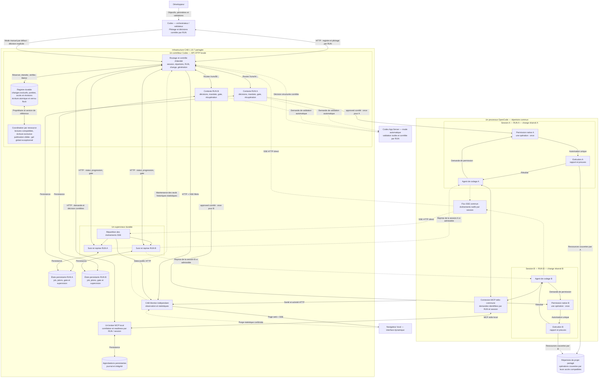

# Codex Approval Bridge — CAB - 100% IA

**CAB - Codex-Approval-Bridge** relie OpenCode et Codex pour fournir un cycle de validation explicite, persistant, observable et résilient.

Le bridge transporte les demandes de validation d'OpenCode vers Codex, conserve leur état, récupère la décision correspondante et restitue une réponse MCP corrélée à OpenCode.

Il ne décide jamais à la place de Codex et ne modifie pas le projet piloté.

La version source courante est CAB 2.1.15. CABU prépare les artefacts avant la coupure,
redémarre les trois services et exige le broker cible si OpenCode est actif. Le plugin CABU fournit un skill
d'entrée directe ; `/CABU` reste la commande et délègue à `/CAB update`,
qui arrête systématiquement les trois unités systemd CAB, remplace les fichiers
des quatre briques puis redémarre les unités. L'absence d'OpenCode n'empêche pas
le remplacement des fichiers broker ; sa version chargée est alors rapportée
`INDISPONIBLE`.

CAB 2.1.10 prend en charge OpenCode V2 uniquement. Les API V1 et OpenCode 1.x
sont refusés sans repli. Le serveur OpenCode V2 utilise Basic Auth avec le nom
fixe `opencode` et le mot de passe configuré par `OPENCODE_PASSWORD` ; CAB
lit son mot de passe depuis `~/.config/cab-approval-bridge/opencode.password`
(permissions `0600`) ou depuis le credential systemd provisionné par l'unité.
Le client local vise `127.0.0.1:4096`, jamais l'adresse de bind `0.0.0.0`.
Le serveur MCP CAB se déclare dans `mcp.servers.cgpt-validation` avec le type
`local` et le transport `stdio`.

La version 1.10.7 prend en charge les propriétaires explicitement distincts des modules, du répertoire et des processus broker dans la preuve privée de maintenance. Une demande orpheline du job courant sous PAUSE peut être réconciliée uniquement pour rejet, avec preuve native exacte d'absence d'effet. L'installation de sources et la migration des processus restent vérifiées séparément.

Le patch 2.1.6 vérifie le credential systemd avant toute coupure. Le raccord explicite `--opencode-password-env-file <workspace>/project.env` peut provisionner le fichier privé depuis la seule variable OPENCODE_PASSWORD lorsque le projet utilise OpenCode. Cette variable n’est pas obligatoire dans les autres projets et aucune lecture de project.env n’a lieu sans cette option. Un credential différent n’est jamais écrasé. Le mode mixte `cab-source --layout managed-release` conserve le broker src/ ordinaire. Les diagnostics par service et le résultat du repli sont détaillés dans [la procédure de mise à jour](plugins/cab-approval-bridge/skills/approval-bridge/references/component-update.md).

## Prévol orphelin et maintenance contrôlée — 1.10.7

Une notification refusée avant admission ne laisse plus de propriétaire de
demande sans validation locale. Pour un ancien prévol orphelin PENDING,
la réconciliation explicite vérifie les preuves et crée seulement une
validation apte au rejet. Le polling du même approval_id doit confirmer
REJECTED avant le retry existant dans la même candidate.

Le profil `frozen-recovery-controller` prépare et sauvegarde le jeu, vérifie
la récupération gelée et les pairs, puis emploie un reçu privé BOOTSTRAP_HELD
distinct du HELD refusé par l'ancien contrôleur. Le nouveau contrôleur adopte
ce reçu et confirme le véritable HELD après recontrôle. La maintenance ne
répare pas elle-même le prévol et n'accorde aucune permission métier.

Cette transition qualifiée conserve OpenCode et le broker, ainsi que le Web.
Elle peut charger le contrôleur 1.10.7 en conservant ces processus 1.7.1 ; son
bilan annonce chaque version réellement observée. Le paquet 1.10.7 ne prouve
pas que tout le runtime est déjà en 1.10.7. Toute autre combinaison est refusée.
L'activation exige un accord distinct. Procédure, limites de reprise et
configuration : `TECHNICAL.md` et la référence distribuée `component-update.md`.

Le mode explicite `managed-release` prend en charge les installations par liens
relatifs, avec conservation des anciennes releases. Le diagnostic
`approval-metadata` filtre une observation native existante sans décider les
demandes non attribuées. Les procédures et leurs limites figurent dans
[la référence de maintenance](plugins/cab-approval-bridge/skills/approval-bridge/references/component-update.md).

## Supervision web locale — CAB Monitor 1.10.7

CAB Monitor fournit une interface moderne et responsive, indépendante du LLM,
du contrôleur et du superviseur. Elle affiche les briques, les RUN, leurs
changes, les tâches cochées X/Y, les phases observées et une chronologie
filtrée. Le tableau distingue ETAT, ÉTAPE et tâches cochées ; la phase
technique reste dans le détail. Les onze étapes acceptent les retours en
arrière et conservent leur historique. Les cartes montrent les versions
réellement observées des briques, sans supposer leur alignement. Une ligne de
job WAITING est surlignée en jaune ; BLOCKED en rouge.
Les données arrivent par SSE ; une collecte périodique réconcilie
l'état et indique les sources indisponibles ou anciennes.

`/CAB start` et toute entrée ou reprise de session de codage pilotée autorisée
préparent ou vérifient le service utilisateur du moniteur dès la résolution du
workspace, avant PLLM et les prévols, même avec services CAB déjà actifs.
La tentative et son bilan précèdent ces contrôles ; leur échec ne provoque
aucun arrêt du moniteur. Aucune activation au login n’est effectuée. La procédure
vérifie le service, la page, la version et le workspace, puis affiche son URL
réelle. Une instance déjà conforme est
réutilisée. Le moniteur reste disponible après `/CAB stop` ou une panne du
contrôleur ou du superviseur. Ses erreurs sont signalées séparément du statut CAB.

Le lancement manuel reste possible depuis la racine du projet à observer :

```bash
OC_Codex_WORKSPACE="$PWD" node /chemin/vers/cab/plugins/cab-approval-bridge/scripts/cgpt-approval-bridge-monitor.mjs
```

Ouvrir ensuite [CAB Monitor local](http://127.0.0.1:8790). Le port se configure
avec `OC_Codex_MONITOR_PORT`. Le moniteur peut démarrer même si CAB est arrêté ;
la page signale alors les données indisponibles. Ce lancement ne démarre aucun
autre composant. La limite effective de commande est affichée en unités
UTF-16, avec 16 384 comme défaut de référence. Une limite inconnue reste
indisponible. Le compteur de tâches ne mesure ni le temps restant ni une
validation métier. Configuration et couverture : section « CAB Monitor » de
`TECHNICAL.md`. La préparation source n'installe aucun service.

Le menu **STATS**, sous **MONITOR**, affiche les statistiques du contexte
courant, de la dernière livraison ou des dernières 24 h, 7 jours et 30 jours,
avec filtre par RUN. Les sources natives et importées restent séparées ;
couverture et date du dernier succès sont visibles. Les cumuls de décisions,
outils et latences sont distingués des métriques de fenêtre. Une source absente
reste `N/A` et une panne marque les dernières données comme anciennes.

Dans STATS, **PURGER…** permet de choisir **1, 3, 7, 30 ou 365 jours**, puis
de prévisualiser et confirmer la suppression des historiques statistiques
strictement antérieurs à la date affichée. Annuler ne supprime rien. Les
contextes actifs ou encore référencés, les fichiers opérationnels et les
preuves métier restent protégés ; les agrégats globaux cumulatifs sont
conservés. La suppression confirmée est irréversible sans sauvegarde préalable.
La rétention native reste limitée à 30 jours : choisir 365 jours ne l'étend
pas. Une erreur partielle présente le résultat par magasin. Aucun nettoyage
automatique n'est activé.

Depuis 1.7.0, **CENTRE D’OBSERVATION** remplace le grand texte d'accueil.
Les cartes Contrôleur, Superviseur et Broker proposent **Démarrer/Arrêter**
et **Redémarrer** ; la carte **Web** affiche son état et **Redémarrer**.
Les services utilisent leurs unités systemd utilisateur dédiées, avec contrôle
de PID et workspace. Le broker passe uniquement par connect/disconnect MCP
dans OpenCode. Les actions perturbatrices exigent CAB disponible, sans RUN
réservé, demande, effet ou activité native en cours. Un Web lancé manuellement
doit être redémarré manuellement ; une demande acceptée n'est confirmée qu'après
reconnexion à une nouvelle instance. Aucun bouton ne redémarre OpenCode.

À droite des lignes admissibles, **Archiver** range une ligne dans le menu
**ARCHIVES**, sous MONITOR et STATS ; **Supprimer** la masque après confirmation.
Ces actions concernent seulement le moniteur : les sources OpenSpec, RUN réels,
décisions et preuves restent conservés. Un RUN arrêté encore réservé reste
protégé. **Désarchiver** remet le RUN dans MONITOR sans reprendre son exécution.
Le catalogue privé persiste sous
`~/.local/state/cab-approval-bridge-monitor/<sha256-workspace>/catalog.json`.
`OC_Codex_MONITOR_STATE_DIR` change son répertoire parent absolu, en conservant
la séparation par workspace. Une nouvelle génération de RUN ou une modification
du document du change reste visible. Une erreur de catalogue bloque le rangement
et s'affiche ; aucune réinitialisation silencieuse n'est effectuée.

Codex est l’orchestrateur et le validateur de la session : il pilote les
mandats du démarrage à la clôture et rend une décision explicite pour chaque
opération nécessitant une permission OpenCode. CAB transmet cette décision,
mais ne l’invente jamais. L’archivage OpenSpec est un mandat séparé, décidé
après contrôle de la cohérence et des validations.

```text
                    Développeur
                        │
            interaction / validation
                        │
             ┌──────────┴──────────┐
             ▼                     ▼
         OpenCode               Codex
      Agent de codage        Orchestrateur
             ▲                     │
             └──── Bridge MCP ─────┘
                                   │
                                   ▼
                                  GPT
                     Analyse / Revue / Validation
```

## Cadences de pilotage

Le protocole CAB prévoit les événements SSE en temps réel et le contrôle des
demandes et rapports toutes les **3 secondes**. Pendant l'analyse ou la
rédaction de l'agent de codage, les vérifications de progression sont espacées
de **7 secondes** fixes, indépendamment du contrôle CAB.

La fraîcheur PLLM de **huit heures** est contrôlée au démarrage initial ; le
choix du RUN est conservé pendant la session, ses tâches, pauses et reprises.
Une panne réelle ou une instruction explicite peut déclencher une réévaluation.
Sans modèle admissible, conserver les preuves et attendre l'instruction du
développeur, sans benchmark ni réessai automatique. La reprise conserve les
contrôles CAB et les mandats unitaires. Les sondes statistiques sont prévues
toutes les **30 minutes**, sans arrêter le travail pour attendre le créneau.
Ces obligations du protocole distribué ne constituent pas un nouvel automate
de benchmark dans les composants CAB.

## Statistiques après archivage

CAB prépare désormais des statistiques dans son contrôleur, sans RUN
d'observation supplémentaire : `GET /statistics` et
`GET /runs/<runId>/statistics?format=markdown` donnent les agrégats et un
brouillon à six sections. `contextId` sélectionne un ancien change du RUN.
Les corps de messages, commandes, URL et sorties ne sont pas collectés ;
les métriques absentes restent `N/A`. L'orchestrateur vérifie le brouillon,
le complète depuis les preuves autorisées et mandate sa publication.

CAB 1.10.7 utilise des ensembles de verrous atomiques sur les ressources partagées : lectures compatibles, écriture exclusive, attente limitée aux conflits. Les fichiers privés prouvés bénéficient d'une admission exclusive sans appel séparé de verrou partagé. La publication ciblée conserve les preuves, le reçu durable et la phase REPORT ; les pairs indépendants continuent. Le gel global concerne seulement réconciliation commune, maintenance partagée, pause globale ou arrêt global.

Le jeu source 1.10.7 conserve la correction de reprise d'un RUN arrêté puis libéré : son propriétaire peut demander une nouvelle réservation avec génération neuve, tout en conservant l'arrêt précédent dans l'historique. Les pauses et arrêts des réservations encore actives, les gels globaux et les permissions unitaires restent inchangés. Ce correctif ne déploie ni ne migre un runtime existant par sa seule présence dans les sources.

Les consultations /CAB stats, /CAB statslast, /CAB stats 24, /CAB stats7 et /CAB stats30 exposent courant, dernière livraison observée et fenêtres 24 h/7 j/30 j. Les imports d'audit restent explicitement locaux, filtrés et séparés du natif, sans relancer le job arrêté. Les métriques et les quotas partagés absents restent N/A. Voir ORCHESTRATED_CODING.md pour les API et la migration explicite du registre schéma 4 ; une préparation source ne change aucun runtime actif.

Le plugin CAB embarque `coding-session-statistics`. Son protocole impose un
rapport `STATISTICS.md` dans chaque dossier d'archive OpenSpec après un
archivage autorisé et réussi, avant la clôture normale du travail. La collecte
est préparée dès le début du change ; les données absentes sont signalées
`N/A` sans estimation. Le suivi des quotas utilise l'outil natif Codex, sans
installation de `cgpt` ou de Tools Codex. Une erreur de publication doit être
résolue ou déclarée comme blocage, sans réarchiver le change.

## Architecture

```text
OpenCode unique : sessions A, B, … — un RUN par session
   │ MCP stdio commun
   ▼
Broker CAB unique — corrélation et readiness par RUN
   │ HTTP local
   ▼
Contrôleur unique ──► contextes A, B, … ──► Codex / Codex App Server
   │
   └── Registre : changes exclusifs, accès atomiques et gels exceptionnels

OpenCode ── SSE HTTP commun ──► superviseur unique ──► suivi par RUN

Contrôleur + superviseur + OpenCode ── observations ──► CAB Monitor ──► navigateur local
```

Le broker MCP est **local en stdio** : aucun serveur MCP réseau n'est exposé.

## Architecture technique détaillée

Cette vue détaille le profil concurrent CAB 1.10.7 : un processus OpenCode,
un broker MCP stdio, un contrôleur et un superviseur communs, avec des
contextes isolés par RUN. A et B illustrent deux sessions ; le même modèle
s'applique aux autres RUN admis. Les contextes et la barrière sont des
éléments internes, pas des services supplémentaires.



- **Un mandat = une opération** : un fichier ou une commande, avec
  corrélation de `requestId`, `approval_id`, `change_id`, `run_id`,
  `reservation_version`, de la session et du répertoire.
- Le broker transporte et persiste ; **Codex décide**. Le contrôleur transmet
  l'approbation à la permission native correspondante avec une réponse
  `once`, consommable une seule fois.
- Les événements SSE et les relances techniques ne donnent aucune
  autorisation. Une décision absente ne vaut jamais approbation.
- Le gate terminal contrôle la clôture du job ; il reste distinct des
  décisions unitaires et ne remplace pas une permission OpenCode.
- Le mode manuel, utilisé par défaut, attend une décision HTTP explicite de
  l'orchestrateur sur `POST /decision/<requestId>`. Le mode automatique
  sollicite une session Codex de validation via Codex App Server.
- Le broker notifie le contrôleur sur `POST /validation/request` et récupère
  la décision sur `GET /decision/<requestId>`. La readiness est publiée
  séparément ; `READY` ne vaut jamais approbation.
- Chaque RUN réserve exclusivement son change et son intention, puis déclare ses ressources et dépendances. Les périmètres peuvent se recouvrir ; les accès actifs sont attribués atomiquement.
- Le contrôleur vérifie identité, contenu, révisions et protection avant une unique permission native once. Une base périmée impose une nouvelle demande.
- Validation et publication protègent leurs ressources utiles. Les RUN indépendants continuent ; seules les preuves affectées sont réexaminées.
- Pause et arrêt sont ciblés par défaut. Réconciliation de l'état commun, maintenance partagée, pause ou arrêt globaux suivent un drainage exceptionnel avec preuves.
- Ajouter un RUN ne purge ni ne reconnecte le broker. Une issue inconnue conserve ses protections ; rapport, gate et clôture restent propres au RUN.

Les cylindres représentent les états persistants des composants, sans
imposer un fichier ou un emplacement partagé. Les flèches en pointillés
identifient les voies SSE, les reprises techniques et le chemin de décision
du mode automatique. La publication désigne l'intégration dans la référence
commune du projet ; elle n'autorise pas un commit ou un déploiement.

## Ce que fournit CAB

- broker MCP persistant ;
- corrélation par `requestId` ;
- journal append-only et contrôle d'intégrité ;
- reprise après interruption ;
- watchdogs de validation et de session, avec relance corrélée du contrôleur
  toutes les trente secondes pour une décision PENDING ;
- readiness `READY / DEGRADED / BLOCKED / HUMAN_REQUIRED` ;
- diagnostic avec cause racine ;
- remédiations techniques contrôlées ;
- circuit breaker d'auto-remédiation ;
- contrôleur Codex local ;
- supervision SSE OpenCode ;
- superviseur durable de job et relance de la même session tant que le gate
  terminal reste ouvert ;
- plugin et skill Codex ;
- commande `/CAB`.

## Commande `/CAB`

La commande canonique utilise les majuscules : `/CAB`. `/CABU` sans argument
exécute exactement `/CAB update` jusqu'au rapport complet. L'ancienne entrée
`/cab` reste compatible et transmet ses
arguments inchangés. Les fichiers `CAB.md`, `CABU.md` et `cab.md` sont livrés
ensemble ; les alias exigent leur fichier frère canonique de même version.
Leur installation dans le profil reste une opération distincte de cette
préparation source.


`/CAB` est une commande de l'agent Codex versionnée avec CAB. Elle orchestre
la communication entre le broker MCP et l'agent Codex ; elle ne prend jamais
de décision d'approbation.

```text
/CAB start
/CAB test
/CAB run
/CAB update
/CABU
/CAB status
/CAB status --run <run_id>
/CAB stop
```

`/CAB status` produit ponctuellement le tableau **RUN / Nom du change — Actions
réalisées — Actions en cours — Actions restant à réaliser**. Chaque ligne
affiche **ACTIF**, **EN ATTENTE DE RUN** avec le pair et sa cause, ou l’état
interne/terminal/indéterminé prouvé. La collecte recoupe CAB, les états natifs
accessibles et les checkpoints/tâches ; une ancienne attente déjà levée est
écartée. Aucune activité, dépendance ou réussite de test n’est inventée. Le
filtre `--run` vise un identifiant exact. Cette consultation ne démarre aucun
service, n’envoie aucun message et ne modifie aucun projet.

Chaque nouvelle session `/CAB start` purge entièrement l'ancien état technique
CAB, y compris ses conflits Syncthing, sans le restaurer. Elle vérifie d'abord
l'inactivité du contexte, arrête les ressources CAB et déconnecte le broker
par OpenCode ; sources, secrets, rapports et historiques natifs restent hors
purge. Le plugin fournit l'outil de purge et son protocole. Une reprise
conserve son état, y compris après prévol de récupération divergent dans la
candidate, selon la procédure ci-dessous.

`/CAB start` reconnecte et vérifie le MCP actif par `/api/mcp`, installe de façon différée les
services utilisateur du contrôleur et du superviseur sans les activer au
login, les démarre explicitement, initialise la supervision CAB, puis crée
une nouvelle session maîtresse persistante visible dans OpenCode.

`/CAB test` réalise, dans cette même session, un test non destructif du chemin
complet OpenCode → MCP → CAB → Codex → CAB → OpenCode.

`/CAB run` arme un contrat durable et maintient le job dans cette session. Tant
que son gate terminal reste ouvert, le superviseur réexamine la même session
après 60 secondes par défaut ; il ne crée ni session de remplacement ni
décision CAB. Chaque édition, commande Bash,
commande système, commande OpenSpec ou opération d’archivage est soumise par
OpenCode comme mandat unitaire, puis exécutée seulement après une décision
Codex corrélée. Une décision consommée ne déverrouille aucune autre action.

Le statut du superviseur publie le dernier jalon et le gate observés ainsi
qu'un compteur persistant des tentatives de reprise, distinct de leur succès.
Un ancien compteur absent reste inconnu ; un nouveau job commence à zéro.
Le contrôleur refuse au démarrage un contrat persistant invalide, même si sa
syntaxe JSON est correcte, sans réécrire le fichier ni perdre silencieusement
le job. Les diagnostics distinguent lecture, syntaxe et contrat invalide.

En cas de récupération sans effet non maîtrisé, l'orchestrateur peut remplacer
la session par `POST /job/recover` (`prepare`, puis `complete`) après contrôles
techniques et prévol CAB réservé. Le RUN reste ouvert ; le job, le périmètre et
le dernier jalon sont conservés. Le superviseur suspend les relances pendant
le gel et suit ensuite la nouvelle session. Les anciennes autorisations
exécutables ne sont jamais réutilisées. Un échec ou une preuve locale perdue
après redémarrage conserve le gel sans fabriquer de réussite. Voir
`TECHNICAL.md` et le protocole de la skill pour le contrat détaillé.

Les mandats lecture seule désactivent explicitement les outils natifs et
d'écriture dans le message OpenCode. Les opérations suivantes gardent leurs
permissions natives et décisions CAB unitaires.

Depuis 1.0.1, les jobs armés vérifient les règles natives avant admission,
approbation et transmission de `once`. Une règle finale globale `ask` est
requise pour le type `bash` ou `edit` concerné ; une preuve absente ou
permissive est refusée. Pour réactiver les outils, utiliser `noReply`, rétablir
`ask` par PATCH et le vérifier, puis générer sans nouveau champ `tools`.
Ce garde ne modifie pas les permissions et exige leur stabilité pendant
l'exécution. Le détail et les diagnostics sont dans `TECHNICAL.md`.

`/CAB stop` exige un gate terminal validé, arrête explicitement le superviseur
puis le contrôleur et les ressources CAB qu'elle a créées, sans fermer OpenCode
ni arrêter le broker MCP géré par OpenCode. Les unités utilisateur restent
installées mais inactives jusqu'au prochain
`/CAB start`.

`/CAB update` vérifie le plugin installé, le skill `CAB`, sa
référence de maintenance et les commandes `CAB.md`, `CABU.md` et `cab.md`.
CABU délègue à la procédure canonique et attend son rapport complet. Après
staging et sauvegardes, l'update arrête systématiquement les trois unités
systemd CAB, remplace les fichiers des quatre briques, recharge systemd puis
redémarre controller, supervisor et monitor. Il n'inspecte pas les états RUN,
permissions ou coordination comme précondition ; aucune unité n'est activée au
login. OpenCode reste ouvert. Son API native recharge le broker si elle répond.
Si elle est indisponible, les fichiers broker sont quand même remplacés et le
runtime est rapporté `INDISPONIBLE`. Le bilan distingue versions publiées,
installées, déployées et réellement actives. Un échec de démarrage déclenche le
retour aux fichiers sauvegardés et le redémarrage des unités ; le rapport
indique le résultat du repli. Détails :
`skills/approval-bridge/references/component-update.md` dans le plugin.

Après un prévol de récupération divergent ou incomplet refusé sans effet,
conserver la session candidate où le prévol a divergé, le même job et leurs
preuves, sans purge ni renouvellement. L'orchestrateur réconcilie puis demande
retry explicite à /job/recover avec requête et approbation neuves. Le contrôleur
vérifie le refus et l'absence d'effet, préserve l'historique et impose un nouveau
prévol exact avant complete. Un timeout MCP seul conserve le polling de la même
approbation. Effet inconnu ou preuve absente suspend la reprise. Le superviseur
reste gelé jusqu'à complete ; OpenCode reste ouvert. Le remplacement initial
prévu par CISMP et la purge avant un nouveau RUN restent inchangés.

Depuis CAB 1.0.2, retry accepte aussi le REJECTED obtenu par poll_approval ou
get_approval après timeout de request_validation, pour la même approbation,
avec décision locale rejected non consommée et identités/opération exactes.
Un timeout seul ou PENDING seul reste insuffisant ; chaque demande enregistrée
doit avoir un refus terminal. Un arrêt ciblé explicitement demandé par le
développeur reste distinct de retry : gate BLOQUÉ et réconciliation avant
désarmement et libération, sans purge ni interruption des autres RUN.

## Organisation du dépôt
terme
```text
CAB/
├── src/                       # bridge Python initié par OpenCode
├── .codex/commands/CAB.md     # commande /CAB pour Codex
├── .agents/plugins/marketplace.json # marketplace Codex
├── plugins/cab-approval-bridge/     # plugin Codex
│   ├── .codex-plugin/plugin.json
│   ├── skills/approval-bridge/SKILL.md
│   └── scripts/
├── PROJECT.md                 # architecture générale
├── TECHNICAL.md               # fonctionnement technique
├── BUILD.md                   # construction et distribution
└── CHANGELOG.md               # Suivi de versions
```

## Prérequis

Le fonctionnement actuel repose sur :

- Python 3 ;
- OpenCode avec MCP local `stdio` ;
- Node.js ;
- Codex App Server ;
- accès local à OpenCode ;
- environnement Unix pour les mécanismes de persistance/verrouillage ;
- `systemctl --user` pour le mécanisme actuel de redémarrage automatique du contrôleur.

Le broker Python n'utilise actuellement aucune dépendance Python tierce.

## Configuration principale

### Broker

| Variable | Rôle |
|---|---|
| `CGPT_CONTROLLER_URL` | URL locale du contrôleur |
| `CGPT_APPROVAL_STORE` | magasin persistant des approbations |
| `CGPT_APPROVAL_JOURNAL` | journal append-only |
| `CGPT_BROKER_INSTANCE_LOCK` | verrou d'instance |
| `CGPT_JOURNAL_HMAC_KEY` | clé optionnelle du checkpoint HMAC |
| `CGPT_JOURNAL_HMAC_KEY_ID` | identifiant de la clé HMAC |
| `CGPT_JOURNAL_HMAC_PREVIOUS_KEYS` | anciennes clés autorisées en vérification |
| `CGPT_JOURNAL_CHECKPOINT_PATH` | chemin du checkpoint |

### Watchdogs

| Variable | Rôle |
|---|---|
| `CGPT_PENDING_WATCHDOG_INTERVAL` | fréquence du watchdog PENDING |
| `CGPT_PENDING_WATCHDOG_WARNING` | seuil de dégradation PENDING |
| `CGPT_PENDING_WATCHDOG_STALLED` | seuil de blocage PENDING |
| `CGPT_SESSION_WATCHDOG_INTERVAL` | fréquence du watchdog session |
| `CGPT_SESSION_WATCHDOG_WARNING` | seuil de dégradation session |
| `CGPT_SESSION_WATCHDOG_STALLED` | seuil de blocage session |

### Auto-remédiation

| Variable | Rôle |
|---|---|
| `CGPT_AUTO_REMEDIATION_ENABLE` | activation globale, désactivée par défaut |
| `CGPT_AUTO_REMEDIATION_ACTIONS` | allowlist des actions |
| `CGPT_AUTO_REMEDIATION_INTERVAL` | fréquence de l'ordonnanceur |
| `CGPT_AUTO_REMEDIATION_CB_FAILURE_THRESHOLD` | seuil d'ouverture du circuit breaker |
| `CGPT_AUTO_REMEDIATION_CB_FAILURE_WINDOW` | fenêtre des échecs |
| `CGPT_AUTO_REMEDIATION_CB_OPEN_SECONDS` | durée OPEN |
| `CGPT_AUTO_REMEDIATION_CB_STATE_PATH` | état persistant du circuit breaker |
| `CGPT_REMEDIATION_ORPHAN_TIMEOUT` | délai des tentatives orphelines |

### Contrôleur et supervision

| Variable | Rôle |
|---|---|
| `OC_Codex_WORKSPACE` | racine absolue du projet à piloter, sans liste de projets codée dans CAB |
| `OC_Codex_OUTSIDE_SANDBOX` | impose l'exécution hors sandbox |
| `OC_Codex_OPENCODE_URL` | URL locale OpenCode |
| `OC_Codex_STATUS_HOST` | adresse loopback du contrôleur : `127.0.0.1` ou `::1` |
| `OC_Codex_STATUS_PORT` | port local du contrôleur |
| `OC_Codex_RECONNECT_MS` | délai de reconnexion SSE |
| `OC_Codex_MAX_COMMAND_LENGTH` | longueur inclusive maximale d'une commande, 16 384 unités UTF-16 par défaut ; `2000` rétablit le seuil précédent |
| `OC_Codex_CONTROLLER_URL` | base HTTP du contrôleur ou endpoint `/status`, avec slash final éventuel, communs au healthcheck et au superviseur |
| `OC_Codex_READINESS_MAX_AGE_MS` | fraîcheur maximale de la readinessterme |
| `OC_Codex_SUPERVISOR_URL` | endpoint de statut du superviseur utilisé par le healthcheck |
| `OC_Codex_SUPERVISOR_STATUS_HOST` | adresse loopback du superviseur |
| `OC_Codex_SUPERVISOR_STATUS_PORT` | port local du superviseur, `8789` par défaut |
| `OC_Codex_SUPERVISOR_RESUME_DELAY_MS` | délai de reprise, 60 secondes par défaut |
| `OC_Codex_SUPERVISOR_POLL_INTERVAL_MS` | fréquence de réconciliation du superviseur |
| `OC_Codex_SUPERVISOR_STATE_PATH` | état runtime non versionné du superviseur |
| `CODEX_COMMAND` | commande utilisée pour Codex App Server |

Les noms historiques équivalents préfixés `OC_CGPT_` restent acceptés pour la
compatibilité avec les installations existantes.

Pour la limite de commande, le nom principal présent prévaut sur l'alias,
même si sa valeur est invalide. La valeur fournie doit être un entier décimal
ASCII strictement positif et sûr JavaScript, sans espace, signe ou fraction ;
une valeur vide ou invalide refuse le démarrage. Le comptage utilise
`String.length` : un caractère hors BMP compte pour deux unités UTF-16.
Une commande trop longue reçoit HTTP 400 JSON avec `error: command-too-long`,
`message`, `maxLength`, `actualLength` et `unit: utf16`, sans son contenu et
avant enregistrement. Le broker conserve un diagnostic filtré dans sa trace
d'échec de notification ; ce refus technique ne constitue pas une décision.
La règle reste une commande exacte, une décision corrélée et une permission
native `once` unique, selon les règles de corrélation existantes. La limite
de transport HTTP de 256 KiB reste indépendante. Voir TECHNICAL.md, section 15.

Le mode `OC_Codex_DECISION_MODE=manual`, utilisé par défaut, conserve les
demandes en attente d'une décision HTTP explicite de l'orchestrateur
principal. Les rappels corrélés restent observables sans créer de thread ni
de tour Codex auxiliaire. Le mode `automatic` conserve son fonctionnement.

Une demande locale indécise bloque le gate terminal même si le dernier
compteur broker était nul. Pour la supervision, seule l'activité SSE de la
session du job, sans répertoire divergent, repousse la reprise ; le trafic
étranger et les heartbeats ne constituent pas une activité de cette session.
Un changement de contexte invalide l'ancienne horloge d'activité.

Les secrets doivent rester hors du dépôt Git et des journaux.

## Persistance

Par défaut, le broker utilise le home du processus OpenCode qui le lance :

```text
$HOME/.opencode/state/cgpt-approval-bridge/
```

Le contrôleur et le superviseur utilisent par défaut l'espace situé dans le
workspace du projet piloté :

```text
<workspace>/.opencode/state/cgpt-approval-bridge/
```

Les variables de configuration peuvent personnaliser les chemins du broker
et celui de l'état du superviseur. Les espaces runtime doivent être résolus
depuis la configuration effective ; `/workspace` est seulement un exemple de
racine de projet. Ces espaces ne sont pas des sources du projet et ne doivent
pas être publiés avec une release.

Le contrôleur démarre sans job uniquement si son fichier de contrat est
absent. Un JSON malformé ou une autre erreur de lecture interrompt son
démarrage avec un diagnostic sans contenu persistant. Le fichier est conservé
pour une intervention autorisée ; aucun état n'est réparé automatiquement.

## Readiness

CAB expose quatre états :

- **READY** — fonctionnement nominal ;
- **DEGRADED** — fonctionnement possible mais dégradé ;
- **BLOCKED** — progression bloquée ;
- **HUMAN_REQUIRED** — intervention humaine nécessaire.

## Distribution

Le dépôt contient directement les sources du bridge et des plugins Codex CAB et
CABU. La marketplace est définie dans `.agents/plugins/marketplace.json` et
référence les plugins `plugins/cab-approval-bridge/` et `plugins/cabu/`.

Pour une marketplace GitHub privée, publiez le dépôt avec ce catalogue à sa
racine, puis importez et synchronisez-le depuis l'administration de votre
espace de travail Codex. Le compte GitHub connecté doit pouvoir lire le dépôt.

La version de base actuelle des briques CAB, du plugin CABU et des commandes
est `2.1.10`. Chaque plugin ajoute un cachebuster Codex pour les installations
locales.

## Documentation

- **ORCHESTRATED_CODING.md** — document facultatif, réservé aux projets
  nécessitant des sessions pilotées ; AGENTS.md impose alors sa lecture aux
  deux agents concernés pour le protocole et ses contrats techniques.
- **PROJECT.md** — but, architecture et périmètre ;
- **TECHNICAL.md** — protocoles, persistance, supervision et configuration ;
- **BUILD.md** — installation, packaging et distribution ;
- **CHANGELOG.md** — historique des versions.
- **openspec/specs/** — contrats normatifs des capacités CAB.

## Plusieurs sessions CISMP — CAB 1.10.7

Un seul OpenCode et un broker stdio servent plusieurs RUN dans le même répertoire. La réservation protège le change ; les accès temporaires protègent les ressources partagées. Une validation OpenSpec peut coexister avec une édition de code indépendante. Un conflit sur un fichier n'arrête pas les autres travaux.

Consulter GET /runs puis les routes /runs/<runId>/... ; négocier resource-scoped-v1 avant mandat mutable. Les anciens appels d'intégration globale ordinaire sont refusés sans effet. Lire ORCHESTRATED_CODING.md et la référence du skill avant activation. Les formats historiques exigent une maintenance explicite ; CISM, CAISM et prompts directs restent hors concurrence pilotée. Les worktrees nécessitent une qualification distincte.

## Broker existant sous un autre compte — 1.10.7

Le mode explicite reuse-readonly réutilise les trois fichiers broker déjà
cibles sans les installer ni changer leurs droits. Une preuve privée lie
empreintes, propriétaires et processus. Les services et le broker sont
relancés par leurs autorités respectives, sans fermer OpenCode ou modifier
son MCP. Après intention de déconnexion, une panne conserve le gel pour
récupération ; elle ne promet pas un retour au processus ancien. Voir la
référence component-update.md pour la procédure. Aucune activation réelle
n'est déclenchée par la préparation source 1.10.7.

## Réservation Docker/LXC et actualisation — 1.10.7

Chaque change peut réserver ses environnements de test Docker/LXC avant leur préparation. La réservation reste détenue entre commandes jusqu'à la fin de tous les tests et à une restitution vérifiée : nettoyage puis contrôle distincts, réussis et corrélés. Une interruption, un échec ou un timeout ne libère rien automatiquement. Les changes utilisant d'autres environnements continuent. Le protocole et les limites entre registres CAB sont détaillés dans la référence [concurrent-runs](plugins/cab-approval-bridge/skills/approval-bridge/references/concurrent-runs.md).

Dans MONITOR, la liste Actualisation propose **Manuel, 1s, 3s, 7s, 30s, 1m, 5m, 10m et 30m**. Le défaut est 1s et le choix est mémorisé dans le navigateur lorsque possible. **Actualiser** récupère immédiatement une vue. En Manuel, le SSE ne modifie pas les données affichées. La collecte des composants reste partagée et indépendante du choix de chaque navigateur.

La dernière vue et la cadence figurent sur une seule ligne après l'identité du workspace dans l'en-tête. Sur petit écran, cette ligne peut défiler horizontalement sans élargir la page.

RUN et Changes sont classés par nombre absolu de tâches cochées décroissant, puis par identifiant du change alphabétique et identifiant RUN. Un avancement indisponible vient après les valeurs connues, y compris zéro ; la sélection et les filtres sont conservés.

Les états des composants et RUN, les compteurs et les détails représentent le snapshot daté affiché. Ils restent stables jusqu'à la prochaine vue appliquée, notamment en Manuel ou après erreur de rafraîchissement. Une source déjà ancienne lors du relevé reste indiquée comme telle. Les commandes de gestion vérifient séparément la fraîcheur à l'heure courante et peuvent demander une actualisation avant exécution.

Le pavé **Web** indique **Disponible** pendant les 30 minutes suivant le dernier rafraîchissement réussi de la vue, puis **Non observé**, même sans nouvelle récupération. Une perte SSE seule ne change pas ce délai et un rafraîchissement échoué ne le prolonge pas. Les autres composants conservent l'état observé à la date du snapshot affiché. La version source 1.10.7 ne prouve aucune mise à jour de l'installation active.

Les navigateurs externes de test déclarés dans DEVOPS.md, actuellement Chromium et Firefox, suivent aussi ce cycle avec les clés `browser:<hôte>/<navigateur>`. La réservation reste détenue jusqu'à fermeture des sessions WebDriver/BiDi et processus, libération des ports et profils temporaires du change, nettoyage puis vérification distincts. Les sessions utilisateur préexistantes sont préservées. Les ensembles navigateur/conteneur sont acquis atomiquement ; des mécanismes indépendants peuvent avancer.

## Sélection du modèle de codage — 1.10.7

Appliquer [la politique de modèle](plugins/cab-approval-bridge/skills/approval-bridge/references/model-policy.md) : un modèle explicite du prompt garde sa priorité ; sinon PLLM en mode automatique. Sans raisonnement explicite, demander medium ; si cette variante est indisponible, demander high sur le même modèle avant la politique PLLM suivante. Un modèle imposé incompatible bloque. Le catalogue public et les variantes réelles ne remplacent pas le prévol exact. Le choix validé est persisté et transmis explicitement lors des reprises ; broker et moniteur restent sans sélection LLM, et le validateur Codex conserve son rôle distinct.

## Maintenance des registres volumineux — 1.10.7

La mise à jour des briques accepte un registre complet jusqu'à 16 Mio, en HTTP et pour son contrôle privé sous maintenance. Cette exception reste limitée au registre ; les autres bornes et toutes les gardes sont conservées. Le déploiement local distingue sources qualifiées, plugin installé, publication distante et versions réellement chargées. Les CISMP en pause ne reprennent qu'après preuve de mise à jour et réconciliation.

### Compatibilité et reprise de maintenance 1.10.7

Les clés logiques historiques Docker/LXC/navigateur sont conservées à la lecture. Les nouvelles réservations de test et les permissions gardent leurs contrôles canoniques. Si le contrôleur cible échoue à lire cette histoire après déconnexion du broker, la réparation ciblée conserve le même gel, le journal initial et les données métier, puis prépare une nouvelle release immuable. Consulter [la procédure de mise à jour](plugins/cab-approval-bridge/skills/approval-bridge/references/component-update.md) ; ces vérifications renforcées concernent les profils frozen-recovery-controller et reuse-readonly, pas le flux standard `/CABU`.

Le contrôle du broker 1.10.7 reconnaît aussi un enfant lancé par un thread secondaire du même OpenCode. Les vérifications de parent, UID, commande et unicité restent strictes ; une preuve absente ou divergente conserve le gel de maintenance.

### Budget /provider — 1.10.7

La session de pilotage peut imposer providerMaxBytes dans /model-policy/resolve et dans modelSelection lors de l'armement. Ce budget entier positif en octets s'applique à ce seul appel /provider. Sans valeur, le défaut reste 2 Mio ; sessions/messages et catalogue PLLM conservent leurs limites. Voir la référence [model-policy.md](plugins/cab-approval-bridge/skills/approval-bridge/references/model-policy.md). Aucun corps fournisseur privé n'est enregistré dans les preuves.

### Raccord PLLM/OpenCode — 1.10.7

Le paquet prépare un patch de catalogue public à transmettre au contrôleur, rapproche l'alias logique Go avec l'identité native vérifiée et accepte les variantes de prévol imbriquées ou historiques cohérentes. Les cas ambigus, déconnectés ou contradictoires restent refusés. La référence [model-policy.md](plugins/cab-approval-bridge/skills/approval-bridge/references/model-policy.md) précise préparation, transmission et compatibilité ; les sources ne déploient aucun service.

CABU 2.1.6 conserve les RUN sans notification pendant sa coupure technique.
La reprise restaure les états persistants et interdit tout rejeu implicite
des permissions consommées. Les mesures et limites de durée figurent dans
TECHNICAL.md, section « CABU 2.1.6 : coupure courte et reprise ».

### Identifiants publics CAB 2.1.6

| Élément | Identifiant |
| --- | --- |
| Plugin principal | `CAB` |
| Skill principal | `$CAB` |
| Commande principale | `/CAB` |
| Plugin de mise à jour | `CABU` |
| Skill de mise à jour | `$CABU` |
| Commande de mise à jour | `/CABU` |
| Marketplace affichée | `CAB Codex Plugins` |

Le skill de statistiques garde son nom `coding-session-statistics`, sous le
namespace `CAB`. Les chemins `plugins/cab-approval-bridge/`,
`skills/approval-bridge/` et `plugins/cabu/` restent stables. L'alias historique
`/cab` conserve la compatibilité. Les noms des services, routes et données
persistantes ne sont pas renommés.

## Codes de lot dans le moniteur

Les tableaux RUN et CHANGE affichent « codes de lot » en deuxième colonne. Le
code provient du début du premier titre Markdown de niveau 1 de `proposal.md`,
hors blocs de code : par exemple `# PA01 — Composition PA`. Il comporte de une
à dix lettres majuscules puis de deux à quatre chiffres, seul ou suivi d'un
séparateur explicite (`—`, `–`, `-`, `:`) et d'un intitulé. Sans code reconnu ou
sans document admissible, la cellule reste vide. Le RUN reprend le code de son
change corrélé, y compris une archive référencée. Le tri et les actions restent
identiques. Cette évolution source 2.1.6 ne prouve pas une mise à jour active.

### Compatibilité des catalogues PLLM — 2.1.6

CAB accepte strictement le schéma 2 à six politiques et le schéma 3 à sept politiques, sans réécrire le catalogue. Les priorités, dates, sélection courante, medium et prévol natif restent contrôlés ; mode7 peut être sélectionné puis conservé dans le job. Les jobs existants conservent leur choix. Le raccord utilise le catalogue public du skill actif, vérifié par /model-policy/resolve avant nouveau job. Aucune activation ou réussite de CAB test n’est déduite de la qualification source.

### Pagination et prévol natif V2 — 2.1.6

Le client n’envoie order que sur la première page et conserve les curseurs opaques. Le prévol peut corréler un échange natif unique complet lorsque l’utilisateur omet le modèle : la réponse assistant fournit alors le modèle/variante réellement utilisés, avec les dates et gardes habituelles. Aucun champ utilisateur n’est inventé. Les échanges ambigus ou contradictoires restent refusés. La preuve héritée et le choix des jobs existants sont conservés.

### Fermeture avec OpenCode — 2.1.6

Lorsque le serveur `opencode serve` auquel CAB s’est rattaché termine, le contrôleur, le superviseur et le moniteur se ferment également ; le gardien de verrou du contrôleur est libéré. Le broker MCP termine avec son transport OpenCode. Fermer seulement le client terminal, interrompre SSE ou rendre l’API inaccessible laisse CAB disponible tant que le serveur identifié vit encore.

CAB peut démarrer avant OpenCode et attendre sa première connexion vérifiable. Après une fermeture complète, la remise en service est explicite : les RUN, jobs, réservations et gels sont conservés et leur reprise suit la réconciliation habituelle. Aucun gate de réussite ni libération métier n’est inventé. Le moniteur continue à afficher une panne isolée du contrôleur ; sa fermeture dépend de la disparition prouvée du serveur OpenCode.

Ce correctif source n’installe ni n’active 2.1.6 dans un profil existant. Les preuves et limites sont conservées avec le change OpenSpec de cycle de vie.

## Réconciliation des prévols rejetés — 2.1.7

La distribution courante des quatre briques, plugins et commandes est 2.1.15.
Les preuves historiques conservent leur version. Après redémarrage,
`reconcile-rejected` permet une réconciliation humaine du rejet natif sans
effet et sans reconstruire de décision locale. Le retry ordinaire conserve
ses contrôles. Le reçu lie l'historique natif et, si nécessaire, la transaction
GLOBAL_RECONCILIATION exacte. Confirm/release exigent `authorization` et
`rejectedRecovery` (runId, jobId, recoveryId, prochain preflightRequestId,
nativeToolHash du reçu), puis recontrôlent l'historique et toute la cohorte.
Une permission, un effet, une attente, un pair occupé ou une autre récupération
non réconciliée conserve le gel. Le nouveau prévol exige décision et once
propres avant complete. CABU intervient après archivage ; les tests source
ne prouvent ni installation ni réconciliation réelle.

## Raccord Code Mode OpenCode 2.2 — 2.1.8

Le client reconnaît seulement le retour direct d'un appel MCP cgpt-validation
avec objet de données littérales. Les clés peuvent être des identifiants
statiques non cités ; les valeurs restent des données JSON. Les métadonnées
toolCalls doivent concorder et la sortie ne doit pas être tronquée. CAB
n'évalue aucun programme. La découverte search reconnue reste diagnostique.
Une transformation de résultat, une variable, un calcul, un appel caché ou
une provenance fabriquée conserve une enveloppe execute bloquante. Le sceau
couvre l'enveloppe native complète et les anciens outils directs restent
stables. Les clés de provenance internes reçues dans les métadonnées sont
écartées puis produites seulement par la projection vérifiée.

OpenCode 2.2 nomme sa commande native shell. Le client conserve sa source
native et la rattache au contrat interne bash. Il vérifie l'appel source,
la commande, l'absence de background et le workdir courant avant once. Les
permissions d'écriture relatives sont rapprochées du fichier du contexte
et de l'appel natif. Les règles shell: ask doivent couvrir le nouvel appel ;
une seule règle historique bash: ask ne suffit pas pour transmettre once.
Le drapeau executed ne prouve pas l'effet : OpenCode 2.2 termine réellement
shell et write avec ce drapeau faux. CAB exige permission once acquittée,
identité d'appel, cible, dates et résultat ; shell exige sa fin et son exit
natifs. Une fin non corrélée garde ses protections.

Le rejet réconcilié accepte les découvertes reconnues, un polling interrompu
en lecture seule et le relais natif du rejected décidé par CGPT, avec rejet
terminal exact obligatoire. Aucun ancien accord n'est restauré comme
exécutable. Qualifier avec CAB_TEST_OPENCODE=/chemin/vers/opencode-2.2
et le banc tests/native-opencode-codemode.test.mjs : serveur privé, fournisseur
synthétique loopback, broker réel, prévol et écriture sous once, puis contrôle
de disparition du broker et nettoyage. Aucune configuration ou credential
réel n'est copié. Après archive et publication, CABU précède le recovery réel.

## Découverte non autorisante — complément 2.1.9

Le diagnostic Code Mode admet aussi un unique search à données littérales
suivi du retour d'une chaîne littérale fixe. La liste toolCalls doit être
exacte, terminée, concordante et non tronquée. La projection reste
cab_codemode_discovery ; le texte, même APPROVED, n'a aucune autorité.
Une variable, un appel ajouté ou une expression inconnue conserve le refus.
Ce complément ne change ni admission MCP, ni permissions, ni once, ni fin.
La distribution commune est 2.1.10 ; les preuves 2.1.8 restent historiques.

## Édition native et attente de mandat — source 2.1.10

Le banc `tests/native-opencode-codemode.test.mjs` capture les outils transmis
au fournisseur synthétique et qualifie `edit({path, oldString, newString,
replaceAll?})` comme outil natif direct d’OpenCode 2.2. `search` décrit le
catalogue Code Mode (MCP et helpers internes annoncés) ; il ne suffit pas pour déterminer les outils natifs disponibles.
Le remplacement exact conserve décision CAB, cible unique, accès, `ask`,
`once` et contrôle du contenu final. Refus et ambiguïté sont vérifiés sans
écriture. Voir le skill CAB et la commande CAB pour les permissions V2 de
lecture seule et la séquence PATCH, lecture de contrôle, prompt.

Le superviseur d’un RUN sans mandat publie `WAITING` et
`orchestrator-mandate-required`, sans prompt au codeur. Récupération achevée,
gate ouvert et disponibilité technique ne créent aucun mandat. Le mode
historique sans RUN garde sa relance technique bornée, sans droit nouveau.
Ces résultats source ne prouvent ni activation 2.1.10, ni qualification du
choix d’outil d’un modèle réel ; CABU reste distinct et coordonné.

## Adaptations natives V2 — source 2.1.10

Le retry historique après `access_id` vide exige l’enveloppe native exacte
Code Mode, un seul appel et ses arguments concordants, `metadata.error=true`,
`truncated=false`, le refus de validation déterministe, puis un `get_approval`
natif corrélé prouvant l’absence de cette approbation. Session, RUN, génération,
commande `/usr/bin/true`, absence d’effet et nouvelle identité de prévol restent
contrôlés. Le texte libre ou le timeout seuls restent insuffisants. Le schéma
MCP refuse désormais `access_id` vide : omettre cette clé si aucun accès
existant n’est référencé. Le banc reproduit explicitement l’ancien schéma
2.1.9 pour qualifier cette récupération, avec le validateur réel inchangé.

Les vérifications d’un RUN filtrent les permissions par leurs identités de
session avant de valider leurs cibles. Une permission étrangère n’est ni
répondue ni autorisée ; une identité manquante ou une cible propre invalide
reste bloquante. Les contrôles globaux conservent leur validation stricte.

Le client expose les `tokens` et le `cost` natifs valides dans `info`, avec
`usageSource=opencode-v2`. Absence reste inconnue, zéro reste zéro ; les
métadonnées libres ne fabriquent pas ces mesures. Les événements SSE V2
`data` et `location` sont normalisés avec vérification des identités et
répertoires. Les débuts/fins d’exécution et permissions corrélés invalident
les observations de génération ; les états statistiques suivent l’activité
sans créer de décision CAB. Les mesures historiques manquantes ne sont pas
reconstruites.

## Récupération directe et pagination — source 2.1.11

Le retry historique du refus `access_id` vide reconnaît aussi les erreurs MCP
natives directes qualifiées, en plus de Code Mode : partie assistant tool pour
request_validation/get_approval, executed faux, error de type tool.execution,
itemId natif fc_ lié exactement au call_, et temps created/ran/completed
entiers positifs ordonnés. Le client dérive la provenance et l’empreinte de
la partie complète ; une marque libre ne suffit pas. Le refus déterministe,
les identités/génération exactes, `/usr/bin/true` unique, le lookup natif inconnu
corrélé, la quiescence et l’absence d’effet restent requis. Le prévol suivant
a une identité neuve dans la même candidate. Aucun -32602 n’est fabriqué et
aucun once n’est rejoué. Les autres formes restent refusées.

Pour les historiques volumineux, le client conserve le plafond de 2 Mio et
réduit par moitié la limite de la même page seulement après
`opencode-response-too-large`, de 200 jusqu’à un minimum de un. Il n’avance pas
le curseur et ne conserve aucune réponse partielle lors de cette réduction.
Les pages complètes, l’ordre, les curseurs et la borne de 100 pages restent
contrôlés ; un message unique trop volumineux échoue explicitement. Les autres
erreurs ne sont pas masquées ni réessayées par ce mécanisme. Ne pas purger
ni tronquer le transcript pour franchir cette limite.

Les tests et lectures filtrées qualifient les sources. L’activation CABU et
la récupération réelle du RUN restent des étapes distinctes, coordonnées
séparément ; les services actifs ne sont pas modifiés par cette préparation.

## Diagnostics de notification et refus avant admission — source 2.1.15

Une approbation peut rester `PENDING` alors que sa notification au contrôleur
est `FAILED`. Le champ optionnel `notification_diagnostic` expose le dernier
échec HTTP sous la forme `{http_status, error_code}`. Le code est reconnu dans
une liste fermée pour son statut ; `null` signifie inconnu. Le corps est lu
sous une limite de1024 octets, sans recopier message distant, ressources,
commande ou champ arbitraire. Le diagnostic existant `command-too-long` reste
filtré comme auparavant. La lease exacte conditionne la persistance ; un
résultat périmé n’écrase rien et une livraison réussie retire l’ancien diagnostic.
Les anciennes approbations restent compatibles sans ce champ.

Les refus de validation corrélés au RUN connu sont comptés dans
`GET /runs/<runId>/statistics`, section `contexts[].httpFailures`, y compris
lorsqu’ils surviennent localement avant admission. Chaque requête HTTP compte
au plus une fois ; les réessais sont des tentatives distinctes. Ce compteur
ne représente ni des demandes uniques, ni des décisions `REJECTED`. Une demande
non admise ne doit pas apparaître comme validation indécise. Les compteurs ne
contiennent aucun corps ou contenu métier.

Lire le diagnostic et les révisions réellement observées ; ne pas inventer
une révision0 pour une ressource non listée. Réconcilier l’ancienne demande
sans effet puis préparer une demande exacte neuve selon les règles applicables.
`FAILED` ne donne aucune décision, attribution, admission, permission ou retry
exécutable ; les corrélations, révisions, accès et `ask/once` restent inchangés.
La préparation source n’active rien. L’activation CABU coordonnée est rapportée
avec les versions des processus réels avant notification aux sessions.


## Restitution des réservations sans effet — source 2.1.15

La route explicite release-unused permet de restituer une réservation de test
HELD sans nettoyage fictif, uniquement sur autorisation humaine spécifique,
attestation exhaustive et preuves natives complètes à frontière inchangée.
Les échecs de diagnostic restent des échecs ; aucune disponibilité distante
n’est déduite. Les mutations et incertitudes conservent la restitution
ordinaire. Procédure et limites :
[référence distribuée](plugins/cab-approval-bridge/skills/approval-bridge/references/unused-test-reservations.md).
Le reçu enrichi est refusé par les anciens lecteurs stricts ; ne pas restaurer
un état ancien pour supprimer une preuve. La préparation source ne modifie
aucun RUN ni composant actif.


## Isolation des sondes et du broker partagé — source 2.1.15

La découverte serveur est envoyée sans scope de workspace. Les contrôles MCP
visent la location partagée et refusent une cible explicite divergente.
createProbeSession prépare la sonde jetable dans cette location avec deny
global et modèle explicite ; sa suppression ne touche que sa session.
Aucune panne ne déclenche de reconnexion automatique ni de redémarrage
OpenCode. La récupération d’un contexte concurrent reste explicitement
autorisée et contrôlée. Les workspaces des exemples sont génériques.
Voir [le contrat distribué](plugins/cab-approval-bridge/skills/approval-bridge/references/mcp-location-isolation.md).


## Attente du contrôleur et échec de récupération — CAB2.1.15

L’attente de la version réelle du contrôleur utilise le budget --wait-ms
existant (120000ms par défaut, borne maximale900000ms), y compris au rollback.
Un service déclaré active par systemd ne suffit pas. Un dépassement conserve
update-controller-start-unconfirmed, distinct du rechargement du broker.
Aucun délai ne remplace la vérification des versions et de la readiness.

Après la coupure, un rollback non confirmé reste ROLLBACK_FAILED, non terminal.
La reprise doit traiter le même journal avant une nouvelle transaction ;
elle ne peut pas le reclasser PREPARATION_FAILED. Ne jamais modifier le
journal pour fabriquer un succès. Les anciens journaux déjà classés à tort
par une version antérieure restent conservés comme preuves ; observer les
artefacts et processus effectivement restaurés séparément, sans réécrire
leur historique. Les RUN, demandes et once ne sont pas restaurés depuis
une sauvegarde. Seul un retour réellement vérifié peut être annoncé.


### Complément de lecture de maintenance2.1.15

GET /status et GET /runs des services CAB acceptent jusqu’à16Mio sous contrôle
des octets reçus avant parsing. Cette exception ciblée ne modifie ni les
limites OpenCode, ni celles des autres réponses HTTP (2Mio). Le statut complet
est vérifié sans troncature ou purge ; un dépassement conserve son diagnostic
et le journal de récupération non terminal.
